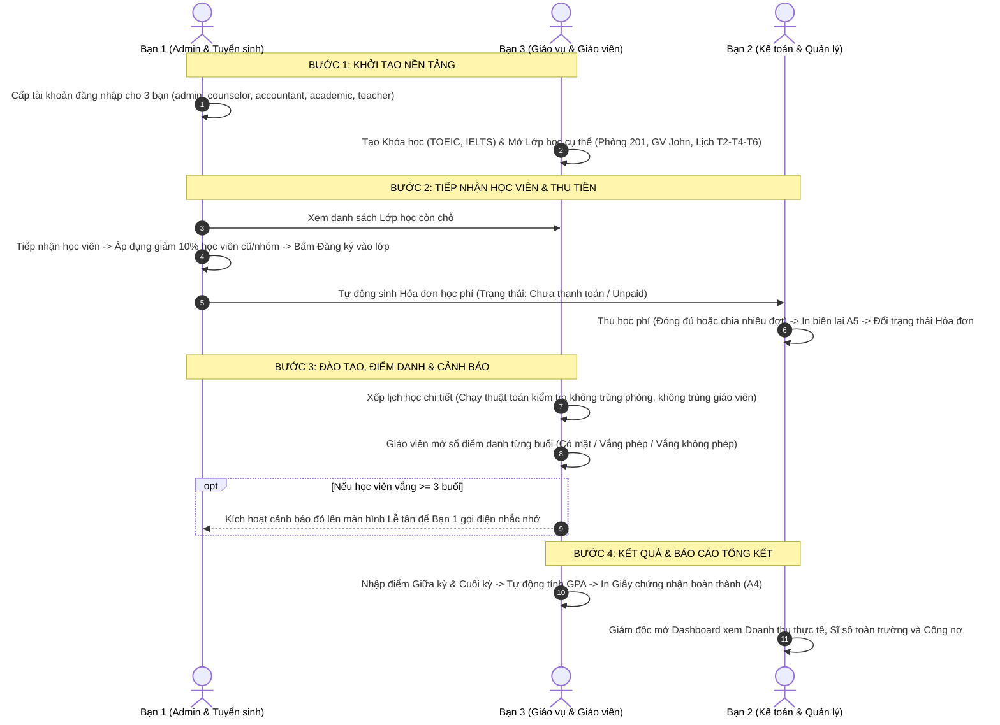

# BẢNG PHÂN CÔNG NHIỆM VỤ CHI TIẾT & HƯỚNG DẪN TRIỂN KHAI ĐỒ ÁN ECMS
## ĐỀ TÀI: PHẦN MỀM QUẢN LÝ TRUNG TÂM TIẾNG ANH / ĐÀO TẠO (NHÓM 3 NGƯỜI)
### (Bám sát 100% đề bài chính thức của Giảng viên - Tinh gọn phạm vi cốt lõi MVP)

---

| Thông tin dự án | Chi tiết |
| :--- | :--- |
| **Tên dự án** | English Center Management System (ECMS) |
| **Công nghệ** | C# .NET 10 LTS, Windows Forms, SQLite 3 (WAL Mode, Foreign Keys) |
| **Kiến trúc** | Layered Architecture 4 tầng (`ECMS.Core` $\rightarrow$ `ECMS.Data` $\rightarrow$ `ECMS.Business` $\rightarrow$ `ECMS.UI`) |
| **CSDL Cục bộ** | `%APPDATA%\ECMS\ecms_data.db` (Chạy 100% Offline, không phụ thuộc API ngoài) |
| **Phạm vi** | Tập trung hoàn thành **3 khối nghiệp vụ xương sống theo đúng đề bài của Giảng viên** |
| **Đặc biệt** | **Loại bỏ vai trò Phụ huynh (`ROLE_PAR`)** và các tính năng mở rộng (Wallpaper động, Kiosk) để tối ưu tiến độ |

---

# MỤC LỤC
1. [TỔNG QUAN YÊU CẦU ĐỀ BÀI CỦA GIẢNG VIÊN](#1-tổng-quan-yêu-cầu-đề-bài-của-giảng-viên)
2. [SƠ ĐỒ PHỐI HỢP NGHIỆP VỤ & LUỒNG DỮ LIỆU LIÊN THÔNG](#2-sơ-đồ-phối-hợp-nghiệp-vụ--luồng-dữ-liệu-liên-thông)
3. [PHÂN CÔNG CHI TIẾT DÀNH CHO TỪNG THÀNH VIÊN](#3-phân-công-chi-tiết-dành-cho-từng-thành-viên)
   - [3.1. BẠN 1 (Trưởng nhóm - Quản trị hệ thống & Tư vấn tuyển sinh)](#31-bạn-1-trưởng-nhóm---quản-trị-hệ-thống--tư-vấn-tuyển-sinh)
   - [3.2. BẠN 2 (Kế toán tài chính & Báo cáo điều hành)](#32-bạn-2-kế-toán-tài-chính--báo-cáo-điều-hành)
   - [3.3. BẠN 3 (Giáo vụ đào tạo & Giảng viên giảng dạy)](#33-bạn-3-giáo-vụ-đào-tạo--giảng-viên-giảng-dạy)
4. [MA TRẬN PHỤ THUỘC CHÉO GIỮA CÁC THÀNH VIÊN (CROSS-DEPENDENCIES)](#4-ma-trận-phụ-thuộc-chéo-giữa-các-thành-viên-cross-dependencies)
5. [3 BÀI TOÁN & THUẬT TOÁN ĂN ĐIỂM TUYỆT ĐỐI KHI BẢO VỆ](#5-3-bài-toán--thuật-toán-ăn-điểm-tuyệt-đối-khi-bảo-vệ)
6. [QUY CHUẨN LẬP TRÌNH 4 TẦNG & QUY TẮC AN TOÀN DỮ LIỆU](#6-quy-chuẩn-lập-trình-4-tầng--quy-tắc-an-toàn-dữ-liệu)

---

# 1. TỔNG QUAN YÊU CẦU ĐỀ BÀI CỦA GIẢNG VIÊN

Theo đề bài chính thức được Giảng viên giao, hệ thống gồm **3 khối nghiệp vụ trọng tâm**:

```
1. NGHIỆP VỤ QUẢN LÝ KHÓA HỌC & LỚP HỌC:
   - Quản lý danh mục Khóa học (ví dụ: TOEIC 500, IELTS 6.5).
   - Từ khóa học mở ra các Lớp học cụ thể (Lớp T2-T4-T6, Phòng 201, Giáo viên A phụ trách).
   - Xếp lịch học: Kiểm tra để tránh việc 2 lớp bị xếp trùng phòng học hoặc 1 giáo viên bị trùng lịch dạy cùng một giờ.

2. NGHIỆP VỤ ĐĂNG KÝ & THU HỌC PHÍ:
   - Học viên đến đăng ký -> Chọn lớp học -> Tính học phí.
   - Áp dụng chính sách ưu đãi (giảm 10% cho học viên cũ, giảm khi đăng ký nhóm).
   - Cho phép đóng tiền một lần hoặc chia thành nhiều đợt -> In biên lai thu tiền cho học viên.

3. NGHIỆP VỤ ĐIỂM DANH & QUẢN LÝ KẾT QUẢ:
   - Màn hình điểm danh theo từng buổi học (Có mặt / Vắng có phép / Vắng không phép).
     Nếu học viên vắng quá 3 buổi -> Hệ thống hiện cảnh báo để lễ tân liên hệ nhắc nhở.
   - Nhập điểm bài thi giữa kỳ, cuối kỳ -> Tự động tính điểm trung bình và xuất/in Chứng nhận hoàn thành khóa học.
```

> [!IMPORTANT]
> **Quyết định phạm vi (Scope Decision):**  
> Cả nhóm chỉ tập trung triển khai **chính xác 100% các gạch đầu dòng trên**. Toàn bộ các chức năng ngoài đề bài (Lively Wallpaper, Kiosk quầy tự động, Cổng phụ huynh, v.v.) được **loại bỏ hoàn toàn** để các thành viên không bị phân tâm và đảm bảo hoàn thành đồ án đúng hạn với chất lượng cao nhất.

---

# 2. SƠ ĐỒ PHỐI HỢP NGHIỆP VỤ & LUỒNG DỮ LIỆU LIÊN THÔNG

Luồng dữ liệu trong đồ án chạy theo một chu trình khép kín giữa 3 bạn:



---

# 3. PHÂN CÔNG CHI TIẾT DÀNH CHO TỪNG THÀNH VIÊN

---

## 3.1. BẠN 1 (TRƯỞNG NHÓM - TECH LEAD)
* **Vai trò đảm nhiệm:** Quản trị hệ thống (`ROLE_ADMIN`) & Tư vấn tuyển sinh / Lễ tân (`ROLE_EC`).
* **Các bảng CSDL phụ trách:** `Users`, `Roles`, `UserRoles`, `AuditLogs`, `Leads`, `Students`, `Enrollments`.
* **Trọng tâm công việc:** Hạ tầng đăng nhập, tiếp nhận học viên vào lớp và xử lý cảnh báo vắng học.

### Chức năng 1.1: Quản trị tài khoản & Cấp quyền đăng nhập (Admin)
* **Tình trạng:** **ĐÃ HOÀN THÀNH (Ngày 1 - Ngày 5).**
* **Nghiệp vụ:** Cung cấp sẵn các tài khoản đăng nhập mã hóa BCrypt cho các thành viên thử nghiệm:
  - `admin` / `Admin@123` (Admin hệ thống)
  - `counselor` / `Counselor@123` (Tư vấn tuyển sinh)
  - `accountant` / `Accountant@123` (Kế toán thu ngân)
  - `academic` / `Academic@123` (Giáo vụ đào tạo)
  - `teacher` / `Teacher@123` (Giáo viên giảng dạy)
  - `manager` / `Manager@123` (Quản lý / Giám đốc)
* **File liên quan:** `ECMS.UI/Forms/LoginForm.cs`, `AdminDashboardView.cs`, `AuthService.cs`.

---

### Chức năng 1.2: Quản lý Tiếp nhận học viên & Đăng ký Lớp học (Theo đề bài)
* **Nghiệp vụ chi tiết:**
  1. Lễ tân/Tư vấn nhập thông tin học viên đến đăng ký (Mã tự sinh `HV-yyyy-xxxx`, Họ tên, Số điện thoại, Email, Ngày sinh).
  2. Chọn Khóa học mong muốn $\rightarrow$ Danh sách các **Lớp học đang mở còn chỗ trống** sẽ hiển thị để chọn.
  3. **Áp dụng chính sách ưu đãi (Bắt buộc theo đề bài):**
     - Checkbox: `Học viên cũ (Giảm 10%)`.
     - Checkbox: `Đăng ký theo nhóm (Giảm 15%)`.
     - Hệ thống tự động tính:
       $$\text{Học phí thực nộp} = \text{Học phí gốc} - \text{Số tiền giảm giá}$$
  4. Bấm **"ĐĂNG KÝ VÀO LỚP"**:
     - Lưu thông tin vào bảng `Students`.
     - Ghi nhận xếp lớp vào bảng `Enrollments`.
     - **Tự động sinh Hóa đơn học phí (`Invoices`)** ở trạng thái `Unpaid` chuyển sang cho Bạn 2.
* **Thiết kế UI & Code Logic 4 tầng:**
  - **ECMS.UI:** `UserControls/AdmissionsDashboardView.cs` hoặc `Forms/StudentEnrollmentDialog.cs`.
    - Ô nhập thông tin học viên, ComboBox chọn Lớp học, GroupBox chính sách giảm giá, Nút "Xác nhận đăng ký".
  - **ECMS.Core:** `EnrollmentDto (StudentId, ClassId, DiscountType, DiscountAmount, FinalAmount)`.
  - **ECMS.Data:** `IStudentRepository` / `StudentRepository` (Insert `Students`, Insert `Enrollments`, Insert `Invoices` trong cùng 1 Transaction).
  - **ECMS.Business:** `StudentService.EnrollStudentAsync(...)`:
    - Kiểm tra sĩ số lớp: Không cho đăng ký nếu lớp đã đủ sĩ số tối đa (`CurrentStudents >= MaxStudents`).
* **Ràng buộc phụ thuộc:**
  > [!WARNING]
  > **CẦN BẠN 3:** Bạn 1 cần Bạn 3 tạo trước danh mục Khóa học và mở Lớp học trong CSDL thì Bạn 1 mới có danh sách Lớp học để chọn đăng ký.

---

### Chức năng 1.3: Màn hình Tiếp nhận Cảnh báo Học viên vắng quá 3 buổi (Theo đề bài)
* **Nghiệp vụ chi tiết:**
  - Đề bài yêu cầu: *"Nếu học viên vắng quá 3 buổi -> Hệ thống hiện cảnh báo để lễ tân liên hệ nhắc nhở"*.
  - Màn hình Lễ tân có một bảng/tab riêng: **"CẢNH BÁO CHUYÊN CẦN NGUY HIỂM"**.
  - Hiển thị danh sách các học viên có tổng số buổi vắng (Vắng có phép + Vắng không phép) $\ge 3$ buổi.
  - Cột thông tin: Mã học viên, Tên học viên, Tên lớp học, Số buổi đã vắng, Số điện thoại liên hệ.
  - Có nút tác vụ: **"Đã gọi điện nhắc nhở"** để lưu vết ghi chú lễ tân đã xử lý.
* **Thiết kế UI & Code Logic 4 tầng:**
  - **ECMS.UI:** Tab hoặc Thẻ cảnh báo trong `AdmissionsDashboardView.cs`.
  - **ECMS.Data:** Truy vấn SQL trích xuất danh sách vắng:
    ```sql
    SELECT s.StudentId, s.FullName, s.Phone, c.ClassName, COUNT(a.AttendanceId) AS AbsentCount
    FROM AttendanceRecords a
    JOIN Students s ON a.StudentId = s.StudentId
    JOIN Classes c ON a.ClassId = c.ClassId
    WHERE a.Status IN ('Absent', 'Excused')
    GROUP BY s.StudentId, s.FullName, s.Phone, c.ClassName
    HAVING COUNT(a.AttendanceId) >= 3;
    ```
  - **ECMS.Business:** `StudentService.GetAttendanceAlertsAsync()`.
* **Ràng buộc phụ thuộc:**
  > [!WARNING]
  > **CẦN BẠN 3:** Dữ liệu cảnh báo này chỉ xuất hiện khi Giáo viên (Bạn 3) đã thực hiện thao tác Điểm danh vào các buổi học.

---

## 3.2. BẠN 2 (KẾ TOÁN TÀI CHÍNH & BÁO CÁO ĐIỀU HÀNH)
* **Vai trò đảm nhiệm:** Kế toán / Thu ngân (`ROLE_ACC`) & Quản lý trung tâm / Giám đốc (`ROLE_MGR`).
* **Các bảng CSDL phụ trách:** `Invoices`, `Payments`, `FeeDiscounts`, và các câu lệnh truy vấn Doanh thu.
* **Trọng tâm công việc:** Quản lý khoản phải thu, thu tiền nhiều đợt, in biên lai A5 và màn hình báo cáo doanh số.

---

### Chức năng 2.1: Quản lý Danh sách Hóa đơn & Công nợ học phí
* **Nghiệp vụ chi tiết:**
  - Kế toán đăng nhập tài khoản `accountant`.
  - Màn hình hiển thị toàn bộ hóa đơn học phí do khâu Đăng ký của Bạn 1 sinh ra.
  - Lọc hóa đơn theo trạng thái:
    - `Unpaid`: Chưa thanh toán đồng nào.
    - `Partial`: Đã nộp một phần (còn nợ).
    - `Paid`: Đã hoàn tất 100% học phí.
  - Hiển thị rõ: Mã hóa đơn, Tên học viên, Lớp học, Tổng học phí, Đã đóng, Số tiền còn nợ (`BalanceDue`).
* **Thiết kế UI & Code Logic 4 tầng:**
  - **ECMS.UI:** `UserControls/FinanceDashboardView.cs`.
    - Bảng `dgvInvoices` được định dạng `ModernGridHelper.ApplyStyle`.
    - Các nút lọc trạng thái, ô tìm kiếm theo Tên học viên hoặc Mã hóa đơn.
  - **ECMS.Core:** DTO `InvoiceListItemDto`.
  - **ECMS.Data:** `IInvoiceRepository` / `InvoiceRepository` (Query từ bảng `Invoices` JOIN `Students` và `Classes`).
  - **ECMS.Business:** `FinanceService.GetInvoicesAsync(statusFilter, keyword)`.
* **Ràng buộc phụ thuộc:**
  > [!WARNING]
  > **CẦN BẠN 1:** Cần Bạn 1 bấm Đăng ký lớp cho học viên để CSDL có các bản ghi Hóa đơn.

---

### Chức năng 2.2: Thu học phí (Đóng 1 lần hoặc Nhiều đợt) & In Biên lai A5 (Theo đề bài)
* **Nghiệp vụ chi tiết:**
  1. Kế toán chọn một hóa đơn cần thanh toán $\rightarrow$ Bấm nút **"LẬP PHIẾU THU"**.
  2. Cửa sổ Thu tiền mở ra:
     - Hiển thị: Tổng số tiền phải nộp và Số tiền còn nợ hiện tại.
     - **Tùy chọn đóng tiền linh hoạt (Theo đề bài):**
       - Lựa chọn 1: *Đóng toàn bộ số tiền còn lại (100%)*.
       - Lựa chọn 2: *Đóng nhiều đợt / Đóng một phần* (Người dùng tự gõ số tiền nộp đợt này, ví dụ: Nộp trước 2.000.000 VNĐ).
     - Chọn phương thức thanh toán: `Tiền mặt` hoặc `Chuyển khoản`.
     - Ghi chú thu tiền.
  3. Bấm **"XÁC NHẬN THU TIỀN & IN BIÊN LAI"**:
     - Hệ thống sinh bản ghi vào bảng `Payments` với mã phiếu thu chuẩn: `PT-yyyyMMdd-xxxx`.
     - Cập nhật số tiền lũy kế trong bảng `Invoices`:
       $$\text{PaidAmount}_{\text{mới}} = \text{PaidAmount}_{\text{cũ}} + \text{Số tiền nộp đợt này}$$
       $$\text{BalanceDue}_{\text{mới}} = \text{TotalAmount} - \text{PaidAmount}_{\text{mới}}$$
     - Nếu `BalanceDue == 0` $\rightarrow$ Chuyển trạng thái hóa đơn sang `Paid`; Nếu còn nợ $\rightarrow$ Chuyển sang `Partial`.
     - **In Biên lai thu tiền:** Mở cửa sổ xem trước (Print Preview) hoặc xuất file PDF/in trực tiếp khổ A5 gồm: Tên trung tâm, Mã phiếu thu, Họ tên học viên, Tên lớp, Số tiền nộp (bằng số & bằng chữ), Số tiền còn nợ, Chữ ký thu ngân.
* **Thiết kế UI & Code Logic 4 tầng:**
  - **ECMS.UI:** `Forms/PaymentReceiptDialog.cs` (Nhập số tiền thu, xem mẫu biên lai A5).
  - **ECMS.Core:** DTO `PaymentCreateDto`, `ReceiptPrintDto`.
  - **ECMS.Data:** `IPaymentRepository` / `PaymentRepository` (Ghi nhận `Payments`, Update `Invoices` trong 1 Transaction).
  - **ECMS.Business:** `FinanceService.CreatePaymentAsync(...)`:
    - Validate logic: Số tiền thu đợt này không được $\le 0$ và không được vượt quá số tiền còn nợ (`BalanceDue`).
* **Ràng buộc phụ thuộc:** Phụ thuộc vào Hóa đơn của Chức năng 2.1.

---

### Chức năng 2.3: Bàn làm việc Giám đốc (Báo cáo Doanh thu & Sĩ số thực tế)
* **Nghiệp vụ chi tiết:**
  - Giám đốc đăng nhập tài khoản `manager`.
  - Màn hình cung cấp bức tranh tài chính và vận hành trung tâm tổng thể:
    1. **Thẻ KPI 1:** Tổng doanh thu thực thu trong tháng (Cộng dồn từ các phiếu thu `Payments`).
    2. **Thẻ KPI 2:** Tổng số học viên đang theo học (Tính từ bảng `Students`).
    3. **Thẻ KPI 3:** Tổng công nợ học phí chưa thu hồi (`SUM(BalanceDue)`).
    4. **Thẻ KPI 4:** Số lớp học đang mở hoạt động (`Classes`).
    5. **Bảng dữ liệu:** Danh sách nhật ký các giao dịch thu tiền gần nhất trong ngày.
* **Thiết kế UI & Code Logic 4 tầng:**
  - **ECMS.UI:** `UserControls/DashboardView.cs` (Giao diện riêng khi `manager` đăng nhập).
  - **ECMS.Business:** `FinanceService.GetDirectorDashboardSummaryAsync()`.
* **Ràng buộc phụ thuộc:** Lấy dữ liệu từ bảng `Payments` (Bạn 2) và bảng `Classes`, `Students` (Bạn 1 & Bạn 3).

---

## 3.3. BẠN 3 (GIÁO VỤ ĐÀO TẠO & GIẢNG VIÊN GIẢNG DẠY)
> [!NOTE]
> **Lưu ý đặc biệt:** **Đã loại bỏ hoàn toàn vai trò Phụ huynh (`ROLE_PAR`)** ra khỏi phạm vi công việc của Bạn 3 để bạn tập trung trọn vẹn 100% vào nghiệp vụ Đào tạo & Giảng dạy theo đúng đề bài của Giảng viên.

* **Vai trò đảm nhiệm:** Giáo vụ đào tạo (`ROLE_AA`) & Giảng viên giảng dạy (`ROLE_TEA`).
* **Các bảng CSDL phụ trách:** `Courses`, `ClassRooms`, `Classes`, `ClassSchedules`, `AttendanceRecords`, `Exams`, `ExamScores`, `Certificates`.
* **Trọng tâm công việc:** Danh mục Khóa học, Mở lớp, Thuật toán xếp lịch chống trùng, Sổ điểm danh, Nhập điểm thi và In chứng nhận hoàn thành.

---

### Chức năng 3.1: Quản lý Danh mục Khóa học & Mở Lớp học cụ thể (Theo đề bài)
* **Nghiệp vụ chi tiết:**
  1. **Quản lý Khóa học (`Courses`):**
     - Thêm/Sửa/Xem các khóa học tại trung tâm (Ví dụ: *TOEIC 500*, *IELTS 6.5*, *Giao tiếp phản xạ*).
     - Mỗi khóa học có: Tên khóa, Thời lượng (Tổng số buổi: ví dụ 24 buổi), Học phí gốc (ví dụ: 4.500.000 VNĐ).
  2. **Quản lý Phòng học (`ClassRooms`):**
     - Danh sách phòng học: *Phòng 201*, *Phòng 202*, *Lab 1* kèm sức chứa tối đa (Sĩ số trần: ví dụ 20 học viên).
  3. **Mở Lớp học cụ thể (`Classes`):**
     - Từ một Khóa học mở ra các lớp cụ thể:
       - Tên lớp (Ví dụ: `IELTS-K26-T246`).
       - Chọn Khóa học tương ứng.
       - Gán Phòng học mặc định (Ví dụ: *Phòng 201*).
       - Gán Giáo viên phụ trách (Ví dụ: *Thầy John Smith*).
       - Ngày khai giảng và Ngày bế giảng dự kiến.
       - Sĩ số tối đa (`MaxStudents`).
* **Thiết kế UI & Code Logic 4 tầng:**
  - **ECMS.UI:** `UserControls/AcademicDashboardView.cs` (Gồm 2 Tab: Tab Khóa học và Tab Danh sách Lớp học).
  - **ECMS.Core:** DTO `CourseDto`, `ClassCreateDto`, `ClassListItemDto`.
  - **ECMS.Data:** `IAcademicRepository` / `AcademicRepository` (CRUD bảng `Courses`, `Classes`, `ClassRooms`).
  - **ECMS.Business:** `AcademicService.CreateClassAsync(...)`.
* **Ràng buộc phụ thuộc:**
  > [!TIP]
  > **ƯU TIÊN LÀM ĐẦU TIÊN:** Bạn 3 cần làm chức năng này trước tiên để Bạn 1 có Lớp học phục vụ việc xếp học viên vào lớp.

---

### Chức năng 3.2: Xếp Lịch học & Thuật toán Chống trùng lịch (Theo đề bài - Trọng tâm)
* **Nghiệp vụ chi tiết:**
  - Đề bài yêu cầu: *"Xếp lịch học: Kiểm tra để tránh việc 2 lớp bị xếp trùng phòng học hoặc 1 giáo viên bị trùng lịch dạy cùng một giờ"*.
  - Giáo vụ chọn một Lớp học $\rightarrow$ Bấm **"XẾP THỜI KHÓA BIỂU"**.
  - Thiết lập các ca học trong tuần (Ví dụ: Thứ 2 - Thứ 4 - Thứ 6 từ 18:00 đến 20:00).
  - **Thuật toán kiểm tra xung đột thời gian (Collision Check):**
    Trước khi lưu một lịch học mới, hệ thống tự động quét toàn bộ các lịch học hiện có trong CSDL:
    1. *Kiểm tra trùng phòng:* Cùng ngày trong tuần, cùng phòng học, nhưng khung giờ bị đè lên nhau.
    2. *Kiểm tra trùng giáo viên:* Cùng ngày trong tuần, cùng giáo viên, nhưng bị xếp dạy 2 lớp cùng giờ.
    $$\text{Xung đột} \iff (\text{StartTime}_{\text{cũ}} < \text{EndTime}_{\text{mới}}) \land (\text{EndTime}_{\text{cũ}} > \text{StartTime}_{\text{mới}})$$
  - Nếu phát hiện trùng $\rightarrow$ Chặn không cho lưu và bật thông báo cảnh báo rõ ràng:  
    *Ví dụ: "Không thể xếp lịch! Phòng 201 đã có lớp TOEIC-K12 học từ 18:00 - 20:00 vào Thứ 2."*
* **Thiết kế UI & Code Logic 4 tầng:**
  - **ECMS.UI:** `Forms/ClassScheduleDialog.cs`.
  - **ECMS.Data:** `IScheduleRepository` / `ScheduleRepository` (Lưu bảng `ClassSchedules`).
  - **ECMS.Business:** `ScheduleService.ValidateScheduleConflictAsync(...)` *(Đã có khung sẵn, chỉ cần gọi trong Service)*.
* **Ràng buộc phụ thuộc:** Phụ thuộc vào Khóa học & Lớp học của Chức năng 3.1.

---

### Chức năng 3.3: Sổ Điểm danh theo từng buổi học (Dành cho Giảng viên)
* **Nghiệp vụ chi tiết:**
  - Giáo viên đăng nhập tài khoản `teacher` (hoặc Giáo vụ mở sổ điểm danh).
  - Chọn Lớp học phụ trách $\rightarrow$ Chọn Ngày/Buổi học hôm nay $\rightarrow$ Bấm **"MỞ SỔ ĐIỂM DANH"**.
  - Danh sách học viên trong lớp tự động hiển thị (lấy từ dữ liệu Bạn 1 đã xếp lớp).
  - Với mỗi học viên, giáo viên tích chọn 1 trong 3 trạng thái chuẩn theo đề bài:
    - `Có mặt` (`Present`)
    - `Vắng có phép` (`Excused`)
    - `Vắng không phép` (`Absent`)
  - Bấm **"LƯU ĐIỂM DANH"**:
    - Dữ liệu lưu vào bảng `AttendanceRecords`.
    - **Tự động kích hoạt cảnh báo:** Nếu tổng số buổi vắng của học viên này đạt $\ge 3$ buổi $\rightarrow$ Học viên lập tức xuất hiện bên Màn hình Cảnh báo của Lễ tân (Bạn 1).
* **Thiết kế UI & Code Logic 4 tầng:**
  - **ECMS.UI:** `UserControls/TeacherPortalView.cs` (Tab Sổ Điểm Danh).
  - **ECMS.Data:** `IAttendanceRepository` / `AttendanceRepository` (Batch insert/update vào bảng `AttendanceRecords`).
  - **ECMS.Business:** `AttendanceService.SaveAttendanceBatchAsync(...)`.
* **Ràng buộc phụ thuộc:** Lớp học phải có Học viên do Bạn 1 đăng ký vào lớp.

---

### Chức năng 3.4: Nhập Điểm Giữa kỳ, Cuối kỳ & In Giấy chứng nhận hoàn thành (A4)
* **Nghiệp vụ chi tiết:**
  1. **Nhập điểm bài thi (Theo đề bài):**
     - Giáo viên/Giáo vụ chọn Lớp học $\rightarrow$ Mở Bảng điểm.
     - Nhập điểm thi **Giữa kỳ** (thang điểm 10.0) và điểm thi **Cuối kỳ** (thang điểm 10.0) cho từng học viên.
  2. **Tự động tính điểm trung bình (GPA):**
     - Hệ thống tự động tính điểm theo công thức trọng số:
       $$\text{Điểm TB} = \frac{\text{Điểm Giữa Kỳ} \times 1 + \text{Điểm Cuối Kỳ} \times 2}{3}$$
     - Hoặc trung bình cộng: $\text{Điểm TB} = (\text{Giữa kỳ} + \text{Cuối kỳ}) / 2$.
  3. **Xuất/In Chứng nhận hoàn thành khóa học (Theo đề bài):**
     - Điều kiện cấp chứng nhận: Học viên có $\text{Điểm TB} \ge 5.0$ và Tỷ lệ chuyên cần $\ge 80\%$.
     - Với học viên đủ điều kiện, nút **"IN CHỨNG NHẬN"** sáng lên.
     - Bấm nút $\rightarrow$ Mở bản in Giấy chứng nhận khổ A4 nằm ngang:
       - Tiêu đề: *CHỨNG NHẬN HOÀN THÀNH KHÓA HỌC (CERTIFICATE OF COMPLETION)*.
       - Tên học viên, Tên khóa học đã hoàn thành, Điểm tốt nghiệp, Ngày cấp, Mã chứng chỉ (`CC-yyyy-xxxx`), Chữ ký Giám đốc trung tâm.
* **Thiết kế UI & Code Logic 4 tầng:**
  - **ECMS.UI:** Tab Bảng Điểm & In Chứng Chỉ trong `TeacherPortalView.cs` hoặc `AcademicDashboardView.cs`.
  - **ECMS.Core:** DTO `GradebookItemDto`, `CertificateDto`.
  - **ECMS.Data:** Query và Update vào bảng `Exams`, `ExamScores`, `Certificates`.
  - **ECMS.Business:** `AcademicService.SaveGradesAndGenerateCertificatesAsync(...)`.
* **Ràng buộc phụ thuộc:** Phụ thuộc vào danh sách học viên trong lớp (Bạn 1) và Điểm danh (Chức năng 3.3).

---

# 4. MA TRẬN PHỤ THUỘC CHÉO GIỮA CÁC THÀNH VIÊN (CROSS-DEPENDENCIES)

Bảng này giúp 3 bạn nắm rõ **thứ tự trước - sau**: việc nào làm trước, việc nào phải đợi dữ liệu từ bạn khác:

| Công việc | Người làm | Phụ thuộc vào ai? | Mô tả chi tiết sự phụ thuộc |
| :--- | :---: | :---: | :--- |
| **1. Cấp tài khoản đăng nhập** | **Bạn 1** | *Không phụ thuộc* | **Đã xong**. Cung cấp sẵn tài khoản cho Bạn 2 và Bạn 3 đăng nhập. |
| **2. Tạo Khóa học & Mở Lớp học** | **Bạn 3** | *Không phụ thuộc* | **Cần làm ngay đầu tiên** để Bạn 1 có lớp xếp học viên vào. |
| **3. Xếp Lịch học & Chống trùng lịch** | **Bạn 3** | Khóa học & Lớp học | Chạy thuật toán kiểm tra không trùng phòng, không trùng GV. |
| **4. Tiếp nhận học viên & Đăng ký Lớp** | **Bạn 1** | **Bạn 3** | Cần Bạn 3 mở Lớp học trước thì Bạn 1 mới có Lớp để chọn đăng ký. |
| **5. Quản lý Hóa đơn & Thu tiền học phí** | **Bạn 2** | **Bạn 1** | Cần Bạn 1 bấm Đăng ký Lớp để hệ thống sinh Hóa đơn nợ cho Bạn 2 thu tiền. |
| **6. In Biên lai thu tiền A5** | **Bạn 2** | Thu tiền (Bạn 2) | Thu tiền xong thì bấm in biên lai A5 cho học viên. |
| **7. Sổ Điểm danh buổi học** | **Bạn 3** | **Bạn 1** | Lớp học phải có học viên (Bạn 1 xếp vào) thì Giáo viên mới điểm danh được. |
| **8. Màn hình Cảnh báo vắng > 3 buổi** | **Bạn 1** | **Bạn 3** | Cần Bạn 3 điểm danh vắng thì Bạn 1 mới thấy danh sách đỏ để gọi điện. |
| **9. Nhập điểm & In Chứng nhận A4** | **Bạn 3** | **Bạn 1** | Có học viên trong lớp thì Giáo viên mới nhập điểm và in chứng nhận tốt nghiệp. |
| **10. Dashboard Doanh thu Giám đốc** | **Bạn 2** | **Bạn 2 & Bạn 3** | Lấy tổng tiền thu được (Bạn 2) và tổng sĩ số học viên (Bạn 1 & Bạn 3). |

---

# 5. 3 BÀI TOÁN & THUẬT TOÁN ĂN ĐIỂM TUYỆT ĐỐI KHI BẢO VỆ

Khi thuyết minh đồ án với Giảng viên, Thầy sẽ đặc biệt chú ý đến **3 thuật toán nghiệp vụ cốt lõi** này:

### Thuật toán 1: Kiểm tra xung đột lịch học (Bạn 3)
```csharp
// Kiểm tra 2 khoảng thời gian [StartA, EndA] và [StartB, EndB] có bị đè lên nhau không:
public bool IsTimeOverlapping(TimeSpan startA, TimeSpan endA, TimeSpan startB, TimeSpan endB)
{
    return startA < endB && endA > startB;
}

// Kiểm tra toàn diện cả Phòng học lẫn Giáo viên:
public async Task<(bool HasConflict, string Message)> CheckConflictAsync(int classId, int roomId, int teacherId, DayOfWeek day, TimeSpan start, TimeSpan end)
{
    var existingSchedules = await _scheduleRepo.GetSchedulesByDayAsync(day);
    foreach (var s in existingSchedules)
    {
        // Bỏ qua chính lớp đang xét
        if (s.ClassId == classId) continue;

        if (IsTimeOverlapping(s.StartTime, s.EndTime, start, end))
        {
            if (s.RoomId == roomId)
                return (true, $"Phòng {s.RoomName} đã có lớp {s.ClassName} sử dụng từ {s.StartTime:hh\\:mm} đến {s.EndTime:hh\\:mm}!");

            if (s.TeacherId == teacherId)
                return (true, $"Giáo viên {s.TeacherName} đã bận dạy lớp {s.ClassName} từ {s.StartTime:hh\\:mm} đến {s.EndTime:hh\\:mm}!");
        }
    }
    return (false, "Lịch học hợp lệ, không có xung đột.");
}
```

---

### Thuật toán 2: Tính lũy kế học phí & Đóng nhiều đợt (Bạn 2)
```csharp
public async Task<(bool Success, string Message)> ProcessPaymentAsync(int invoiceId, decimal amountPaid, string paymentMethod)
{
    var invoice = await _invoiceRepo.GetByIdAsync(invoiceId);
    if (invoice == null) return (false, "Không tìm thấy hóa đơn!");

    if (amountPaid <= 0) return (false, "Số tiền nộp phải lớn hơn 0!");
    if (amountPaid > invoice.BalanceDue) return (false, $"Số tiền nộp vượt quá công nợ còn lại ({invoice.BalanceDue:N0} VNĐ)!");

    // Cập nhật lũy kế
    invoice.PaidAmount += amountPaid;
    invoice.BalanceDue = invoice.TotalAmount - invoice.PaidAmount;
    invoice.Status = (invoice.BalanceDue <= 0) ? "Paid" : "Partial";

    // Sinh mã phiếu thu duy nhất chuẩn ISO
    string receiptCode = $"PT-{DateTime.Now:yyyyMMdd}-{Guid.NewGuid().ToString()[..4].ToUpper()}";

    // Lưu vào CSDL trong Transaction
    await _paymentRepo.InsertPaymentAndUpdateInvoiceAsync(invoice, amountPaid, receiptCode, paymentMethod);
    return (true, $"Thu tiền thành công! Mã biên lai: {receiptCode}");
}
```

---

### Thuật toán 3: Trích xuất danh sách học viên vắng quá 3 buổi (Bạn 1 & Bạn 3)
```csharp
public async Task<IEnumerable<AbsenceAlertDto>> GetStudentsWithExcessiveAbsencesAsync()
{
    const string sql = @"
        SELECT 
            s.StudentId,
            s.StudentCode,
            s.FullName AS StudentName,
            s.Phone,
            c.ClassId,
            c.ClassName,
            COUNT(a.AttendanceId) AS TotalAbsences
        FROM AttendanceRecords a
        JOIN Students s ON a.StudentId = s.StudentId
        JOIN Classes c ON a.ClassId = c.ClassId
        WHERE a.Status IN ('Absent', 'Excused')
        GROUP BY s.StudentId, s.StudentCode, s.FullName, s.Phone, c.ClassId, c.ClassName
        HAVING COUNT(a.AttendanceId) >= 3
        ORDER BY TotalAbsences DESC;";

    using var conn = DatabaseConfig.CreateOpenConnection();
    return await conn.QueryAsync<AbsenceAlertDto>(sql);
}
```

---

# 6. QUY CHUẨN LẬP TRÌNH 4 TẦNG & QUY TẮC AN TOÀN DỮ LIỆU

Để toàn bộ dự án đồng bộ 100% và không xảy ra xung đột khi gộp mã nguồn (merge code):

1. **Quy tắc 4 tầng nghiêm ngặt (Strict Layering):**
   - **Tầng UI (`ECMS.UI`):** Chỉ xử lý hiển thị giao diện WinForms, bắt sự kiện Click, gán `DataSource`. **Tuyệt đối không viết câu lệnh SQL `SELECT` hay `INSERT` trong Form!**
   - **Tầng Business (`ECMS.Business`):** Nơi kiểm tra điều kiện nghiệp vụ (validate), chạy thuật toán tính điểm, kiểm tra trùng lịch, tính tiền nợ.
   - **Tầng Data (`ECMS.Data`):** Nơi thực thi câu lệnh truy vấn SQLite thông qua thư viện Dapper (`conn.QueryAsync`, `conn.ExecuteAsync`).
   - **Tầng Core (`ECMS.Core`):** Nơi định nghĩa thực thể Entity và DTO truyền dữ liệu giữa các tầng.

2. **Quy chuẩn mã hóa tự động:**
   - Mã học viên: `HV-yyyy-xxxx` (Ví dụ: `HV-2026-0001`).
   - Mã phiếu thu: `PT-yyyyMMdd-xxxx` (Ví dụ: `PT-20261107-0001`).
   - Mã chứng chỉ tốt nghiệp: `CC-yyyy-xxxx` (Ví dụ: `CC-2026-0001`).

3. **Nguyên tắc an toàn dữ liệu Offline:**
   - CSDL SQLite được cấu hình tự động tại `%APPDATA%\ECMS\ecms_data.db`.
   - Bật kiểm tra khóa ngoại: `PRAGMA foreign_keys = ON;`.
   - Bật cơ chế ghi nhật ký song song: `PRAGMA journal_mode = WAL;` (đảm bảo không bị khóa dữ liệu khi nhiều màn hình cùng đọc/ghi).

---

> [!TIP]
> **Kế hoạch hành động tuần tới cho cả nhóm:**
> - **Bạn 1 (Trưởng nhóm):** Gửi tài liệu này vào nhóm chat; hướng dẫn Bạn 2 và Bạn 3 đăng nhập thử tài khoản tương ứng; sau đó tập trung làm phần **Đăng ký học viên & Màn hình Cảnh báo vắng học**.
> - **Bạn 2:** Bắt đầu dựng giao diện **Danh sách Hóa đơn & Hộp thoại Thu tiền nhiều đợt / In biên lai A5**.
> - **Bạn 3:** Bắt đầu dựng **Danh mục Khóa học & Mở Lớp học cụ thể**, sau đó ráp thuật toán kiểm tra trùng lịch.
