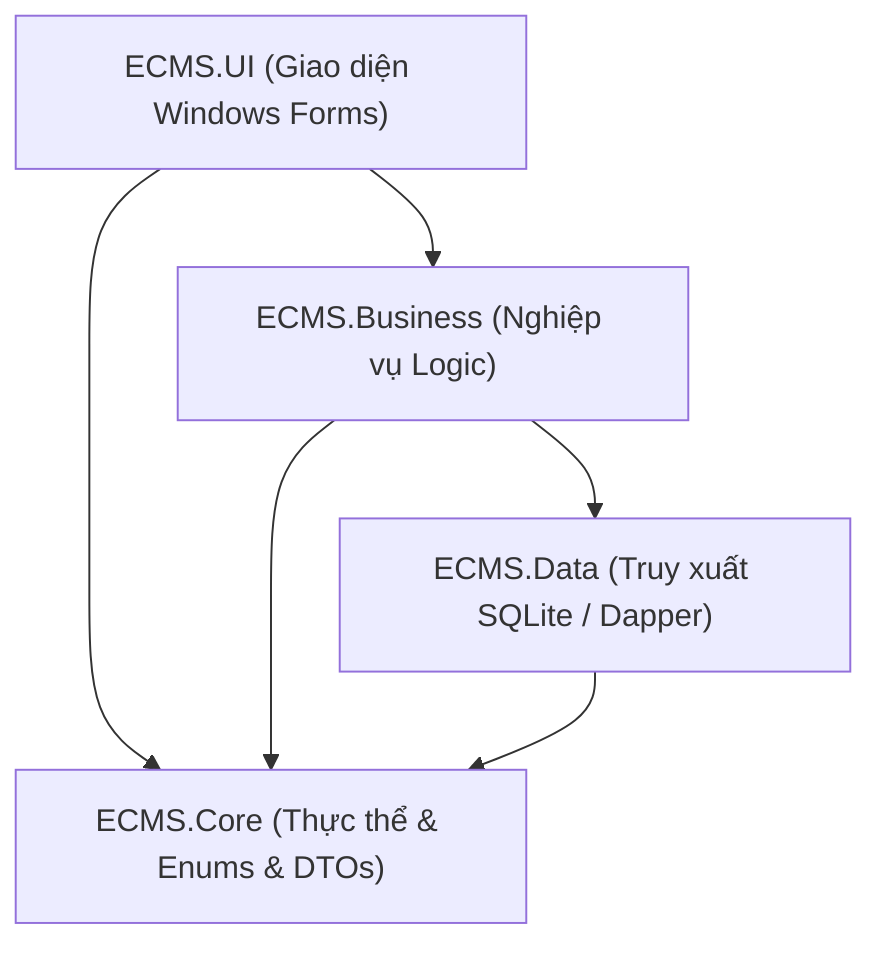
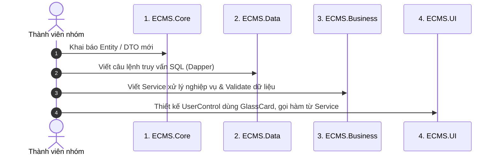

# HỆ THỐNG QUẢN LÝ TRUNG TÂM ANH NGỮ (ECMS)
## TÀI LIỆU CẤU TRÚC DỰ ÁN & HƯỚNG DẪN LÀM VIỆC NHÓM (PROJECT STRUCTURE & TEAM COLLABORATION GUIDELINES)

---

| Thông tin tài liệu | Chi tiết |
|:---|:---|
| **Dự án** | English Center Management System (ECMS) |
| **Công nghệ** | C# .NET 10 LTS / Windows Forms / SQLite 3 (WAL Mode) |
| **Kiến trúc** | Layered Architecture (Core - Data - Business - UI) |
| **Phong cách UI** | Modern Enterprise Desktop + Frosted Glassmorphism |
| **Quy mô nhóm** | 3 thành viên |

---

# MỤC LỤC
1. [TỔNG QUAN KIẾN TRÚC PHÂN TẦNG](#1-tổng-quan-kiến-trúc-phân-tầng)
2. [SƠ ĐỒ CÂY CẤU TRÚC THƯ MỤC TOÀN DIỆN](#2-sơ-đồ-cây-cấu-trúc-thư-mục-toàn-diện)
3. [MÔ TẢ CHI TIẾT TỪNG DỰ ÁN CON TRONG SOLUTION](#3-mô-tả-chi-tiết-từng-dự-án-con-trong-solution)
   - [3.1. Docs (Thư mục tài liệu)](#31-docs-thư-mục-tài-liệu)
   - [3.2. ECMS.Core (Tầng Nhân & Thực thể)](#32-ecmscore-tầng-nhân--thực-thể)
   - [3.3. ECMS.Data (Tầng Truy xuất CSDL)](#33-ecmsdata-tầng-truy-xuất-csdl)
   - [3.4. ECMS.Business (Tầng Nghiệp vụ Logic)](#34-ecmsbusiness-tầng-nghiệp-vụ-logic)
   - [3.5. ECMS.UI (Tầng Giao diện WinForms)](#35-ecmsui-tầng-giao-diện-winforms)
4. [QUY TRÌNH 4 BƯỚC KHI LẬP TRÌNH TÍNH NĂNG MỚI](#4-quy-trình-4-bước-khi-lập-trình-tính-năng-mới)
5. [PHÂN CHIA VÙNG FILE LÀM VIỆC CHO NHÓM 3 NGƯỜI](#5-phân-chia-vùng-file-làm-việc-cho-nhóm-3-người)
6. [QUY ƯỚC ĐẶT TÊN & NGUYÊN TẮC BẢO MẬT DỮ LIỆU](#6-quy-ước-đặt-tên--nguyên-tắc-bảo-mật-dữ-liệu)

---

# 1. TỔNG QUAN KIẾN TRÚC PHÂN TẦNG

Dự án được cấu trúc theo mô hình **Layered Architecture** chuẩn công nghiệp, phân tách nghiêm ngặt giữa dữ liệu, nghiệp vụ và hiển thị:



* **Quy tắc phụ thuộc một chiều:** Tầng ngoài được phép gọi tầng trong, tuyệt đối tầng trong không được phụ thuộc ngược ra tầng ngoài.
* **Độc lập nền tảng CSDL:** Mọi logic kiểm tra (chống trùng lịch, tính học phí, điểm danh) nằm ở `ECMS.Business`, giúp mã nguồn dễ viết kiểm thử và bảo trì.

---

# 2. SƠ ĐỒ CÂY CẤU TRÚC THƯ MỤC TOÀN DIỆN

```text
E:\ECMS\ECMS\
│
├── .gitignore                          # Cấu hình lọc file rác (bin, obj, cache) khi đẩy lên Git
├── ECMS.sln                            # File Solution trung tâm mở bằng JetBrains Rider / Visual Studio
├── README.md                           # Hướng dẫn khởi chạy và tổng quan đồ án
│
├── Docs/                               # BỘ TÀI LIỆU CHÍNH THỨC CỦA ĐỒ ÁN
│   ├── ECMS_Requirements_Analysis_and_Project_Roadmap.docx      # Tài liệu SRS Word (11 chương chi tiết)
│   ├── ECMS_Requirements_Analysis_and_Project_Roadmap.xlsx      # Bảng đặc tả Excel 12 sheet (CSDL, Ma trận)
│   ├── ECMS_Role_Functional_Analysis_and_Cross_Role_Workflows.md # Báo cáo chi tiết 8 vai trò & Ma trận RACI
│   └── ECMS_Project_Structure_and_Team_Guidelines.md            # Tài liệu này (Hướng dẫn cấu trúc cho nhóm)
│
├── ECMS.Core/                          # TẦNG 1: THỰC THỂ & KHAI BÁO DỮ LIỆU (DOMAINS)
│   ├── DTOs/
│   │   └── UserSession.cs              # DTO phiên làm việc (UserId, RoleCode, Quyền hạn, ID liên kết)
│   ├── Entities/
│   │   ├── BaseEntity.cs               # Lớp thực thể cơ sở (CreatedAt, UpdatedAt)
│   │   ├── HumanEntities.cs            # Employee, Teacher, Student, Parent, Lead, StudentParent
│   │   ├── AcademicEntities.cs         # Course, ClassRoom, Class, ClassSchedule, Enrollment, Exam, ExamScore
│   │   ├── FinanceEntities.cs          # Invoice, Payment, FeeDiscount
│   │   ├── SecurityEntities.cs         # User, Role, UserRole, Permission, RolePermission
│   │   └── SystemEntities.cs           # AuditLog, SystemConfig, Notification
│   └── Enums/
│       └── AppEnums.cs                 # UserRoleType, StudentStatus, ClassStatus, InvoiceStatus, AttendanceStatus
│
├── ECMS.Data/                          # TẦNG 2: KẾT NỐI & KHỞI TẠO CSDL SQLITE (DATA LAYER)
│   ├── Database/
│   │   ├── DatabaseConfig.cs           # Chuỗi kết nối, bật khóa ngoại PRAGMA foreign_keys = ON & WAL Mode
│   │   └── DatabaseInitializer.cs      # Script tạo 26 bảng SQLite tự động & nạp dữ liệu mẫu 8 vai trò
│   └── Repositories/
│       ├── IRepository.cs              # Interface CRUD tổng quát
│       └── BaseRepository.cs           # Lớp triển khai Repository cơ sở qua Dapper
│
├── ECMS.Business/                      # TẦNG 3: QUY TẮC NGHIỆP VỤ & THUẬT TOÁN (BUSINESS LAYER)
│   ├── Services/
│   │   ├── AuthService.cs              # Đăng nhập, kiểm tra mật khẩu BCrypt, chống Brute-force 5 lần
│   │   ├── StudentService.cs           # Sinh mã HV-yyyy-xxxx, tìm kiếm, kiểm tra ràng buộc trước khi xóa
│   │   ├── ScheduleService.cs          # Thuật toán chống trùng lịch giáo viên & phòng học
│   │   ├── AttendanceService.cs        # Điểm danh, thuật toán trích xuất học viên vắng >= 3 buổi
│   │   └── FinanceService.cs           # Quản lý khoản phải thu, sinh mã PT-yyyyMMdd-xxxx, tính công nợ
│   └── Session/
│       └── SessionManager.cs           # Biến tĩnh lưu trữ phiên người dùng hiện hành (CurrentUser)
│
└── ECMS.UI/                            # TẦNG 4: GIAO DIỆN NGƯỜI DÙNG (PRESENTATION LAYER - WINFORMS)
    ├── Program.cs                      # Hàm Main khởi động ứng dụng
    ├── Assets/                         # Phông nền mờ ambient bokeh đa tầng chuẩn Glassmorphism
    ├── Controls/                       # BỘ COMPONENT CHUNG (MODERN ENTERPRISE & GLASSMORPHISM)
    │   ├── ThemeColors.cs              # Bảng Design Tokens chuẩn màu tương phản WCAG 2.1 Level AA
    │   ├── GlassCard.cs                # Thẻ kính mờ Acrylic, bo góc 18px, đổ bóng mềm 3 lớp
    │   ├── CustomButton.cs             # Nút bấm hiện đại có hiệu ứng đổi màu Hover & Click
    │   ├── ModernTextBox.cs            # Ô nhập liệu bo góc, hỗ trợ Placeholder và phát sáng khi Focus
    │   ├── StatusBadge.cs              # Thẻ trạng thái dạng viên thuốc (Pill Badge) chuẩn màu WCAG
    │   ├── ModernGridHelper.cs         # Helper chuyển DataGridView thành bảng phẳng, tiêu đề Deep Navy
    │   ├── WallpaperHelper.cs          # Sinh và lưu bộ ảnh nền ambient bokeh độ nét cao
    │   └── RoundedPanel.cs             # Panel bo góc đơn giản
    ├── Forms/                          # CÁC CỬA SỔ WINFORMS CHÍNH
    │   ├── LoginForm.cs                # Form Đăng nhập (Mã hóa BCrypt, thông báo tài khoản bị khóa)
    │   └── MainForm.cs                 # Form Master (Sidebar kính nổi, Header tìm kiếm, Content nổi)
    └── UserControls/                   # CÁC MÀN HÌNH CHỨC NĂNG CỦA 8 VAI TRÒ
        ├── ModernGlassDemoView.cs      # Màn hình DEMO siêu đẹp theo đúng ảnh mẫu số 2
        ├── AdminDashboardView.cs       # Màn hình Kỹ thuật cho Admin (Quản trị Users, SQLite WAL, Backup)
        ├── DashboardView.cs            # Màn hình Giám đốc điều hành (Doanh thu tháng, Học viên vắng học)
        ├── AdmissionsDashboardView.cs  # Màn hình Tuyển sinh (Khách tiềm năng, Test đầu vào, Tạo học viên)
        ├── FinanceDashboardView.cs     # Màn hình Thu ngân (Khoản phải thu, Lập phiếu thu, Công nợ)
        ├── AcademicDashboardView.cs    # Màn hình Giáo vụ (Mở lớp, Phòng học, Xếp lịch chống trùng)
        ├── TeacherPortalView.cs        # Cổng Giảng viên (Thời khóa biểu cá nhân, Sổ điểm danh, Nhập điểm)
        ├── StudentPortalView.cs        # Cổng Học viên (Tra cứu lịch học, chuyên cần, bảng điểm, học phí)
        ├── ParentPortalView.cs         # Cổng Phụ huynh (Theo dõi con, giờ đón con, hotline hỗ trợ)
        └── StudentListView.cs          # Màn hình Quản lý danh sách học viên
```

---

# 3. MÔ TẢ CHI TIẾT TỪNG DỰ ÁN CON TRONG SOLUTION

### 3.1. Thư mục `Docs/`
* Nơi lưu trữ bộ tài liệu chính thức phục vụ nộp đồ án và thuyết trình với Giảng viên.
* Bao gồm tệp Word SRS hoàn chỉnh, file Excel 12 sheet đặc tả cơ sở dữ liệu và tài liệu Markdown phân tích nghiệp vụ 8 vai trò.

### 3.2. Dự án `ECMS.Core`
* Là tầng nền tảng, định nghĩa ngôn ngữ chung của hệ thống.
* **Không chứa logic phức tạp**, chỉ chứa thuộc tính (Properties), Enums và DTOs.
* Mọi thay đổi về cấu trúc bảng trong CSDL phải được cập nhật tương ứng vào các file Entity trong project này.

### 3.3. Dự án `ECMS.Data`
* Chịu trách nhiệm trực tiếp với cơ sở dữ liệu SQLite cục bộ tại `%APPDATA%\ECMS\ecms_data.db`.
* `DatabaseConfig.cs` kích hoạt chế độ **WAL (Write-Ahead Logging)** và bật kiểm tra ràng buộc khóa ngoại `PRAGMA foreign_keys = ON;`.
* `DatabaseInitializer.cs` tự động kiểm tra và khởi tạo 26 bảng kèm dữ liệu mẫu (Seed Data) mỗi khi chạy ứng dụng mà không cần cài đặt SQL Server hay MySQL.

### 3.4. Dự án `ECMS.Business`
* Là "bộ não" của phần mềm, nơi thực thi toàn bộ logic nghiệp vụ trước khi ghi vào CSDL hoặc hiển thị ra màn hình.
* `SessionManager`: Lưu giữ thông tin người dùng đang đăng nhập để phục vụ phân quyền.
* Chứa các thuật toán cốt lõi:
  * Thuật toán kiểm tra xung đột thời khóa biểu: `(StartTime < NewEnd) && (EndTime > NewStart)`.
  * Thuật toán kiểm tra điều kiện tốt nghiệp: `Chuyên cần >= 80%` và `GPA >= 5.0`.
  * Ràng buộc an toàn: Không cho phép xóa cứng học viên đã phát sinh giao dịch nộp học phí hoặc đã có điểm danh.

### 3.5. Dự án `ECMS.UI`
* Tầng giao diện người dùng sử dụng Windows Forms trên nền tảng .NET 10.
* Triển khai bộ component chung tại `Controls/` đảm bảo tính đồng nhất 100% về màu sắc, bo góc, bóng đổ và độ tương phản WCAG 2.1.
* Tổ chức màn hình thành các `UserControl` độc lập, được nạp động vào khung nội dung của `MainForm.cs`.

---

# 4. QUY TRÌNH 4 BƯỚC KHI LẬP TRÌNH TÍNH NĂNG MỚI

Khi một thành viên muốn bổ sung một chức năng mới (ví dụ: Chức năng Đổi phòng học hoặc In chứng chỉ), hãy làm đúng theo thứ tự 4 bước sau:



> [!CAUTION]
> **Quy tắc vàng:** Tuyệt đối không viết câu lệnh truy vấn `SELECT` hay `INSERT` trực tiếp trong file giao diện Form / UserControl! Mọi thao tác dữ liệu bắt buộc phải đi qua Service của tầng `ECMS.Business`.

---

# 5. PHÂN CHIA VÙNG FILE LÀM VIỆC CHO NHÓM 3 NGƯỜI

Để tránh xung đột code (Merge Conflict) khi làm việc đồng thời, nhóm được phân chia ranh giới file phụ trách rõ ràng như sau:

| Thành viên | Phân hệ nghiệp vụ phụ trách | Các file mã nguồn chính cần làm việc |
|:---|:---|:---|
| **Thành viên 1<br>(Trưởng nhóm)** | **Tuyển sinh & Học viên**<br>• Quản trị Leads & Tư vấn<br>• Hồ sơ học viên & Phụ huynh<br>• Phân quyền & Quản trị User | • `ECMS.Business/Services/StudentService.cs`<br>• `ECMS.Business/Services/AuthService.cs`<br>• `ECMS.UI/UserControls/AdmissionsDashboardView.cs`<br>• `ECMS.UI/UserControls/StudentListView.cs`<br>• `ECMS.UI/UserControls/AdminDashboardView.cs` |
| **Thành viên 2** | **Kế toán & Tài chính**<br>• Lập khoản phải thu (Invoices)<br>• Phiếu thu tiền & In biên lai A5<br>• Quản lý công nợ & Sổ quỹ | • `ECMS.Business/Services/FinanceService.cs`<br>• `ECMS.Core/Entities/FinanceEntities.cs`<br>• `ECMS.UI/UserControls/FinanceDashboardView.cs` |
| **Thành viên 3** | **Giáo vụ & Đào tạo**<br>• Khóa học, Lớp học, Phòng học<br>• Thời khóa biểu chống trùng lịch<br>• Sổ điểm danh & Nhập điểm thi | • `ECMS.Business/Services/ScheduleService.cs`<br>• `ECMS.Business/Services/AttendanceService.cs`<br>• `ECMS.UI/UserControls/AcademicDashboardView.cs`<br>• `ECMS.UI/UserControls/TeacherPortalView.cs`<br>• `ECMS.UI/UserControls/StudentPortalView.cs`<br>• `ECMS.UI/UserControls/ParentPortalView.cs` |

---

# 6. QUY ƯỚC ĐẶT TÊN & NGUYÊN TẮC BẢO MẬT DỮ LIỆU

1. **Quy tắc mã hóa tự động:**
   * Mã học viên: `HV-yyyy-xxxx` (Ví dụ: `HV-2026-0001`).
   * Mã phụ huynh: `PH-yyyy-xxxx` (Ví dụ: `PH-2026-0012`).
   * Mã phiếu thu: `PT-yyyyMMdd-xxxx` (Ví dụ: `PT-20261101-0001`).
   * Mã chứng chỉ: `CC-yyyy-xxxx` (Ví dụ: `CC-2026-0001`).
2. **Quy tắc bảo mật mật khẩu:**
   * Không lưu mật khẩu dạng bản rõ (Plaintext). Mọi mật khẩu bắt buộc phải đi qua hàm `BCrypt.Net.BCrypt.HashPassword()`.
3. **Quy tắc an toàn giao dịch:**
   * Không thực hiện xóa cứng (Hard Delete) các bản ghi đã liên kết với hóa đơn hoặc lịch sử điểm danh. Thay vào đó, cập nhật trạng thái `Status = 'Dropped'` hoặc `'Cancelled'`.
4. **Quy chuẩn giao diện:**
   * Tất cả bảng danh sách sử dụng `ModernGridHelper.ApplyStyle(dgv)` để có tiêu đề phẳng Deep Navy và hàng xen kẽ Zebra Striping.
   * Tất cả thẻ tóm tắt số liệu sử dụng `GlassCard` với `EnableShadow = true`.
