# HỆ THỐNG QUẢN LÝ TRUNG TÂM ANH NGỮ (ECMS)
## BÁO CÁO PHÂN TÍCH CHỨC NĂNG THEO VAI TRÒ & MA TRẬN PHỐI HỢP NGHIỆP VỤ LIÊN VAI TRÒ (CROSS-ROLE WORKFLOWS)

---

| Thông tin tài liệu | Chi tiết |
|:---|:---|
| **Dự án** | English Center Management System (ECMS) |
| **Loại ứng dụng** | Desktop Application (.NET 10 / Windows Forms / SQLite 3) |
| **Môi trường vận hành** | 100% Offline (Không API ngoài, Không Cloud, Lưu trữ cục bộ) |
| **Kiến trúc phần mềm** | Layered Architecture (Core - Data - Business - UI) |
| **Tài liệu tham chiếu** | SRS, Database DDL (26 bảng), RACI Matrix |
| **Số lượng vai trò** | 8 vai trò độc lập (Admin, Manager, EC, ACC, AA, TEA, STU, PAR) |

---

# MỤC LỤC
1. [TỔNG QUAN KIẾN TRÚC PHÂN QUYỀN 8 VAI TRÒ](#1-tổng-quan-kiến-trúc-phân-quyền-8-vai-trò)
2. [PHÂN TÍCH CHI TIẾT CHỨC NĂNG & LIÊN KẾT TỪNG VAI TRÒ](#2-phân-tích-chi-tiết-chức-năng--liên-kết-từng-vai-trò)
   - [2.1. Admin – Quản trị hệ thống (ROLE_ADMIN)](#21-admin--quản-trị-hệ-thống-role_admin)
   - [2.2. Quản lý trung tâm / Giám đốc (ROLE_MGR)](#22-quản-lý-trung-tâm--giám-đốc-role_mgr)
   - [2.3. Nhân viên tư vấn tuyển sinh (ROLE_EC)](#23-nhân-viên-tư-vấn-tuyển-sinh-role_ec)
   - [2.4. Nhân viên kế toán / Thu ngân (ROLE_ACC)](#24-nhân-viên-kế-toán--thu-ngân-role_acc)
   - [2.5. Nhân viên giáo vụ đào tạo (ROLE_AA)](#25-nhân-viên-giáo-vụ-đào-tạo-role_aa)
   - [2.6. Giáo viên giảng dạy (ROLE_TEA)](#26-giáo-viên-giảng-dạy-role_tea)
   - [2.7. Học viên (ROLE_STU)](#27-học-viên-role_stu)
   - [2.8. Phụ huynh học sinh (ROLE_PAR)](#28-phụ-huynh-học-sinh-role_par)
3. [MA TRẬN QUY TRÌNH PHỐI HỢP NGHIỆP VỤ LIÊN VAI TRÒ (WORKFLOWS)](#3-ma-trận-quy-trình-phối-hợp-nghiệp-vụ-liên-vai-trò-workflows)
4. [BẢNG MA TRẬN PHÂN ĐỊNH TRÁCH NHIỆM (RACI MATRIX)](#4-bảng-ma-trận-phân-định-trách-nhiệm-raci-matrix)
5. [DANH MỤC TÀI KHOẢN KIỂM THỬ MẶC ĐỊNH](#5-danh-mục-tài-khoản-kiểm-thử-mặc-định)
6. [CÁC RÀNG BUỘC KỸ THUẬT VÀ TOÀN VẸN DỮ LIỆU](#6-các-ràng-buộc-kỹ-thuật-và-toàn-vẹn-dữ-liệu)

---

# 1. TỔNG QUAN KIẾN TRÚC PHÂN QUYỀN 8 VAI TRÒ

Hệ thống ECMS tổ chức phân quyền theo mô hình **RBAC (Role-Based Access Control)** thích ứng động:
* **Nhóm Quản trị & Điều hành:** `ROLE_ADMIN` (Admin kỹ thuật), `ROLE_MGR` (Giám đốc điều hành).
* **Nhóm Nghiệp vụ chuyên môn:** `ROLE_EC` (Tư vấn tuyển sinh), `ROLE_ACC` (Kế toán tài chính), `ROLE_AA` (Giáo vụ đào tạo), `ROLE_TEA` (Giáo viên giảng dạy).
* **Nhóm Người thụ hưởng dịch vụ:** `ROLE_STU` (Học viên), `ROLE_PAR` (Phụ huynh).

Mỗi phiên đăng nhập tạo ra một đối tượng `UserSession` lưu trữ trong bộ nhớ tạm thời của tiến trình desktop, quyết định giao diện Sidebar và dữ liệu được nạp vào màn hình.

---

# 2. PHÂN TÍCH CHI TIẾT CHỨC NĂNG & LIÊN KẾT TỪNG VAI TRÒ

---

## 2.1. Admin – Quản trị hệ thống (`ROLE_ADMIN`)

### A. Mục tiêu & Phạm vi
Chịu trách nhiệm cao nhất về tính toàn vẹn, bảo mật kỹ thuật và sao lưu phục hồi dữ liệu hệ thống offline.

### B. Danh mục chức năng chi tiết
1. **Quản trị người dùng (Users):**
   - Tạo mới, cập nhật trạng thái (Kích hoạt / Khóa), đổi mật khẩu cho tất cả tài khoản.
   - Gán vai trò (`UserRoles`) và liên kết khóa ngoại tương ứng (`EmployeeId`, `TeacherId`, `StudentId`, `ParentId`).
2. **Quản lý mở khóa tài khoản (Brute-force Lockout):**
   - Theo dõi tài khoản bị hệ thống tự động khóa tạm thời khi nhập sai mật khẩu quá 5 lần.
   - Mở khóa khẩn cấp theo yêu cầu nhân sự.
3. **Phân quyền chức năng RBAC:**
   - Cấu hình phân quyền chi tiết (Xem, Thêm, Sửa, Xóa, Xuất Excel, Phê duyệt) cho từng vai trò trên 23 phân hệ.
4. **Sao lưu CSDL SQLite (Backup):**
   - Xuất tệp sao lưu chuẩn nén `.bak` có gắn mác thời gian (`ECMS_Backup_yyyyMMdd_HHmmss.bak`).
5. **Khôi phục CSDL (Restore):**
   - Tự động chạy lệnh kiểm tra tính toàn vẹn `PRAGMA integrity_check;` trước khi cho phép ghi đè cơ sở dữ liệu.
6. **Nhật ký hệ thống (Audit Logs):**
   - Xem toàn bộ lịch sử thao tác thêm/sửa/xóa nhạy cảm (Ai làm, lúc nào, bảng nào, giá trị cũ, giá trị mới). Bảng này được cấu hình **Append-Only** (chỉ ghi thêm, cấm sửa/xóa).
7. **Cấu hình trung tâm & Hình nền động:**
   - Cập nhật thông tin cơ sở (Tên trung tâm, hotline, địa chỉ, logo).
   - Thiết lập hình nền Lively Wallpaper (đường dẫn video MP4 cục bộ, thanh trượt Dark Overlay 0% - 90%).

### C. Ràng buộc & Điểm giao thoa liên vai trò
* **Cung cấp cho:** Cấp phát tài khoản đăng nhập cho tất cả 7 vai trò còn lại.
* **Nguyên tắc phân định ranh giới nghiệp vụ:**
  > [!IMPORTANT]
  > Admin **tuyệt đối không can thiệp sửa đổi trực tiếp dữ liệu học thuật hay tài chính** (không tự ý sửa điểm thi, không sửa tiền học phí hay sửa phiếu thu của học viên). Mọi điều chỉnh nghiệp vụ phải do Kế toán, Giáo vụ hoặc Giáo viên thực hiện để đảm bảo tính minh bạch kiểm toán.

---

## 2.2. Quản lý trung tâm / Giám đốc (`ROLE_MGR`)

### A. Mục tiêu & Phạm vi
Chịu trách nhiệm về chiến lược tuyển sinh, doanh thu tài chính, chất lượng đào tạo và là **chốt chặn phê duyệt cuối cùng (Approval Gateway)**.

### B. Danh mục chức năng chi tiết
1. **Bàn làm việc điều hành (Director Dashboard):**
   - Theo dõi doanh thu thực thu tháng này, tổng sĩ số học viên đang theo học, số lớp đang mở.
   - Xem danh sách cảnh báo học viên vắng học $\ge 3$ buổi để chỉ đạo giáo vụ xử lý.
2. **Phê duyệt nghiệp vụ cấp cao (Approvals):**
   - Phê duyệt kế hoạch mở lớp mới hoặc hủy lớp do không đủ sĩ số tối thiểu.
   - Phê duyệt chính sách giảm giá/học bổng đặc biệt ($> 10\%$ hoặc trường hợp ngoại lệ).
   - Phê duyệt hủy phiếu thu học phí hoặc hoàn phí khi học viên rút hồ sơ.
   - Ký duyệt danh sách học viên đủ điều kiện cấp chứng chỉ hoàn thành khóa học.
3. **Giám sát hiệu suất nhân sự:**
   - Thống kê số lượng học viên do từng nhân viên tư vấn tuyển sinh mang về.
   - Theo dõi tổng số giờ dạy và thù lao chi trả cho từng giáo viên.
4. **Báo cáo chiến lược:**
   - Xuất báo cáo doanh thu tài chính theo ngày/tháng/quý/năm ra tệp Excel chuẩn.
   - Báo cáo tổng hợp công nợ quá hạn toàn trường.
   - Báo cáo tỷ lệ hoàn thành khóa học và tỷ lệ đỗ chứng chỉ quốc tế.

### C. Ràng buộc & Điểm giao thoa liên vai trò
* **Nhận dữ liệu từ Kế toán (ACC):** Tờ trình xin hoàn học phí, tờ trình miễn giảm phí $> 10\%$.
* **Nhận dữ liệu từ Giáo vụ (AA):** Kế hoạch mở lớp; Danh sách học viên đủ điều kiện tốt nghiệp.
* **Chỉ đạo Tư vấn (EC):** Giao chỉ tiêu doanh số và số lượng học viên tuyển mới theo từng đợt.

---

## 2.3. Nhân viên tư vấn tuyển sinh (`ROLE_EC`)

### A. Mục tiêu & Phạm vi
Quản lý quy trình chăm sóc khách hàng đầu vào, chuyển đổi khách tiềm năng thành học viên chính thức.

### B. Danh mục chức năng chi tiết
1. **Quản lý khách tiềm năng (Leads):**
   - Tiếp nhận và phân loại thông tin khách (Mới tiếp nhận, Đang tư vấn, Đã hẹn test, Đã chốt, Không có nhu cầu).
2. **Nhật ký tư vấn (Consultation Logs):**
   - Ghi nhận chi tiết nội dung cuộc gọi/gặp mặt, nhu cầu học tập, thời gian rảnh, mức học phí mong muốn.
3. **Lập lịch & Ghi nhận kiểm tra đầu vào (Placement Test):**
   - Đặt lịch thi thử cho khách; Ghi nhận kết quả đánh giá 4 kỹ năng do giáo viên chấm; Đề xuất khóa học phù hợp trình độ.
4. **Khởi tạo hồ sơ Học viên & Phụ huynh:**
   - Chuyển đổi Lead thành Học viên chính thức (`HV-yyyy-xxxx`).
   - Khởi tạo hồ sơ Phụ huynh (`PH-yyyy-xxxx`) và thiết lập quan hệ giám hộ (`StudentParents`).
5. **Đăng ký vào lớp học:**
   - Tra cứu danh sách lớp đang tuyển sinh và kiểm tra số chỗ trống khả dụng; Đăng ký học viên vào lớp.

### C. Ràng buộc & Điểm giao thoa liên vai trò
* **Chuyển giao cho Kế toán (ACC):** Khi EC thực hiện "Đăng ký vào lớp", hệ thống tự động sinh một Khoản phải thu (`Invoice` trạng thái `Unpaid`) sang phân hệ Kế toán để ACC thu tiền.
* **Phối hợp với Giáo viên (TEA):** Chuyển bài thi Placement Test cho Giáo viên chấm điểm và tư vấn trình độ.
* **Chuyển giao cho Giáo vụ (AA):** Chuyển danh sách học viên đã đóng cọc/học phí để AA chốt sĩ số chính thức và xếp lịch học.
* **Ràng buộc quyền hạn:**
  > [!NOTE]
  > Sau khi học viên đã nhập học chính thức và có lịch học/điểm số, nhân viên tư vấn chỉ có quyền **Xem (Read-only)** hồ sơ học viên; không được sửa điểm, sửa sổ điểm danh hoặc tự ý chuyển lớp.

---

## 2.4. Nhân viên kế toán / Thu ngân (`ROLE_ACC`)

### A. Mục tiêu & Phạm vi
Quản lý thu chi học phí, phát hành biên lai thanh toán, kiểm soát công nợ và sổ quỹ tiền mặt.

### B. Danh mục chức năng chi tiết
1. **Quản lý khoản phải thu (Invoices):**
   - Tiếp nhận yêu cầu nộp học phí của học viên từ phân hệ Tuyển sinh.
   - Áp dụng các chính sách ưu đãi/voucher hợp lệ theo thẩm quyền ($\le 10\%$).
2. **Thu học phí & Lập phiếu thu (Payments):**
   - Tiếp nhận thanh toán qua: Tiền mặt, Chuyển khoản, Quẹt thẻ POS.
   - Hỗ trợ thanh toán nhiều đợt (ghi nhận `BalanceDue` giảm trừ dần theo từng lần nộp).
   - Tự động sinh mã phiếu thu duy nhất: `PT-yyyyMMdd-xxxx`.
3. **In biên lai thu tiền A5/PDF:**
   - In biên lai chuẩn có đầy đủ thông tin: Mã học viên, Tên lớp, Số tiền nộp, Số tiền còn nợ, Số tiền bằng chữ và chữ ký thu ngân.
4. **Quản lý công nợ học viên (Receivables Aging):**
   - Lọc danh sách học viên nợ học phí quá hạn để đốc thúc đóng học phí đúng hạn.
5. **Chốt sổ quỹ cuối ngày:**
   - Đối soát số tiền mặt thu được trong ngày với phần mềm trước khi bàn giao ca.

### C. Ràng buộc & Điểm giao thoa liên vai trò
* **Nhận dữ liệu từ Tư vấn (EC):** Nghĩa vụ học phí được sinh tự động ngay khi EC đăng ký lớp cho học viên.
* **Trình duyệt lên Giám đốc (MGR):** Trình duyệt yêu cầu giảm giá học phí $> 10\%$, duyệt hoàn học phí khi học viên rút hồ sơ, duyệt hủy biên lai thu tiền do sai sót.
* **Cung cấp trạng thái cho Giáo vụ (AA):** Khi Kế toán xác nhận học viên đã thanh toán đủ hoặc đạt mức cọc tối thiểu, trạng thái hồ sơ học viên chuyển thành `Active`, cho phép Giáo vụ xếp lớp chính thức.
* **Cập nhật cho Học viên (STU) & Phụ huynh (PAR):** Mọi phiếu thu và công nợ được cập nhật tức thời lên Cổng tra cứu của học viên và phụ huynh.
* **Ràng buộc nghiệp vụ:**
  > [!WARNING]
  > Kế toán **tuyệt đối không được xóa cứng (Hard Delete)** giao dịch thanh toán hoặc hóa đơn. Trường hợp thu nhầm/hủy biên lai, hệ thống ghi nhận trạng thái `Cancelled`, lưu vết người hủy, lý do hủy và ghi vào nhật ký Audit Log.

---

## 2.5. Nhân viên giáo vụ đào tạo (`ROLE_AA`)

### A. Mục tiêu & Phạm vi
Quản trị toàn bộ quy trình học thuật: Khóa học, phòng học, lớp học, thời khóa biểu, chuyên cần, kỳ thi và xét tốt nghiệp.

### B. Danh mục chức năng chi tiết
1. **Quản lý khóa học (Courses):** Quản lý chương trình học, số giờ học, số buổi học chuẩn, học phí gốc và điểm chuẩn đầu ra.
2. **Quản lý phòng học (ClassRooms):** Danh mục phòng học, số chỗ ngồi tối đa, trang thiết bị máy chiếu, điều hòa.
3. **Mở lớp & Quản lý sĩ số (Classes):**
   - Khởi tạo mã lớp học, ngày bắt đầu, ngày kết thúc.
   - Xếp học viên vào lớp (kiểm tra sĩ số không vượt quá sức chứa tối đa `MaxStudents`).
   - Xử lý nghiệp vụ chuyển lớp, bảo lưu kết quả học tập hoặc thôi học.
4. **Xếp thời khóa biểu chống trùng lịch (Anti-Collision Scheduling):**
   - Lập lịch chi tiết từng buổi học (Ngày, Giờ bắt đầu, Giờ kết thúc, Phòng học, Giáo viên, Chủ đề bài học).
   - *Thuật toán kiểm tra xung đột:* Tự động cảnh báo và ngăn chặn nếu giáo viên hoặc phòng học bị trùng giờ:
     $$\text{Conflict} \iff (Start_{\text{cũ}} < End_{\text{mới}}) \land (End_{\text{cũ}} > Start_{\text{mới}})$$
5. **Giám sát sổ điểm danh & Cảnh báo chuyên cần:**
   - Theo dõi tỷ lệ chuyên cần của tất cả các lớp; Tự động trích xuất danh sách học viên vắng $\ge 3$ buổi để gọi điện cho phụ huynh.
6. **Quản lý kỳ thi & Bảng điểm:** Lập danh mục bài thi Giữa kỳ, Cuối kỳ; Khóa sổ điểm thi sau khi hết thời hạn nhập điểm.
7. **Xét tốt nghiệp & In chứng chỉ:**
   - Tự động kiểm tra điều kiện tốt nghiệp:
     $$\text{Tốt nghiệp} \iff (\text{Chuyên cần} \ge 80\%) \land (\text{GPA} \ge 5.0)$$
   - Trình Giám đốc phê duyệt và in phôi chứng chỉ hoàn thành khóa học A4 (`CC-yyyy-xxxx`).

### C. Ràng buộc & Điểm giao thoa liên vai trò
* **Cung cấp cho Tư vấn (EC):** Danh sách lớp học đang mở tuyển sinh, thời khóa biểu và số chỗ trống thực tế.
* **Giao việc cho Giáo viên (TEA):** Phân công lớp dạy, gán thời khóa biểu; Mở quyền điểm danh và nhập điểm cho giáo viên.
* **Phối hợp với Kế toán (ACC):** Khi học viên chuyển lớp (có chênh lệch học phí), bảo lưu hoặc rút hồ sơ, AA xác nhận trạng thái đào tạo để Kế toán điều chỉnh hóa đơn học phí.
* **Trình duyệt lên Giám đốc (MGR):** Trình duyệt mở lớp, hủy lớp và danh sách cấp chứng chỉ tốt nghiệp.
* **Thông báo cho Phụ huynh (PAR):** Trực tiếp liên hệ phụ huynh khi con em có nguy cơ bị cấm thi do vắng $\ge 3$ buổi.

---

## 2.6. Giáo viên giảng dạy (`ROLE_TEA`)

### A. Mục tiêu & Phạm vi
Thực hiện nghiệp vụ giảng dạy trực tiếp, điểm danh buổi học, chấm điểm và đánh giá sự tiến bộ của học viên.

### B. Danh mục chức năng chi tiết
1. **Xem thời khóa biểu cá nhân:** Xem lịch dạy theo tuần/tháng, phòng học được phân công và giáo trình tương ứng.
2. **Xem danh sách học viên lớp phụ trách:** Xem danh sách học viên trong các lớp mình đứng lớp (Ảnh đại diện, Họ tên, Ngày sinh, Tỷ lệ chuyên cần hiện tại).
3. **Điểm danh buổi học (Attendance Taking):**
   - Mở sổ điểm danh buổi học hôm nay; Tích chọn trạng thái (*Có mặt*, *Vắng không phép*, *Vắng có phép*, *Đi muộn*); Ghi chú thái độ học tập.
4. **Nhập điểm & Nhận xét kết quả học tập:**
   - Nhập điểm thi các bài Quiz, Giữa kỳ, Cuối kỳ theo thang điểm 10.0.
   - Ghi nhận xét chi tiết điểm mạnh, điểm yếu 4 kỹ năng (Nghe, Nói, Đọc, Viết) cho từng học sinh.
5. **Kho tài liệu bài tập:** Tải lên file giáo trình, tài liệu bài tập PDF của lớp để học sinh tải về tự học.

### C. Ràng buộc & Điểm giao thoa liên vai trò
* **Bảo mật truy cập dữ liệu:**
  > [!IMPORTANT]
  > Giáo viên **chỉ được phép xem và thao tác trên đúng lớp học do mình phụ trách** (`MainTeacherId = @CurrentTeacherId`). Tuyệt đối không thể xem hoặc sửa dữ liệu lớp của giáo viên khác.
* **Nhận dữ liệu từ Giáo vụ (AA):** Lịch giảng dạy, danh sách học sinh và danh mục bài kiểm tra do AA thiết lập.
* **Chuyển giao cho Giáo vụ (AA):** Dữ liệu điểm danh và điểm thi do TEA nhập là căn cứ để AA tính tỷ lệ chuyên cần và GPA xét tốt nghiệp.
* **Hiển thị tức thời cho Học viên (STU) & Phụ huynh (PAR):** Dữ liệu điểm danh, điểm thi và nhận xét ngay khi lưu sẽ hiển thị lên Cổng học viên và Cổng phụ huynh.

---

## 2.7. Học viên (`ROLE_STU`)

### A. Mục tiêu & Phạm vi
Sử dụng Cổng học viên (`STUDENT PORTAL`) để tra cứu lộ trình, theo dõi tiến độ học tập và nghĩa vụ học phí cá nhân.

### B. Danh mục chức năng chi tiết
1. **Trang cá nhân học viên:** Xem ảnh đại diện, thông tin cá nhân, mã học viên (`HV-yyyy-xxxx`), lớp đang theo học.
2. **Tra cứu thời khóa biểu:** Xem lịch học các ca trong tuần, phòng học, giáo viên đứng lớp và nội dung bài học từng buổi.
3. **Theo dõi sổ chuyên cần cá nhân:** Xem lịch sử điểm danh từng buổi, số buổi vắng và tỷ lệ % chuyên cần hiện tại.
4. **Tra cứu bảng điểm & Nhận xét:** Xem điểm các bài Quiz, Giữa kỳ, Cuối kỳ, điểm GPA và nhận xét của thầy cô.
5. **Tra cứu nghĩa vụ học phí:** Xem chi tiết học phí khóa học, số tiền đã đóng, số tiền còn nợ, hạn nộp đợt tới và lịch sử biên lai thanh toán.
6. **Kho học liệu & Chứng chỉ số:** Tải giáo trình điện tử của lớp; Xem chứng chỉ hoàn thành khóa học điện tử sau khi tốt nghiệp.

### C. Ràng buộc & Điểm giao thoa liên vai trò
* **Phạm vi phân quyền:** Quyền truy cập **Chỉ đọc (Read-only)** đối với toàn bộ lịch học, điểm số, điểm danh, hóa đơn học phí.
* **Nguồn dữ liệu:**
  - Dữ liệu lịch học, lớp học: Do Giáo vụ (AA) cung cấp.
  - Dữ liệu chuyên cần, điểm số, nhận xét: Do Giáo viên (TEA) nhập.
  - Dữ liệu học phí, biên lai: Do Kế toán (ACC) xử lý.
* **Ràng buộc:** Học viên chỉ được tự chỉnh sửa một số thông tin liên lạc cá nhân đơn giản (Email cá nhân, số điện thoại phụ). Mọi thay đổi về thông tin nhân thân pháp lý (Họ tên, Ngày tháng năm sinh) bắt buộc phải mang giấy tờ đến phòng Giáo vụ (AA) để đối soát cập nhật.

---

## 2.8. Phụ huynh học sinh (`ROLE_PAR`)

### A. Mục tiêu & Phạm vi
Sử dụng Cổng phụ huynh (`PARENT PORTAL`) để đồng hành, giám sát kết quả học tập và nghĩa vụ tài chính của con em.

### B. Danh mục chức năng chi tiết
1. **Bàn làm việc gia đình:** Hỗ trợ chuyển đổi linh hoạt giữa các con (trong trường hợp 1 phụ huynh giám hộ nhiều học viên).
2. **Theo dõi lịch học & Giờ đưa đón:** Xem chi tiết giờ vào lớp, giờ tan học, số phòng học của từng con để tiện sắp xếp việc đưa đón.
3. **Giám sát chuyên cần của con:** Xem chi tiết điểm danh từng buổi; Hiển thị **cảnh báo đỏ** nổi bật nếu con vắng từ 3 buổi trở lên.
4. **Theo dõi kết quả học tập & Đạo đức:** Xem điểm thi, điểm GPA và nhận xét trực tiếp của thầy cô về thái độ học tập của con.
5. **Theo dõi tài chính con em:** Tra cứu học phí từng con, lịch sử các lần đã nộp tiền, số tiền còn thiếu và thời hạn đóng tiền đợt kế tiếp.
6. **Kênh hỗ trợ khẩn cấp:** Xem số hotline trung tâm, số điện thoại của nhân viên giáo vụ phụ trách và số điện thoại của giáo viên chủ nhiệm lớp của con.

### C. Ràng buộc & Điểm giao thoa liên vai trò
* **Phạm vi bảo mật:** Phụ huynh **tuyệt đối chỉ có quyền Xem (Read-only)** dữ liệu của chính con em mình được liên kết qua bảng `StudentParents`. Không có quyền sửa đổi bất kỳ thông tin nào thay cho học viên.
* **Nhận dữ liệu từ:**
  - Giáo viên (TEA): Điểm danh, điểm số, nhận xét tiến độ của con.
  - Giáo vụ (AA): Cảnh báo khi con nghỉ học nhiều buổi; Lịch học, phòng học để đưa đón.
  - Kế toán (ACC): Thông báo học phí còn nợ và biên lai thu tiền.
  - Tư vấn (EC): Được EC tạo hồ sơ liên kết ngay từ khâu tiếp nhận học viên đầu vào.

---

# 3. MA TRẬN QUY TRÌNH PHỐI HỢP NGHIỆP VỤ LIÊN VAI TRÒ (WORKFLOWS)

```mermaid
sequenceDiagram
    autonumber
    actor EC as 1. Tư vấn tuyển sinh (EC)
    actor ACC as 2. Kế toán / Thu ngân (ACC)
    actor AA as 3. Giáo vụ đào tạo (AA)
    actor TEA as 4. Giáo viên (TEA)
    actor STU_PAR as 5. Học viên & Phụ huynh
    actor MGR as 6. Giám đốc điều hành (MGR)

    Note over EC, MGR: QUY TRÌNH 1: TUYỂN SINH - XẾP LỚP - THU HỌC PHÍ
    EC->>EC: Nhận Lead -> Test đầu vào -> Tạo hồ sơ HV & PH
    EC->>AA: Kiểm tra lớp còn chỗ -> Đăng ký vào lớp
    EC->>ACC: Tự động sinh Hóa đơn học phí (Invoice Unpaid)
    STU_PAR->>ACC: Đóng học phí (Tiền mặt / Chuyển khoản / POS)
    ACC->>ACC: Lập Phiếu thu -> In biên lai A5 -> Đổi trạng thái Paid
    ACC-->>STU_PAR: Cập nhật hóa đơn "Đã thanh toán" lên Portal
    ACC-->>AA: Xác nhận hoàn tất học phí -> Chốt sĩ số chính thức

    Note over AA, TEA: QUY TRÌNH 2: XẾP LỊCH & ĐIỀU HÀNH HỌC THUẬT
    AA->>MGR: Trình kế hoạch mở lớp mới (Khóa học, Phòng, Sĩ số)
    MGR-->>AA: Phê duyệt mở lớp
    AA->>AA: Xếp TKB (Thuật toán chống trùng lịch GV & Phòng)
    AA->>TEA: Phân công giảng dạy & Gán lớp phụ trách
    AA-->>STU_PAR: Hiển thị TKB, phòng học, giáo viên lên Portal

    Note over TEA, STU_PAR: QUY TRÌNH 3: ĐIỂM DANH, ĐÁNH GIÁ & CẢNH BÁO
    TEA->>TEA: Mở sổ điểm danh từng buổi (Có mặt / Vắng / Muộn)
    TEA->>TEA: Nhập điểm thi thang 10.0 & Lời nhận xét
    TEA-->>STU_PAR: Điểm danh & Điểm số hiển thị tức thời trên Portal
    TEA-->>AA: Dữ liệu chuyên cần & điểm số chuyển về sổ giáo vụ
    opt Nếu học viên vắng >= 3 buổi
        AA->>STU_PAR: Kích hoạt cảnh báo đỏ & Gọi điện cho Phụ huynh
    end

    Note over AA, MGR: QUY TRÌNH 4: TỐT NGHIỆP & CẤP CHỨNG CHỈ
    AA->>AA: Kiểm tra điều kiện: Chuyên cần >= 80% & GPA >= 5.0
    AA->>MGR: Trình danh sách học viên đủ điều kiện tốt nghiệp
    MGR-->>AA: Ký duyệt cấp chứng chỉ
    AA->>AA: In phôi chứng chỉ A4 (Mã CC-yyyy-xxxx)
    AA-->>STU_PAR: Cấp chứng chỉ số điện tử hiển thị trên Portal
```

---

# 4. BẢNG MA TRẬN PHÂN ĐỊNH TRÁCH NHIỆM (RACI MATRIX)

| Quy trình nghiệp vụ cốt lõi | Admin | Giám đốc | Tư vấn | Kế toán | Giáo vụ | Giáo viên | Học viên | Phụ huynh |
|:---|:---:|:---:|:---:|:---:|:---:|:---:|:---:|:---:|
| **1. Quản trị tài khoản & Phân quyền RBAC** | **R / A** | I | I | I | I | I | I | I |
| **2. Tiếp nhận Lead & Test đầu vào** | I | I | **R / A** | I | C | C | I | I |
| **3. Khởi tạo hồ sơ Học viên & Phụ huynh** | I | I | **R** | I | **A** | I | I | I |
| **4. Lập hóa đơn & Thu học phí** | I | I | I | **R / A** | I | I | I | I |
| **5. Phê duyệt miễn giảm học phí > 10%** | I | **A** | C | **R** | I | I | I | I |
| **6. Khởi tạo lớp & Xếp thời khóa biểu** | I | **A** | C | I | **R** | C | I | I |
| **7. Phân công giáo viên đứng lớp** | I | **A** | I | I | **R** | I | I | I |
| **8. Điểm danh học viên từng buổi** | I | I | I | I | **A** | **R** | I | I |
| **9. Cảnh báo học viên vắng $\ge 3$ buổi** | I | I | I | I | **R / A** | C | I | **I** |
| **10. Nhập điểm & Nhận xét tiến độ** | I | I | I | I | **A** | **R** | I | I |
| **11. Xét tốt nghiệp & Ký chứng chỉ** | I | **A** | I | I | **R** | C | I | I |
| **12. Sao lưu & Phục hồi CSDL SQLite** | **R / A** | I | I | I | I | I | I | I |

*Quy ước:*
- **R (Responsible):** Vai trò trực tiếp thực hiện thao tác trên phần mềm.
- **A (Accountable):** Vai trò phê duyệt, chịu trách nhiệm cao nhất về kết quả.
- **C (Consulted):** Vai trò phối hợp cung cấp thông tin hai chiều.
- **I (Informed):** Vai trò chỉ nhận thông báo hoặc xem dữ liệu (Read-only).

---

# 5. DANH MỤC TÀI KHOẢN KIỂM THỬ MẶC ĐỊNH

Tất cả 8 tài khoản dưới đây đã được mã hóa mật khẩu bằng thuật toán **BCrypt** và lưu trữ sẵn trong cơ sở dữ liệu SQLite cục bộ (`%APPDATA%\ECMS\ecms_data.db`):

| STT | Vai trò nghiệp vụ | Mã vai trò | Tên đăng nhập | Mật khẩu | Người dùng đại diện | Cổng giao diện (Portal) |
|:---:|:---|:---:|:---:|:---:|:---|:---:|
| **1** | Admin – Quản trị hệ thống | `ROLE_ADMIN` | `admin` | `Admin@123` | Quản trị viên hệ thống | `ADMINISTRATOR PORTAL` |
| **2** | Quản lý trung tâm (Giám đốc) | `ROLE_MGR` | `manager` | `Manager@123` | Hoàng Văn Quản *(Ban Giám đốc)* | `DIRECTOR PORTAL` |
| **3** | Tư vấn tuyển sinh | `ROLE_EC` | `counselor` | `Counselor@123` | Lê Thị Thảo *(Tư vấn viên)* | `CONSULTANT PORTAL` |
| **4** | Kế toán / Thu ngân | `ROLE_ACC` | `accountant` | `Accountant@123` | Phạm Minh Tài *(Kế toán)* | `FINANCE PORTAL` |
| **5** | Giáo vụ đào tạo | `ROLE_AA` | `academic` | `Academic@123` | Đặng Thị Mai *(Giáo vụ)* | `ACADEMIC PORTAL` |
| **6** | Giáo viên giảng dạy | `ROLE_TEA` | `teacher` | `Teacher@123` | Thầy John Smith *(GV Bản ngữ)* | `TEACHER PORTAL` |
| **7** | Học viên | `ROLE_STU` | `student` | `Student@123` | Nguyễn Văn An *(HV-2026-0001)* | `STUDENT PORTAL` |
| **8** | Phụ huynh học sinh | `ROLE_PAR` | `parent` | `Parent@123` | Trần Thị Mai *(Mẹ học viên)* | `PARENT PORTAL` |

---

# 6. CÁC RÀNG BUỘC KỸ THUẬT VÀ TOÀN VẸN DỮ LIỆU

1. **Phiên làm việc độc lập (Session Isolation):**
   - Lớp `SessionManager` lưu trữ phiên làm việc `CurrentUser` hiện hành với đầy đủ định danh (`UserId`, `RoleCode`, `EmployeeId`, `TeacherId`, `StudentId`, `ParentId`). Khi người dùng đăng xuất, toàn bộ thông tin phiên làm việc được dọn sạch khỏi RAM.
2. **Ngăn chặn chỉnh sửa dữ liệu học thuật:**
   - Màn hình `StudentPortalView` và `ParentPortalView` khóa toàn bộ thuộc tính `ReadOnly = true` trên các DataGridView để học viên và phụ huynh chỉ xem kết quả học tập.
3. **Phân vùng dữ liệu giáo viên:**
   - Trong `TeacherPortalView`, các truy vấn dữ liệu lớp học, điểm danh và danh sách học viên luôn được gắn mệnh đề `WHERE MainTeacherId = @CurrentTeacherId`, đảm bảo giáo viên không thể xem chéo lớp học của đồng nghiệp.
4. **Cơ chế SQLite an toàn khi chạy Offline:**
   - Bật cờ `PRAGMA foreign_keys = ON;` để kiểm soát chặt chẽ toàn vẹn khóa ngoại.
   - Bật cờ `PRAGMA journal_mode = WAL;` (Write-Ahead Logging) giúp ứng dụng Windows Forms đọc ghi đồng thời ổn định, không bị nghẽn (locking) cơ sở dữ liệu.
