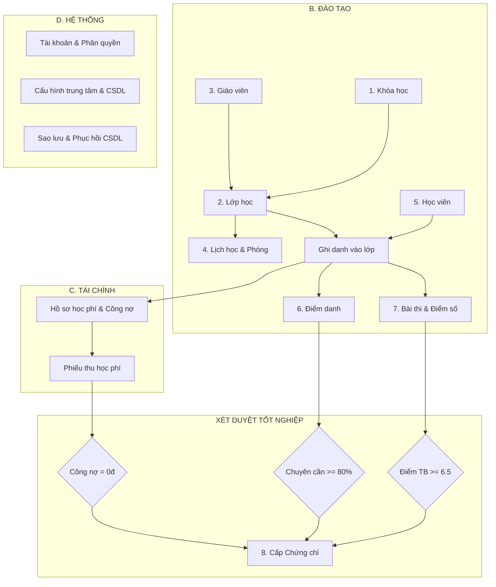

# TÀI LIỆU ĐẶC TẢ LOGIC & KẾ HOẠCH TRIỂN KHAI PHẦN MỀM ECMS
> **Dự án**: Hệ thống Quản lý Vận hành Trung tâm Anh ngữ (English Center Management System - ECMS)  
> **Phiên bản tài liệu**: 2.0 (Chuẩn hóa Back-office, Độc lập chức năng & An toàn giao dịch)  
> **Ngày lập**: 16/11/2026  
> **Mục đích**: Tài liệu hướng dẫn phân công nhiệm vụ và lập trình logic cho nhóm tại thư viện.

---

## MỤC LỤC
1. [Nguyên lý Kiến trúc & Cô lập dữ liệu (Chống lỗi chéo)](#1-nguyên-lý-kiến-trúc--cô-lập-dữ-liệu-chống-lỗi-chéo)
2. [Sơ đồ Luồng Dữ liệu & Ranh giới trách nhiệm](#2-sơ-đồ-luồng-dữ-liệu--ranh-giới-trách-nhiệm)
3. [Đặc tả Chi tiết Logic từng Phân hệ](#3-đặc-tả-chi-tiết-logic-từng-phân-hệ)
   - [Phân hệ A: Tổng quan (Dashboard Overview)](#phân-hệ-a-tổng-quan-dashboard-overview)
   - [Phân hệ B: Đào tạo & Quản lý Học thuật](#phân-hệ-b-đào-tạo--quản-lý-học-thuật)
   - [Phân hệ C: Tài chính & Thu học phí](#phân-hệ-c-tài-chính--thu-học-phí)
   - [Phân hệ D: Quản trị Hệ thống & Dữ liệu](#phân-hệ-d-quản-trị-hệ-thống--dữ-liệu)
4. [Ma trận Phụ thuộc & Quy tắc An toàn Dữ liệu](#4-ma-trận-phụ-thuộc--quy-tắc-an-toàn-dữ-liệu)
5. [Phân công Nhiệm vụ Nhóm (Task Backlog)](#5-phân-công-nhiệm-vụ-nhóm-task-backlog)

---

## 1. NGUYÊN LÝ KIẾN TRÚC & CÔ LẬP DỮ LIỆU (CHỐNG LỖI CHÉO)

Để đảm bảo **"Chức năng này không làm ảnh hưởng hay phá hỏng chức năng khác"**, hệ thống áp dụng 4 nguyên tắc kỹ thuật bắt buộc:

```
┌────────────────────────────────────────────────────────┐
│            TẦNG GIAO DIỆN (UI LAYER - WinForms)        │
│   AccountManagementView, TuitionPaymentView, etc.      │
└───────────────────────────┬────────────────────────────┘
                            │ (Chỉ gửi/nhận DTOs)
┌───────────────────────────▼────────────────────────────┐
│      TẦNG NGHIỆP VỤ (BUSINESS LOGIC LAYER - Services)   │
│   StudentService, ClassService, TuitionService, etc.   │
│   • Kiểm tra ràng buộc (Business Rules)                │
│   • Quản lý Transaction (BeginTransaction / Commit)    │
└───────────────────────────┬────────────────────────────┘
                            │ (Dapper / SQL Queries)
┌───────────────────────────▼────────────────────────────┐
│         TẦNG DỮ LIỆU (DATA LAYER - Repositories)        │
│          SQLite Database (ecms.db cục bộ)              │
└────────────────────────────────────────────────────────┘
```

### Nguyên tắc 1: Luôn dùng Transaction cho các hành động thay đổi dòng tiền và trạng thái
* **Ví dụ**: Khi "Lập phiếu thu học phí", hệ thống phải:
  1. Thêm bản ghi mới vào bảng `Receipts`.
  2. Cập nhật số tiền `PaidAmount` và giảm `DebtAmount` ở bảng `Enrollments`.
  * *Bắt buộc*: 2 hành động này nằm trong cùng một `using var trans = conn.BeginTransaction()`. Nếu bước 2 gặp sự cố, bước 1 sẽ tự động `Rollback`, đảm bảo không bao giờ có chuyện mất phiếu thu hoặc lệch số liệu công nợ.

### Nguyên tắc 2: Không Xóa Cứng (Hard Delete) - Chỉ Dùng Xóa Mềm (Soft Delete / Archive)
* **Tuyệt đối không chạy `DELETE FROM Students WHERE StudentId = ...`**:
  * Lý do: Một học viên đã có lịch sử điểm danh, bảng điểm và phiếu thu. Nếu xóa cứng sẽ làm "gãy" khóa ngoại (Foreign Key Integrity) khiến phân hệ Điểm số và Báo cáo tài chính bị crash!
  * **Giải pháp**: Chỉ cập nhật cờ `Status = 'Inactive'` hoặc `IsDeleted = 1`. Phân hệ quản lý học viên ẩn đi, nhưng phân hệ Báo cáo Tài chính và Lịch sử thu vẫn truy xuất được dữ liệu đối soát.

### Nguyên tắc 3: Tách biệt hoàn toàn Logic đọc (Read-only) và Logic ghi (Write)
* Phân hệ **Chứng chỉ** chỉ *đọc* điểm số và *đọc* công nợ để đối chiếu điều kiện cấp chứng chỉ. Tuyệt đối không có bất kỳ dòng lệnh nào trong module Chứng chỉ làm sửa đổi điểm số hay sửa đổi công nợ của học viên.

---

## 2. SƠ ĐỒ LUỒNG DỮ LIỆU & RANH GIỚI TRÁCH NHIỆM



---

## 3. ĐẶC TẢ CHI TIẾT LOGIC TỪNG PHÂN HỆ

### PHÂN HỆ A: TỔNG QUAN (DASHBOARD OVERVIEW)
*Mục đích: Hiển thị nhanh các chỉ số hoạt động tổng thể của trung tâm cho Ban Quản trị.*

| Chức năng | Đầu vào (Input) | Xử lý logic & Ràng buộc an toàn | Kết quả đầu ra (Output) |
| :--- | :--- | :--- | :--- |
| **A1. Đếm thẻ KPI** | Tháng/Năm lọc | • Đếm `COUNT(StudentId)` với `Status = 'Active'`.<br>• Đếm số lớp có `Status = 'InProgress'`.<br>• Tính `SUM(Amount)` từ `Receipts` trong tháng.<br>• Tính `SUM(DebtAmount)` từ `Enrollments`. | Cập nhật 6 thẻ số liệu: Tổng HV, Đang học, Lớp hoạt động, Giáo viên, Doanh thu, Công nợ tồn. |
| **A2. Biểu đồ Doanh thu & Sĩ số** | 6 tháng gần nhất | • Group dữ liệu phiếu thu theo từng tháng (`strftime('%m', PaymentDate)`).<br>• Chỉ đọc (Read-only), không lock bảng. | Vẽ các cột doanh thu và biểu đồ học viên tăng trưởng. |
| **A3. Lịch học hôm nay** | Ngày hiện tại (`DateTime.Today`) | • Query bảng `ClassSchedules` nối với `Classes`, `Teachers`, `ClassRooms` có `Date = Today`. | Danh sách các ca học diễn ra trong ngày kèm phòng học và sĩ số. |

---

### PHÂN HỆ B: ĐÀO TẠO & QUẢN LÝ HỌC THUẬT

#### B1. Quản lý Học viên (`StudentManagementView`)
* **Thêm mới học viên**:
  * *Ràng buộc*: Mã học viên tự sinh (`HV-2026-XXXX`) không được trùng. Số điện thoại từ 9–11 chữ số. Họ tên tối thiểu 2 ký tự.
  * *Không ảnh hưởng module khác*: Học viên mới chưa ghi danh vào lớp sẽ không sinh công nợ và không có lịch học.
* **Cập nhật hồ sơ**:
  * Chỉ sửa đổi thông tin cá nhân (SĐT, Email, Địa chỉ). **Không cho phép sửa đổi Mã học viên** (khóa chính).
* **Lưu trữ / Xóa học viên**:
  * Nếu học viên đã từng có phiếu thu hoặc điểm số: **Chuyển `Status = 'Archived'` (Lưu trữ)**, tuyệt đối không dùng lệnh `DELETE`.

#### B2. Quản lý Giáo viên (`TeacherManagementView`)
* **Thêm/Sửa giáo viên**:
  * Mã giáo viên `GV-XXXX`, SĐT, Email, chuyên môn giảng dạy (IELTS / TOEIC / Giao tiếp).
* **Kiểm tra phân công**:
  * Nếu giáo viên đang đứng lớp có trạng thái `InProgress`, khi khóa hồ sơ giáo viên hệ thống phải cảnh báo: *"Giáo viên đang phụ trách lớp X, vui lòng chuyển giao lớp trước khi vô hiệu hóa"*.

#### B3. Quản lý Khóa học (`CourseManagementView`)
* **Định nghĩa khóa học**: Mã khóa (`ENG-IELTS-5.5`), Tên khóa, Tổng số buổi (`TotalSessions`), Học phí tiêu chuẩn (`BaseTuitionFee`), Điểm đạt chuẩn (`PassingScore = 6.5`).
* **Quy tắc an toàn**: Không cho xóa Khóa học nếu đang có Lớp học trực thuộc đang hoạt động.

#### B4. Quản lý Lớp học (`ClassManagementView`)
* **Tạo lớp học**:
  * Lựa chọn: Khóa học, Giáo viên phụ trách, Phòng học mặc định, Ngày bắt đầu, Ngày kết thúc, Sĩ số tối đa (ví dụ: 20 học viên).
  * *Hỗ trợ Giáo viên tự tạo*: Nếu tài khoản đăng nhập là Giáo viên, trường `Giáo viên phụ trách` tự động khóa và điền tên Giáo viên đang đăng nhập.
* **Ghi danh học viên (Enrollment)**:
  * Kiểm tra sĩ số: `CurrentCount < MaxStudents`.
  * Khi ghi danh thành công, hệ thống tự động sinh ra bản ghi `Enrollment`:
    * Khởi tạo `TotalTuitionFee = BaseTuitionFee`.
    * Khởi tạo `PaidAmount = 0`, `DebtAmount = TotalTuitionFee`.
    * Trạng thái học phí: `Chưa đóng`.

#### B5. Lịch học & Phòng học (`ScheduleManagementView`)
* **Xếp thời khóa biểu**:
  * Tự động sinh lịch học theo mẫu tuần (T2-T4-T6 hoặc T3-T5-T7).
  * **Thuật toán kiểm tra xung đột (Conflict Prevention)**:
    1. Kiểm tra phòng học: `COUNT(*) WHERE RoomId = @RoomId AND Date = @Date AND TimeSlot trùng nhau`. Nếu > 0 ➜ Cảnh báo phòng bị trùng.
    2. Kiểm tra giáo viên: `COUNT(*) WHERE TeacherId = @TeacherId AND Date = @Date AND TimeSlot trùng nhau`. Nếu > 0 ➜ Cảnh báo giáo viên bị trùng lịch.

#### B6. Điểm danh chuyên cần (`TeacherAttendanceCheckView`)
* **Ghi nhận điểm danh**:
  * Các trạng thái: `Có mặt`, `Đi muộn (< 15 phút)`, `Vắng có phép`, `Vắng không phép`.
  * Tự động cập nhật `AttendanceRate` trên bảng `Enrollments`:
    $$\text{Tỷ lệ chuyên cần} = \frac{\text{Số buổi tham gia}}{\text{Tổng số buổi đã diễn ra}} \times 100\%$$
* **Quy tắc khóa sổ**: Buổi học đã điểm danh quá 24h sẽ được gắn cờ `IsLocked = 1` để tránh sửa đổi làm sai lệch lịch sử.

#### B7. Kiểm tra & Điểm số (`TeacherGradeManagementView`)
* **Tạo bài kiểm tra**:
  * Phải chọn rõ: Áp dụng cho Lớp nào, Loại bài (`Thường xuyên - TX`, `Giữa khóa - GK`, `Cuối khóa - CK`), Ngày thi.
* **Nhập điểm & Công thức tính GPA tự động**:
  * Thang điểm: 0.0 đến 10.0 (kiểm tra `Score >= 0 && Score <= 10`).
  * Công thức tính điểm tổng kết:
    $$\text{GPA} = (\text{TX} \times 20\%) + (\text{GK} \times 30\%) + (\text{CK} \times 50\%)$$
  * Tự động xếp loại: `Xuất sắc (>= 9.0)`, `Giỏi (>= 8.0)`, `Khá (>= 6.5)`, `Trung bình (>= 5.0)`, `Yếu (< 5.0)`.

#### B8. Tài liệu học tập (`StudyMaterialView`)
* **Chia sẻ tài liệu**:
  * Upload file (PDF, DOCX, MP3, ZIP) ➜ Tự động copy vào thư mục cấu hình `C:\ECMS\TaiLieu\[MaLop]\`.
  * Lưu đường dẫn tệp vào bảng `StudyMaterials`. Giáo viên chỉ upload được vào lớp mình dạy.

#### B9. Quản lý Chứng chỉ (`CertificateManagementView`)
* **Xét duyệt điều kiện cấp chứng chỉ tự động**:
  * Một học viên **chỉ xuất hiện trong danh sách Đủ điều kiện cấp** khi thỏa mãn đồng thời 3 điều kiện:
    1. `FinalGPA >= 6.5` (Điểm đạt chuẩn).
    2. `AttendanceRate >= 80%` (Chuyên cần đạt chuẩn).
    3. `DebtAmount == 0` (Học phí đã hoàn thành 100%).
* **Cấp chứng chỉ**:
  * Tạo số chứng chỉ duy nhất: `CC-2026-XXXX`.
  * Lưu ngày cấp, người ký duyệt (đồng bộ từ ComboBox chọn người ký).
  * **An toàn tuyệt đối**: Việc cấp chứng chỉ chỉ tạo thêm bản ghi vào bảng `Certificates`, không làm thay đổi bảng điểm hay tiền bạc của học viên.

---

### PHÂN HỆ C: TÀI CHÍNH & THU HỌC PHÍ

#### C1. Tab 1 - Hồ sơ học phí
* Hiển thị bảng tổng hợp học phí của học viên: Tổng phải thu, Đã đóng, Còn phải thu, Trạng thái (`Đã tất toán`, `Còn nợ`, `Chưa đóng`).
* 3 Thẻ thống kê chân bảng tính tự động theo thời gian thực.

#### C2. Tab 2 - Quản lý Công nợ
* Lọc danh sách những học viên có `DebtAmount > 0`.
* Cột `Hạn thanh toán`: Cảnh báo màu đỏ nếu ngày hiện tại vượt quá hạn thanh toán.

#### C3. Tab 3 - Lập phiếu thu & Lịch sử giao dịch (`CollectTuitionDialog`)
* **Quy trình lập phiếu thu (Transaction an toàn)**:
  ```csharp
  using var trans = connection.BeginTransaction();
  try {
      // 1. Tạo bản ghi phiếu thu
      string receiptCode = GenerateReceiptCode(); // PT-20261116-XXX
      InsertReceipt(receiptCode, studentId, amountPaid, paymentMethod, cashierName);

      // 2. Cập nhật số tiền ở Enrollment
      UpdateEnrollmentTuition(enrollmentId, amountPaid);

      // 3. Nếu còn nợ = 0 -> Đổi trạng thái 'PaidFull'
      trans.Commit();
  } catch {
      trans.Rollback();
      throw;
  }
  ```
* **Dịch số thành chữ**: Tự động chuyển đổi `3.400.000đ` thành *"Ba triệu bốn trăm nghìn đồng chẵn"*.
* **In phiếu thu**: Mở bản xem trước `ReceiptPrintPreviewDialog` trước khi in ra máy in nhiệt hoặc máy in A5.

---

### PHÂN HỆ D: QUẢN TRỊ HỆ THỐNG & DỮ LIỆU

#### D1. Quản lý Tài khoản & Phân quyền (`AccountManagementView`)
* Danh sách người dùng: Tạo tài khoản, Đặt lại mật khẩu ngẫu nhiên tạm thời, Khóa/Mở tài khoản.
* *Ràng buộc an toàn*:
  * Không cho phép khóa chính tài khoản Admin đang đăng nhập.
  * Tên đăng nhập là duy nhất (Unique Index), không dấu, không khoảng trắng.
* Ma trận phân quyền: Click trực tiếp trên ô để chuyển đổi quyền hạn (`Q ➜ S ➜ X ➜ — ➜ Q`).

#### D2. Tài khoản cá nhân & Đổi mật khẩu
* Tự động nạp thông tin người đăng nhập từ `AppSession`.
* Đổi mật khẩu: Bắt buộc nhập mật khẩu cũ, mật khẩu mới tối thiểu 8 ký tự, 2 ô mật khẩu mới phải khớp 100%.

#### D3. Cấu hình trung tâm & Sao lưu CSDL (`SystemConfigView`)
* Lưu cấu hình thông tin đơn vị, người ký đại diện, tỷ lệ trọng số điểm (bắt buộc tổng $= 100\%$).
* **Sao lưu dự phòng CSDL**:
  * Copy file `ecms.db` sang thư mục sao lưu với tên `ecms_backup_yyyyMMdd_HHmm.db`.
  * Chạy lệnh `PRAGMA integrity_check;` để kiểm tra độ nguyên vẹn của tệp sao lưu.
* **Phục hồi CSDL**:
  * Ghi đè file `.db` được chọn vào CSDL hệ thống kèm hộp thoại cảnh báo xác nhận hai bước.

---

## 4. MA TRẬN PHỤ THUỘC & QUY TẮC AN TOÀN DỮ LIỆU

Để các thành viên trong nhóm code độc lập mà không làm hỏng chức năng của nhau, mọi người phải tuân thủ nghiêm ngặt **Bảng quy tắc khóa phụ thuộc (Dependency Rules)**:

| Phân hệ thao tác | Bảng dữ liệu tác động | Chức năng khác có liên quan | Biện pháp bảo vệ bắt buộc |
| :--- | :--- | :--- | :--- |
| **Xóa / Đổi trạng thái Lớp học** | `Classes` | Lịch học, Điểm danh, Điểm số | Không xóa nếu lớp đã có học viên học. Chỉ chuyển `Status = 'Completed'` hoặc `'Cancelled'`. |
| **Sửa điểm kiểm tra** | `ExamScores` | Cấp chứng chỉ | Khóa sổ điểm (IsLocked = 1) sau khi đã xuất chứng chỉ. Muốn sửa điểm phải có quyền Admin mở khóa. |
| **Thu học phí** | `Receipts`, `Enrollments` | Công nợ, Điều kiện chứng chỉ | Bắt buộc nằm trong 1 SQL Transaction duy nhất. Không update trực tiếp vào bảng Học viên. |
| **Sửa thông tin Khóa học** | `Courses` | Lớp học đang mở | Sửa học phí của Khóa học chỉ áp dụng cho các lớp mở MỚI, không làm thay đổi học phí các lớp đang học dở. |
| **Đổi mật khẩu / Khóa tài khoản** | `Users` | Đăng nhập hệ thống | Kiểm tra `UserId != CurrentUserId` trước khi khóa. Lưu mật khẩu băm BCrypt. |

---

## 5. PHÂN CÔNG NHIỆM VỤ NHÓM (TASK BACKLOG TẠI THƯ VIỆN)

Nhóm có thể chia thành 3 đến 4 vai trò lập trình viên (Developer) làm việc song song:

### 👤 Thành viên 1: Chuyên trách Phân hệ Đào tạo (Classes, Schedules, Attendance, Grades)
* **Nhiệm vụ 1**: Viết Logic Lớp học (`ClassService`): Tạo lớp, kiểm tra sĩ số, lấy danh sách học viên theo lớp.
* **Nhiệm vụ 2**: Viết Logic Lịch học (`ScheduleService`): Kiểm tra trùng lịch giáo viên và trùng phòng học.
* **Nhiệm vụ 3**: Viết Logic Điểm danh & Nhập điểm: Lưu trạng thái vắng/muộn, tính tự động điểm GPA (20% - 30% - 50%).

### 👤 Thành viên 2: Chuyên trách Hồ sơ & Chứng chỉ (Students, Teachers, Courses, Certificates)
* **Nhiệm vụ 1**: Viết Logic Học viên & Giáo viên (`StudentService`, `TeacherService`): Thêm mới, cập nhật hồ sơ, Soft-delete lưu trữ.
* **Nhiệm vụ 2**: Viết Logic Khóa học (`CourseService`): Danh mục chương trình đào tạo.
* **Nhiệm vụ 3**: Viết Logic Chứng chỉ (`CertificateService`): Thuật toán kiểm tra 3 điều kiện (GPA $\ge 6.5$, Chuyên cần $\ge 80\%$, Nợ $= 0đ$), sinh mã `CC-2026-XXXX`.

### 👤 Thành viên 3: Chuyên trách Tài chính & Học phí (Tuition, Debts, Receipts)
* **Nhiệm vụ 1**: Viết Logic Hồ sơ học phí & Công nợ: Tính tổng phải thu, đã thu, còn nợ của từng học viên.
* **Nhiệm vụ 2**: Viết Logic Lập phiếu thu tiền: SQL Transaction lưu phiếu thu và giảm trừ công nợ đồng bộ.
* **Nhiệm vụ 3**: Hàm dịch số tiền thành chữ tiếng Việt và chuẩn bị dữ liệu in biên lai.

### 👤 Thành viên 4: Chuyên trách Quản trị Hệ thống & Dashboard (Accounts, Config, Backup, Overview)
* **Nhiệm vụ 1**: Viết Logic Dashboard: Các câu query thống kê nhanh đếm số liệu và biểu đồ doanh thu.
* **Nhiệm vụ 2**: Viết Logic Tài khoản & Phân quyền: Thêm tài khoản, đổi trạng thái khóa/mở, reset mật khẩu.
* **Nhiệm vụ 3**: Viết Logic Sao lưu CSDL SQLite: Tạo file copy `.db` theo timestamp và kiểm tra `PRAGMA integrity_check`.

---

> **Tài liệu được lưu trữ tại**: [ECMS_LOGIC_SPECIFICATION_AND_TASK_PLAN.md](file:///E:/ECMS/ECMS/ECMS_LOGIC_SPECIFICATION_AND_TASK_PLAN.md)  
> *Chúc nhóm có buổi làm việc hiệu quả và triển khai phần logic thành công tốt đẹp!*
