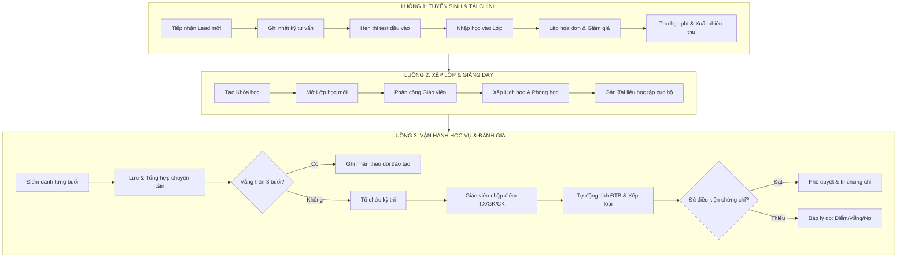

# TÀI LIỆU KIẾN TRÚC HỆ THỐNG VÀ CHI TIẾT LUỒNG NGHIỆP VỤ ECMS
*(English Center Management System - Hệ thống Quản trị Trung tâm Anh ngữ Ngoại tuyến)*

---

## MỤC LỤC
1. [TỔNG QUAN KIẾN TRÚC HỆ THỐNG & ĐẶC THÙ OFFLINE SQLITE](#1-tổng-quan-kiến-trúc-hệ-thống--đặc-thù-offline-sqlite)
2. [SƠ ĐỒ THỰC THỂ & MÔ HÌNH DỮ LIỆU CỐT LÕI (DATA SCHEMA)](#2-sơ-đồ-thực-thể--mô-hình-dữ-liệu-cốt-lõi-data-schema)
3. [BẢN ĐỒ LUỒNG ĐIỀU HƯỚNG TỔNG THỂ (SYSTEM WORKFLOW)](#3-bản-đồ-luồng-điều-hướng-tổng-thể-system-workflow)
4. [CHI TIẾT TỪNG PHÂN HỆ: GIAO DIỆN, THUỘC TÍNH, ĐẦU VÀO / ĐẦU RA](#4-chi-tiết-từng-phân-hệ-giao-diện-thuộc-tính-đầu-vào--đầu-ra)
   - [Phân hệ A: Tổng quan điều hành (Dashboard)](#phân-hệ-a-tổng-quan-điều-hành-dashboard)
   - [Phân hệ B: Đào tạo & Học vụ (Academic Management)](#phân-hệ-b-đào-tạo--học-vụ-academic-management)
   - [Phân hệ C: Tuyển sinh & Tài chính (Admissions & Finance)](#phân-hệ-c-tuyển-sinh--tài-chính-admissions--finance)
   - [Phân hệ D: Nhân sự & Hệ thống (Staff & System Administration)](#phân-hệ-d-nhân-sự--hệ-thống-staff--system-administration)
   - [Luồng Không gian Giáo viên (Teacher Workspace)](#luồng-không-gian-giáo-viên-teacher-workspace)
   - [Luồng Không gian Học viên (Student Portal)](#luồng-không-gian-học-viên-student-portal)
5. [GIẢI MÃ NGUYÊN NHÂN LỖI WINFORMS DESIGNER Ở 3 FILE](#5-giải-mã-nguyên-nhân-lỗi-winforms-designer-ở-3-file)
6. [HƯỚNG DẪN TINH CHỈNH GIAO DIỆN BỚT RƯỜM RÀ & TỐI ƯU UX/UI](#6-hướng-dẫn-tinh-chỉnh-giao-diện-bớt-rườm-rà--tối-ưu-uxui)

---

## 1. TỔNG QUAN KIẾN TRÚC HỆ THỐNG & ĐẶC THÙ OFFLINE SQLITE

### 1.1. Triết lý thiết kế hệ thống
* **100% Ngoại tuyến (Local Workstation):** Dữ liệu được lưu trữ trực tiếp trong tệp CSDL SQLite duy nhất tại `C:\ECMS\Data\ecms.db`.
* **Không phụ thuộc Internet:** Không gọi API đám mây, không gửi SMS/Email trực tuyến. Mọi thông báo, xếp lớp, thu tiền, in ấn phiếu thu và chứng chỉ đều diễn ra cục bộ trong máy tính của trung tâm.
* **Tốc độ phản hồi tức thì (Sub-millisecond latency):** Do đọc ghi trực tiếp SQLite máy trạm, thao tác lọc, tìm kiếm, tính toán điểm trung bình và công nợ diễn ra tức thì.

### 1.2. Ba không gian người dùng độc lập (Role-based Workspaces)
1. **Không gian Quản trị / Nhân viên (`Admin / Staff`):** Toàn quyền truy cập 4 phân hệ lớn: Tổng quan, Đào tạo, Tuyển sinh & Tài chính, Nhân sự & Hệ thống.
2. **Không gian Giáo viên (`Teacher`):** Giao diện tập trung vào giảng dạy: Điểm danh buổi học, Theo dõi chuyên cần, Tạo bài kiểm tra, Lưới nhập điểm. Tuyệt đối không can thiệp học phí hay cấu hình trung tâm.
3. **Không gian Học viên (`Student`):** Chế độ Chỉ đọc (Read-only): Xem sổ điểm cá nhân, biểu đồ tiến bộ, tỷ lệ chuyên cần, trạng thái học phí và chứng chỉ.

---

## 2. SƠ ĐỒ THỰC THỂ & MÔ HÌNH DỮ LIỆU CỐT LÕI (DATA SCHEMA)

```mermaid
erDiagram
    LEAD ||--o| STUDENT : "Chuyển đổi thành"
    LEAD ||--o{ CONSULTATION_LOG : "Có lịch sử tư vấn"
    STUDENT ||--o{ STUDENT_PARENT : "Có liên hệ"
    PARENT ||--o{ STUDENT_PARENT : "Đại diện"
    STUDENT ||--o{ ENROLLMENT : "Đăng ký học"
    COURSE ||--o{ CLASS : "Tạo lớp từ khóa"
    CLASS ||--o{ ENROLLMENT : "Tiếp nhận học viên"
    CLASS ||--o{ CLASS_SCHEDULE : "Có lịch học"
    TEACHER ||--o{ CLASS : "Chủ nhiệm/Giảng dạy"
    CLASS_ROOM ||--o{ CLASS_SCHEDULE : "Địa điểm buổi học"
    CLASS_SCHEDULE ||--o{ ATTENDANCE_RECORD : "Ghi nhận chuyên cần"
    STUDENT ||--o{ ATTENDANCE_RECORD : "Tham dự"
    CLASS ||--o{ EXAM : "Tổ chức kiểm tra"
    EXAM ||--o{ EXAM_SCORE : "Có điểm số"
    STUDENT ||--o{ EXAM_SCORE : "Đạt điểm"
    ENROLLMENT ||--o| INVOICE : "Phát sinh học phí"
    INVOICE ||--o{ PAYMENT : "Thu tiền mặt/CK"
    ENROLLMENT ||--o| CERTIFICATE : "Xét cấp chứng chỉ"
```

---

## 3. BẢN ĐỒ LUỒNG ĐIỀU HƯỚNG TỔNG THỂ (SYSTEM WORKFLOW)



---

## 4. CHI TIẾT TỪNG PHÂN HỆ: GIAO DIỆN, THUỘC TÍNH, ĐẦU VÀO / ĐẦU RA

---

### PHÂN HỆ A: TỔNG QUAN ĐIỀU HÀNH (DASHBOARD)

#### 1. Màn hình Tổng quan (`DashboardOverviewView`)
* **Mục đích:** Trung tâm điều hành cung cấp góc nhìn 360° về toàn bộ hoạt động trung tâm trong ngày/tháng dành cho Giám đốc và Quản lý.
* **Đầu vào (Input):**
  * Lọc tháng/năm (`cboMonth`).
  * Lọc theo nhóm khóa học (`cboCourse`).
  * Dữ liệu tổng hợp từ SQLite (học viên đang học, doanh thu đã thu, lớp đang mở, nợ tồn).
* **Đầu ra (Output):**
  * 6 Thẻ KPI: Học viên đang học, Doanh thu tháng, Lớp đang học, Tỷ lệ chuyên cần toàn trung tâm, Công nợ học phí, Khách tiềm năng mới.
  * 2 Biểu đồ cột mini (`MiniBarChart`): Doanh thu thực thu 4 tuần, Xu hướng học viên mới.
  * 2 Bảng cảnh báo: Lịch học diễn ra hôm nay (phòng, giáo viên), Danh sách công việc cần xử lý gấp (học viên vắng > 3 buổi, công nợ quá hạn).
* **Bảng trường thuộc tính:**

| Trường thuộc tính | Ý nghĩa nghiệp vụ | Nguồn lấy dữ liệu | Kiểu dữ liệu / Hiển thị |
| :--- | :--- | :--- | :--- |
| `ActiveStudentsCount` | Số học viên đang có lớp học active | Đếm từ bảng `Enrollment` (Status = Active) | `int` (VD: `348`) |
| `MonthRevenue` | Tổng tiền mặt đã thu trong tháng | Tổng `PaidAmount` từ `Payment` trong tháng | `decimal` (VD: `186,5 tr`) |
| `ActiveClassesCount` | Số lớp đang trong thời gian học | Đếm từ bảng `Class` (Status = InProgress) | `int` (VD: `18`) |
| `AttendanceRate` | Tỷ lệ chuyên cần trung bình | `(Có mặt + Muộn) / Tổng lượt` | `string` (VD: `92,4%`) |
| `TotalDebt` | Tổng tiền học phí chưa thu | Tổng `BalanceDue` từ `Invoice` | `decimal` (VD: `42,9 tr`) |
| `TodaySchedules` | Danh sách ca học trong ngày | Lọc từ `ClassSchedule` với `Date = Today` | DataGridView |

---

### PHÂN HỆ B: ĐÀO TẠO & HỌC VỤ (ACADEMIC MANAGEMENT)

#### 1. Màn hình Quản lý Học viên (`StudentManagementView` + `StudentDetailDialog`)
* **Mục đích:** Quản lý hồ sơ nhân khẩu học, lịch sử học tập, tình trạng công nợ và liên hệ phụ huynh.
* **Đầu vào:**
  * Từ khóa tìm kiếm: Mã học viên, Tên, Số điện thoại.
  * Bộ lọc lớp học (`cboClassFilter`), Trạng thái (`Đang học`, `Bảo lưu`, `Đã tốt nghiệp`).
* **Đầu ra:**
  * Bảng danh sách học viên kèm badge trạng thái màu sắc.
  * Mở hồ sơ 360° (`StudentDetailDialog`), mở Sổ điểm cá nhân hoặc nộp học phí nhanh.
* **Bảng trường thuộc tính:**

| Trường thuộc tính | Bắt buộc | Nguồn dữ liệu | Mô tả chi tiết |
| :--- | :---: | :--- | :--- |
| `StudentCode` | Có | Tự sinh `HV-yyyy-xxxx` | Mã định danh duy nhất của học viên |
| `FullName` | Có | Người dùng nhập | Họ và tên học viên |
| `DateOfBirth` | Có | DatePicker | Ngày tháng năm sinh (tính độ tuổi) |
| `Gender` | Có | Radio/ComboBox | Giới tính (Nam / Nữ) |
| `Phone` | Có | Người dùng nhập | SĐT liên hệ chính (học viên hoặc phụ huynh) |
| `Email` | Không | Người dùng nhập | Email trao đổi tài liệu |
| `CurrentClass` | Tự động | Bảng `Enrollment` + `Class` | Tên lớp đang theo học (VD: `IELTS-F01`) |
| `AttendanceRate` | Tự động | Bảng `AttendanceRecord` | Tỷ lệ chuyên cần cá nhân (VD: `87,5%`) |
| `DebtBalance` | Tự động | Bảng `Invoice` | Số dư công nợ còn lại (VD: `1.900.000đ`) |
| `ParentName` | Có | Bảng `Parent` | Họ tên phụ huynh/người giám hộ |
| `ParentPhone` | Có | Bảng `Parent` | Số điện thoại liên hệ khẩn cấp |

---

#### 2. Màn hình Quản lý Khóa học (`CourseManagementView` + `CourseEditDialog`)
* **Mục đích:** Chuẩn hóa chương trình đào tạo của trung tâm (IELTS, TOEIC, Giao tiếp).
* **Đầu vào:** Tên khóa, mã khóa, số buổi, học phí niêm yết, chuẩn đầu ra.
* **Đầu ra:** Danh sách khóa học làm gốc để nhân bản thành các lớp học cụ thể.
* **Bảng trường thuộc tính:**

| Trường thuộc tính | Bắt buộc | Ý nghĩa nghiệp vụ | Ràng buộc logic |
| :--- | :---: | :--- | :--- |
| `CourseCode` | Có | Mã khóa học (VD: `KH-IELTS-F`) | Duy nhất trong toàn hệ thống |
| `CourseName` | Có | Tên khóa (VD: `IELTS Foundation`) | Không được để trống |
| `TotalSessions` | Có | Tổng số buổi học trong khóa | Số nguyên dương (VD: `24` buổi) |
| `TotalHours` | Có | Tổng số giờ đào tạo | VD: `48` giờ |
| `BaseTuitionFee`| Có | Học phí gốc niêm yết | Mặc định điền vào Invoice khi xếp lớp |
| `PassingScore` | Có | Điểm sàn đạt yêu cầu tốt nghiệp | Mặc định `6.5` / 10 |

---

#### 3. Màn hình Quản lý Lớp học (`ClassManagementView` + `CreateClassDialog` + `ClassDetailDialog`)
* **Mục đích:** Quản lý thực thể lớp học thực tế: Ngày khai giảng, giáo viên, phòng học, sĩ số hiện tại.
* **Đầu vào:** Chọn khóa học gốc, chọn giáo viên chủ nhiệm, chọn phòng học, khung ngày bắt đầu.
* **Đầu ra:** Mã lớp học, bảng theo dõi tiến độ buổi học (VD: `8/24 buổi đã học`), danh sách học viên theo lớp.
* **Bảng trường thuộc tính:**

| Trường thuộc tính | Bắt buộc | Nguồn dữ liệu | Ràng buộc logic |
| :--- | :---: | :--- | :--- |
| `ClassCode` | Có | Tự sinh (VD: `IELTS-F01`) | Mã lớp học duy nhất |
| `ClassName` | Có | Người dùng nhập | Tên hiển thị của lớp |
| `CourseId` | Có | ComboBox chọn từ `Course` | Kế thừa số buổi, học phí và điểm đạt |
| `MainTeacherId` | Có | ComboBox chọn từ `Teacher` | Giáo viên phụ trách chính |
| `DefaultRoomId` | Có | ComboBox chọn từ `ClassRoom` | Phòng học cố định |
| `StartDate` / `EndDate` | Có | DatePicker | Khoảng thời gian diễn ra lớp học |
| `MaxStudents` | Có | Người dùng nhập (VD: `18`) | Cảnh báo khi vượt sĩ số tối đa |
| `Status` | Tự động | Enum `ClassStatus` | `Sắp mở`, `Đang học`, `Đã kết thúc` |

---

#### 4. Màn hình Thời khóa biểu & Phòng học (`ScheduleManagementView` + `CreateScheduleDialog`)
* **Mục đích:** Xếp lịch học theo tuần dạng ma trận (Thứ $\times$ Ca học), chống xung đột phòng và giáo viên.
* **Đầu vào:** Chọn lớp, chọn thứ trong tuần (T2/T5, T3/T6), chọn ca học (18:00–20:00), chọn phòng.
* **Đầu ra:** Lưới lịch học trực quan màu sắc. Khi có 2 lớp cùng đặt 1 phòng trong 1 khung giờ $\rightarrow$ Báo đỏ xung đột.
* **Bảng trường thuộc tính:**

| Trường thuộc tính | Bắt buộc | Mô tả | Kiểm tra hợp lệ (Validation) |
| :--- | :---: | :--- | :--- |
| `SessionNumber` | Có | Buổi số mấy (VD: `Buổi 08/24`) | Tự động tăng từ 1 đến TotalSessions |
| `Date` | Có | Ngày diễn ra buổi học | Phải nằm giữa `StartDate` và `EndDate` |
| `TimeSlot` | Có | Giờ bắt đầu – Giờ kết thúc | VD: `18:00 - 20:00` |
| `RoomId` | Có | Phòng học được gán | Kiểm tra không có ca học khác cùng giờ tại phòng |
| `TeacherId` | Có | Giáo viên đứng lớp | Kiểm tra giáo viên không bị trùng lịch lớp khác |

---

#### 5. Màn hình Tài liệu học tập cục bộ (`StudyMaterialView`)
* **Mục đích:** Quản lý đường dẫn các tệp PDF, MP3, Bài tập nằm trên máy trạm cục bộ của trung tâm.
* **Đầu vào:** Tên tài liệu, phiên bản, chọn tệp từ máy trạm (`OpenFileDialog`), gán vào khóa học.
* **Đầu ra:** Kiểm tra trạng thái tồn tại của file trên ổ đĩa (`File.Exists`), cảnh báo nếu file bị di chuyển/xóa.
* **Bảng trường thuộc tính:**

| Trường thuộc tính | Bắt buộc | Mô tả | Nguồn dữ liệu |
| :--- | :---: | :--- | :--- |
| `FileName` | Có | Tên hiển thị của tài liệu | VD: `Foundation_Workbook_v1.2.pdf` |
| `Version` | Có | Phiên bản tài liệu | VD: `1.2` |
| `CourseId` | Có | Khóa học được gán tài liệu | ComboBox chọn từ `Course` |
| `LocalPath` | Có | Đường dẫn tuyệt đối trên máy | VD: `C:\ECMS\TaiLieu\IELTS\Workbook.pdf` |
| `FileSize` | Tự động | Kích thước file trên đĩa | VD: `12,8 MB` |
| `Status` | Tự động | Trạng thái kiểm tra tệp | `✓ Tệp khả dụng` hoặc `✕ Không tìm thấy tệp` |

---

#### 6. Màn hình Xét duyệt & In Chứng chỉ (`CertificateManagementView` + `ApproveCertificateDialog`)
* **Mục đích:** Tự động đối chiếu điều kiện tốt nghiệp của học viên và in phôi chứng chỉ hoàn thành khóa học.
* **Đầu vào:** Lọc theo Lớp học đã kết thúc.
* **Quy tắc xét duyệt 3 chiều (MANDATORY):**
  1. **Điểm số:** Điểm trung bình khóa học $\ge 6,5$ / 10.
  2. **Chuyên cần:** Tỷ lệ tham dự $\ge 80\%$ trên tổng số buổi học.
  3. **Tài chính:** Công nợ còn lại $= 0đ$ (Đã hoàn tất 100% học phí).
* **Đầu ra:**
  * Bảng kết luận: `✓ Đạt` (Đủ điều kiện cấp) hoặc `✕ Không đạt` (Chỉ rõ lý do: do Điểm kém, do Vắng $>20\%$ hay do Còn nợ tiền).
  * Sổ cấp chứng chỉ tự sinh số hiệu: `CC-yyyy-xxxx`.
  * Xem trước phôi in ấn (`CertificatePrintPreviewDialog`).
* **Bảng trường thuộc tính:**

| Trường thuộc tính | Bắt buộc | Mô tả | Điều kiện khóa nút Cấp |
| :--- | :---: | :--- | :--- |
| `CertificateNo` | Có | Số chứng chỉ (VD: `CC-2026-0182`) | Tự động sinh tăng dần theo năm |
| `FinalScore` | Tự động | Điểm trung bình cuối khóa | Nếu $< 6.5 \rightarrow$ Khóa nút |
| `AttendanceRate` | Tự động | Tỷ lệ tham dự lớp học | Nếu $< 80\% \rightarrow$ Khóa nút |
| `BalanceDue` | Tự động | Số tiền công nợ còn lại | Nếu $> 0đ \rightarrow$ Khóa nút |
| `IssueDate` | Có | Ngày ký cấp chứng chỉ | Mặc định ngày hiện tại |
| `SignerName` | Có | Người ký chứng chỉ | Lấy từ Cấu hình Giám đốc trung tâm |

---

### PHÂN HỆ C: TUYỂN SINH & TÀI CHÍNH (ADMISSIONS & FINANCE)

#### 1. Màn hình Quản lý Tuyển sinh (`AdmissionsView` + `AddLeadDialog` + `ConsultationDialog` + `EnrollmentDialog`)
* **Mục đích:** Vận hành phễu tuyển sinh từ lúc khách hàng liên hệ đến khi chuyển thành học viên chính thức.
* **Luồng 4 trạng thái:** `Mới tiếp nhận` $\rightarrow$ `Đang tư vấn` $\rightarrow$ `Hẹn test đầu vào` $\rightarrow$ `Đã nhập học`.
* **Đầu vào:** Thông tin khách tiềm năng, nguồn tiếp cận (Facebook, Bạn bè, Trực tiếp), điểm test đầu vào.
* **Đầu ra:** Chuyển đổi Lead thành Student (`HV-xxxx`) và lập hóa đơn học phí tương ứng.
* **Bảng trường thuộc tính:**

| Trường thuộc tính | Bắt buộc | Nguồn dữ liệu | Chức năng nghiệp vụ |
| :--- | :---: | :--- | :--- |
| `LeadName` | Có | Người dùng nhập | Họ tên người có nhu cầu học |
| `Phone` | Có | Người dùng nhập | SĐT để tư vấn viên gọi điện |
| `Source` | Có | ComboBox chọn | Kênh tiếp cận (Trực tiếp, Fanpage, Giới thiệu) |
| `Status` | Có | Enum `LeadStatus` | Trạng thái trong phễu tư vấn |
| `TestScore` | Không | Kết quả thi thử | Điểm test đầu vào (dùng để gợi ý lớp phù hợp) |
| `ProposedCourse`| Không | Tư vấn viên đề xuất | Khóa học phù hợp với trình độ |

---

#### 2. Màn hình Học phí & Thu tiền (`TuitionPaymentView` + `CollectTuitionDialog` + `ReceiptPrintPreviewDialog`)
* **Mục đích:** Theo dõi toàn bộ công nợ học phí và xuất phiếu thu tiền mặt / chuyển khoản chuẩn A5/A4.
* **Đầu vào:** Chọn học viên cần thu $\rightarrow$ Nhập số tiền thu đợt này $\rightarrow$ Chọn hình thức (Tiền mặt/Chuyển khoản).
* **Đầu ra:**
  * Cập nhật công nợ học viên giảm xuống.
  * Tự sinh mã phiếu thu `PT-yyyyMMdd-xxxx`.
  * Hộp thoại xem trước bản in phiếu thu tiền mặt không cần kết nối mạng.
* **Bảng trường thuộc tính:**

| Trường thuộc tính | Bắt buộc | Nguồn dữ liệu | Ràng buộc tính toán |
| :--- | :---: | :--- | :--- |
| `OriginalFee` | Tự động | Học phí gốc từ `Course` | Mức học phí chuẩn |
| `DiscountAmount`| Không | Chính sách giảm giá | Số tiền hoặc % học bổng giảm trừ |
| `FinalAmount` | Tự động | Công thức | $= OriginalFee - DiscountAmount$ |
| `PaidAmount` | Có | Người nộp đóng đợt này | Phải $\le$ Số tiền công nợ hiện tại |
| `BalanceDue` | Tự động | Công thức | $= FinalAmount - \sum(PaidAmount)$ |
| `ReceiptCode` | Tự động | Tự sinh theo ngày | VD: `PT-261002-006` |
| `CashierName` | Tự động | Tài khoản đang đăng nhập | Tên nhân viên kế toán lập phiếu thu |

---

### PHÂN HỆ D: NHÂN SỰ & HỆ THỐNG (STAFF & SYSTEM ADMINISTRATION)

#### 1. Màn hình Quản lý Nhân viên (`StaffManagementView`)
* **Mục đích:** Quản lý nhân sự hành chính (Tư vấn, Kế toán, Đào tạo, Admin) và liên kết với tài khoản đăng nhập.
* **Bảng trường thuộc tính:** `Mã nhân viên (NV-xxx)`, `Họ tên`, `Bộ phận`, `Điện thoại`, `Email`, `Ngày vào làm`, `Trạng thái`, `Tài khoản liên kết`.

#### 2. Màn hình Thông báo nội bộ (`InternalNotificationView`)
* **Mục đích:** Bảng tin nội bộ trên máy trạm để các ca trực giao việc và thông báo cho giáo viên, nhân viên.
* **Bảng trường thuộc tính:** `Tiêu đề`, `Người nhận theo vai trò (Học viên, Phụ huynh, Giáo viên, Tư vấn, Kế toán, Đào tạo)`, `Phạm vi lớp`, `Nội dung`, `Trạng thái (Bản nháp / Đã phát hành)`.

#### 3. Màn hình Cấu hình hệ thống & Sao lưu (`SystemConfigView` + `CreateBackupDialog` + `RestoreDatabaseDialog`)
* **Mục đích:** Cài đặt tham số trung tâm, công thức tính điểm và sao lưu SQLite an toàn.
* **Bảng trường thuộc tính:**
  * Thông tin trung tâm: Tên trung tâm, SĐT, Địa chỉ, Giám đốc ký tên.
  * Vị trí file CSDL: `C:\ECMS\Data\ecms.db`.
  * Quy tắc điểm: Tỷ trọng Thường xuyên ($20\%$) + Giữa khóa ($30\%$) + Cuối khóa ($50\%$) = Đúng $100\%$.
  * Thư mục sao lưu: `D:\ECMS_Backup\ecms_YYYYMMDD_HHmm.db`.

---

### LUỒNG KHÔNG GIAN GIÁO VIÊN (TEACHER WORKSPACE)

#### 1. Màn hình Điểm danh buổi học (`TeacherAttendanceCheckView`)
* **Mục đích:** Giáo viên điểm danh học viên từng buổi học với tốc độ nhanh nhất.
* **Thao tác:** Bấm *"Đánh dấu tất cả Có mặt"* $\rightarrow$ Chọn học viên đi muộn / vắng $\rightarrow$ Bấm *"Lưu điểm danh"*.
* **Bảng trường thuộc tính:** `Học viên`, `Có mặt (Radio)`, `Vắng có phép (Radio)`, `Vắng không phép (Radio)`, `Đi muộn (Radio)`, `Ghi chú phụ huynh`.
* **5 Thẻ số liệu:** Tổng học viên (18), Có mặt (15), Đi muộn (1), Vắng (2), Tỷ lệ dự kiến (88,9%).

#### 2. Màn hình Tổng hợp chuyên cần (`TeacherAttendanceSummaryView`)
* **Mục đích:** Tự động tổng kết số buổi có mặt/vắng của từng bạn trong cả khóa.
* **Cảnh báo vắng $>3$ buổi:** Khi học viên vắng từ buổi thứ 4 trở đi $\rightarrow$ Hệ thống tự hiển thị thông tin liên hệ phụ huynh và cho phép giáo viên bấm nút *"Ghi nhận yêu cầu theo dõi"* gửi phòng Đào tạo.

#### 3. Màn hình Lưới nhập điểm & Kiểm soát lỗi (`TeacherGradeEntryView`)
* **Mục đích:** Giáo viên nhập điểm bài thi cho học viên, ngăn ngừa sai sót nhập liệu.
* **Cơ chế khóa an toàn (Data Guard):**
  * Thang điểm: $0 – 10$.
  * Nếu giáo viên gõ nhầm điểm $> 10$ (VD: gõ `11`): Hệ thống **viền đỏ ô nhập**, hiện cảnh báo *"Chỉ nhận 0–10. Nhập 8,0 để sửa lỗi"* và **KHÓA NÚT LƯU ĐIỂM**.
  * Khi nhập điểm hợp lệ: Tự động tính điểm trung bình $TX(20\%) + GK(30\%) + CK(50\%)$ và tự động xếp loại `✓ Đạt` hoặc `✕ Không đạt`.

---

### LUỒNG KHÔNG GIAN HỌC VIÊN (STUDENT PORTAL)

#### Màn hình Sổ điểm cá nhân (`StudentGradeReportView`)
* **Mục đích:** Học viên tra cứu kết quả học tập của chính mình (Chế độ Chỉ đọc - Read-only, không có nút sửa điểm).
* **Đầu ra:**
  * 4 Thẻ điểm: Thường xuyên (7,0), Giữa khóa (7,5), Cuối khóa (8,0), Điểm trung bình (7,7 - Khá, Đạt).
  * Biểu đồ cột mini (`MiniBarChart`) biểu diễn sự tiến bộ: Đầu vào (4.5) $\rightarrow$ TX (7.0) $\rightarrow$ GK (7.5) $\rightarrow$ CK (8.0).
  * Đánh giá 3 chiều: Chuyên cần 91,7%, Học phí nợ 0đ, Trạng thái chứng chỉ: Đạt điều kiện cấp.

---

## 5. GIẢI MÃ NGUYÊN NHÂN LỖI WINFORMS DESIGNER Ở 3 FILE

Bạn gặp hiện tượng 3 file không mở được trong Designer của Visual Studio / Rider:

### 1. File `DashboardOverviewView.cs`:
* **Nguyên nhân:** File này hiện tại đang được viết **100% bằng code C# thuần trong 1 file duy nhất** (khởi tạo control trong code C#), **CHƯA ĐƯỢC TÁCH** thành cặp file chuẩn WinForms Designer: `DashboardOverviewView.cs` và `DashboardOverviewView.Designer.cs`.
* WinForms Designer chỉ có thể mở khi UserControl có partial class kế thừa `UserControl` và có phương thức `InitializeComponent()` nằm trong file `.Designer.cs`.

### 2. File `ReportManagementView` và `StudentGradeReportView`:
* **Nguyên nhân:** Trong file `.Designer.cs` của 2 view này có chứa các Custom Control được tạo trong project (`MiniBarChart`, `AppCard`, `AppDataGrid`, `AppStatCard`).
* Khi Designer của Visual Studio / Rider mở một UserControl, nếu solution **chưa được Build ở cấu hình x64/AnyCPU**, hoặc nếu constructor của control cha gọi các hàm tính toán dữ liệu mà không bọc trong điều kiện:
  ```csharp
  if (!DesignMode)
  {
      // Không nạp dữ liệu thật khi đang mở trong Designer
  }
  ```
  thì Designer sẽ cố chạy code thật, không tìm thấy kết nối SQLite và báo lỗi `The designer could not be loaded`.

---

## 6. HƯỚNG DẪN TINH CHỈNH GIAO DIỆN BỚT RƯỜM RÀ & TỐI ƯU UX/UI

Để giao diện gọn gàng, thanh lịch và không bị cảm giác "quá nhiều chữ / quá nhiều nút":

1. **Nguyên tắc "Một hành động chính trên một màn hình":**
   * Trong một khu vực, chỉ giữ **1 nút màu xanh đậm (Primary)** cho việc quan trọng nhất (như *Lưu*, *Thêm mới*, *Điểm danh*).
   * Các nút hủy, quay lại, xuất file nên chuyển thành nút viền mỏng màu xám (Secondary) để mắt người dùng không bị phân tâm.
2. **Ẩn các thông tin kỹ thuật không cần thiết:**
   * Những trường như ID tự tăng nội bộ CSDL (`EnrollmentId`, `InvoiceId`) không cần đưa lên màn hình cho người dùng xem; chỉ hiển thị các mã có nghĩa như `HV-0204`, `PT-261002-006`.
3. **Sắp xếp theo thứ tự mắt đọc F-Pattern:**
   * Thanh tìm kiếm & bộ lọc luôn nằm trên cùng bên trái.
   * Nút hành động chính luôn nằm góc trên cùng bên phải.
   * Dữ liệu chính (bảng danh sách) chiếm 60–70% chiều rộng bên trái; bảng chi tiết/chỉnh sửa chiếm 30–40% bên phải.
4. **Kích hoạt chống nhấp nháy (DoubleBuffered):**
   * Trong constructor của các form và user control, luôn bật `DoubleBuffered = true` để khi đổi tab màn hình không bị giật/nháy khung hình.
