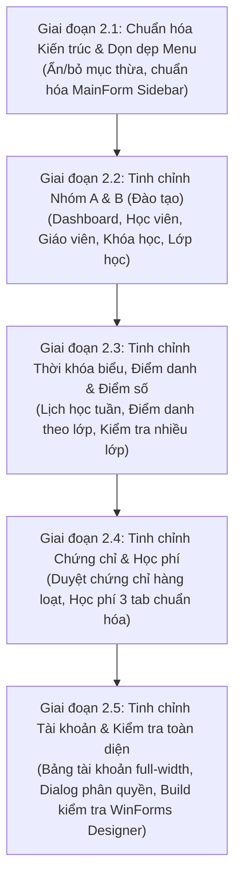

# KẾ HOẠCH CHI TIẾT TINH CHỈNH GIAO DIỆN ECMS (PHASE 1: KHẢO SÁT & ĐẶC TẢ)

> **Tài liệu:** Đề án tinh chỉnh toàn diện hệ thống giao diện WinForms - English Center Management System (ECMS)  
> **Người đề xuất:** Võ Trường Giang  
> **Người lập kế hoạch kỹ thuật:** Đội ngũ AI Assistant  
> **Trạng thái:** Chờ User duyệt (Giai đoạn 1)  
> **Nguyên tắc cốt lõi:** 100% WinForms Designer kéo thả, dọn dẹp bố cục thừa, chuẩn hóa DataGridView cuộn (loại bỏ phân trang Web), thống nhất luồng nghiệp vụ trung tâm Anh ngữ thực tế.

---

## MỤC LỤC
1. [TỔNG QUAN HIỆN TRẠNG & CÁC VẤN ĐỀ TỒN TẠI](#1-tổng-quan-hiện-trạng--các-vấn-đề-tồn-tại)
2. [CÁC QUY CHUẨN THIẾT KẾ DÙNG CHUNG (DESIGN SYSTEM)](#2-các-quy-chuẩn-thiết-kế-dùng-chung-design-system)
3. [ĐỀ XUẤT ĐIỀU CHỈNH CHI TIẾT THEO TỪNG MÀN HÌNH](#3-đề-xuất-điều-chỉnh-chi-tiết-theo-từng-màn-hình)
   - 3.1. [Trang Đăng nhập (LoginForm)](#31-trang-đăng-nhập-loginform)
   - 3.2. [Tổng quan (DashboardOverviewView)](#32-tổng-quan-dashboardoverviewview)
   - 3.3. [Học viên (StudentManagementView & Dialogs)](#33-học-viên-studentmanagementview--dialogs)
   - 3.4. [Giáo viên (TeacherManagementView & Dialogs)](#34-giáo-viên-teachermanagementview--dialogs)
   - 3.5. [Khóa học (CourseManagementView & Dialogs)](#35-khóa-học-coursemanagementview--dialogs)
   - 3.6. [Lớp học (ClassManagementView & Dialogs)](#36-lớp-học-classmanagementview--dialogs)
   - 3.7. [Lịch học & Phòng học (ScheduleManagementView & Dialogs)](#37-lịch-học--phòng-học-schedulemanagementview--dialogs)
   - 3.8. [Điểm danh (AttendanceManagementView & Dialogs)](#38-điểm-danh-attendancemanagementview--dialogs)
   - 3.9. [Kiểm tra & Điểm số (GradeExamManagementView & Dialogs)](#39-kiểm-tra--điểm-số-gradeexammanagementview--dialogs)
   - 3.10. [Chứng chỉ & Tốt nghiệp (CertificateManagementView & Dialogs)](#310-chứng-chỉ--tốt-nghiệp-certificatemanagementview--dialogs)
   - 3.11. [Học phí & Thanh toán (TuitionPaymentView & Dialogs)](#311-học-phí--thanh-toán-tuitionpaymentview--dialogs)
   - 3.12. [Tài khoản & Phân quyền (AccountManagementView & Dialogs)](#312-tài-khoản--phân-quyền-accountmanagementview--dialogs)
4. [DANH SÁCH FORM / USERCONTROL LOẠI BỎ, BỔ SUNG & GIỮ LẠI](#4-danh-sách-form--usercontrol-loại-bỏ-bổ-sung--giữ-lại)
5. [LỘ TRÌNH THỰC HIỆN THEO TỪNG MODULE (PHASE 2 WORKFLOW)](#5-lộ-trình-thực-hiện-theo-từng-module-phase-2-workflow)

---

## 1. TỔNG QUAN HIỆN TRẠNG & CÁC VẤN ĐỀ TỒN TẠI

### 1.1. Hiện trạng kiến trúc giao diện
- **Công nghệ:** C# 13, .NET 10, Windows Forms, Local SQLite Database (`ecms.db`).
- **Sidebar chính (MainForm):** Hiện có 14 mục chia làm 4 nhóm (A - Tổng quan, B - Đào tạo, C - Tuyển sinh & Tài chính, D - Nhân sự & Hệ thống).
- **Các thành phần giao diện hiện có:** 16 UserControls chính và 21 Dialogs.

### 1.2. Những vấn đề tồn tại cốt lõi
1. **Bố cục bị chia cắt nhiều panel con (Splits/Side panels rườm rà):**
   - Hầu hết các màn hình (Giáo viên, Khóa học, Lớp học, Tài khoản) đang chia thành: Nửa trái là Bảng, Nửa phải là Panel xem chi tiết hoặc form thêm/sửa cố định.
   - *Hậu quả:* Bảng bị bóp nghẹt chiều ngang, chữ bị co cụm, trong khi panel bên phải chiếm diện tích lớn và gây rối mắt.
2. **Sử dụng phong cách phân trang dạng Web ("1-5 / 348", "Trước [1] 2 Sau"):**
   - Không phù hợp với ứng dụng Desktop Windows Forms, gây ức chế cho người dùng khi phải bấm lật từng trang thay vì lăn chuột cuộn (Scroll) tự nhiên.
3. **Bộ lọc và thanh tìm kiếm rời rạc:**
   - Nhiều màn hình đặt thanh tìm kiếm một nơi, ô lọc trạng thái một nẻo, không nằm chung trên 1 thẻ Panel đồng nhất.
4. **Trùng lặp và phân mảnh nghiệp vụ:**
   - *Tuyển sinh* vs *Học viên*: Trùng lặp quy trình đăng ký.
   - *Nhân viên* vs *Tài khoản*: Tách riêng hồ sơ nhân sự và tài khoản đăng nhập khiến nhân viên phải nhập liệu 2 lần.
   - *Báo cáo & Thống kê*: Tạo màn hình riêng cồng kềnh trong khi số liệu quan trọng đã nằm sẵn ở từng nghiệp vụ tương ứng.
5. **Nhiều nút bấm thiếu đích đến hoặc sai luồng:**
   - Điểm danh đang thiết kế theo góc nhìn nhập tay đơn chiếc thay vì luồng quản trị: Lớp $\rightarrow$ Danh sách buổi học $\rightarrow$ Điểm danh buổi.
   - Kiểm tra điểm số chưa hỗ trợ gán 1 đề kiểm tra cho nhiều lớp.

---

## 2. CÁC QUY CHUẨN THIẾT KẾ DÙNG CHUNG (DESIGN SYSTEM)

Để đạt tính đồng nhất, hiện đại và sạch sẽ trên toàn bộ ứng dụng:

1. **Chuẩn hóa Bảng dữ liệu (AppDataGrid / DataGridView):**
   - **Loại bỏ 100% các thanh phân trang Web** ("Trước [1] 2 Sau", "1-5 / 348 học viên").
   - Kích hoạt tính năng cuộn mượt mà (`AutoScroll = true`, `ScrollBars = ScrollBars.Both`, `DoubleBuffered = true`).
   - Hàng được định dạng chiều cao chuẩn (`RowTemplate.Height = 40`), xen kẽ màu nền trắng / xám nhạt (`#F8FAFC`).
2. **Chuẩn hóa Khung tìm kiếm & Lọc (Filter Toolbar Panel):**
   - Tất cả ô tìm kiếm nhanh (`txtSearch`) + các ComboBox lọc danh mục/trạng thái đều được gom chung vào **1 Panel bo góc viền xám nhạt (Card Filter Bar)** đặt ngay trên bảng dữ liệu.
3. **Chuẩn hóa Hành động (Action Buttons):**
   - Nút hành động chính (Primary): Xanh dương đậm (`#2563EB`), bo góc 6px, chữ trắng đậm.
   - Nút thứ cấp (Secondary): Nền trắng, viền xám (`#CBD5E1`), chữ xanh đen (`#1E293B`).
   - Nút trên từng hàng của bảng: Thiết kế nút phẳng (Flat) thanh thoát, mở Dialog tương ứng.
4. **Bảo toàn 100% khả năng kéo thả trong WinForms Designer:**
   - Mọi form/UserControl đều có constructor gọi `InitializeComponent()`, kiểm tra guard `if (DesignMode) return;` trước khi nạp dữ liệu.
   - Không dựng giao diện động hoàn toàn bằng code C# tại runtime.

---

## 3. ĐỀ XUẤT ĐIỀU CHỈNH CHI TIẾT THEO TỪNG MÀN HÌNH

### 3.1. Trang Đăng nhập (`LoginForm`)
- **Hiện trạng:** Đơn điệu, màu sắc nhạt nhòa, thiếu điểm nhấn nhận diện thương hiệu.
- **Đề xuất điều chỉnh:**
  - Thiết kế lại panel thương hiệu bên trái: Nền xanh gradient hoặc Deep Navy (`#0F172A` / `#1E40AF`), logo trung tâm lớn có hiệu ứng viền bóng mượt, slogan hiện đại ("Hệ thống quản trị đào tạo ngoại ngữ toàn diện").
  - Panel đăng nhập bên phải: Ô nhập tài khoản, mật khẩu có icon trực quan (user, lock), viền bo mềm mại (`#E2E8F0`), nút con mắt ẩn/hiện mật khẩu, nút [Đăng nhập] nổi bật với hiệu ứng Hover/Click.

---

### 3.2. Tổng quan (`DashboardOverviewView`)
- **Hiện trạng:**
  - Thanh tìm kiếm và bộ lọc rời rạc.
  - Các cột biểu đồ vẽ tay tràn ra ngoài khung viền.
  - Thiếu nút xem chi tiết ở các khối thống kê.
- **Đề xuất điều chỉnh:**
  1. **Thanh công cụ trên cùng:** Đưa ô `Tìm nhanh học viên, lớp học...` cùng 2 ComboBox `Trạng thái` và `Cơ sở / Khóa học` vào **1 Panel thống nhất** có viền trắng bo góc.
  2. **Truy xuất thông tin nhanh:** Khi gõ từ khóa tìm kiếm (mã HV, tên lớp, khóa học) $\rightarrow$ Tự động mở Popup/Dialog xem chi tiết nhanh đối tượng đó (ở mức độ xem tra cứu).
  3. **Thẻ thống kê (StatCards):** Bỏ các dòng phụ đề nhỏ gây rối mắt bên dưới mỗi Card, chỉ giữ lại Số lượng lớn + Tên chỉ số rõ ràng.
  4. **Biểu đồ cột (Tăng trưởng & Doanh thu):**
     - Căn chỉnh lại tọa độ vẽ để các cột luôn nằm trọn trong khung viền (Padding an toàn).
     - Thêm tiêu đề góc trên bên trái: *"Biểu đồ tăng trưởng học viên"* và *"Biểu đồ doanh thu"*.
     - Thêm nút **[Xem chi tiết]** góc trên bên phải mỗi biểu đồ $\rightarrow$ Bấm vào mở Dialog bảng DataGridView đầy đủ số liệu theo từng tháng có cuộn chuột.
  5. **Chuyên cần lớp học & Lịch hôm nay:** Chuyển sang dạng DataGridView cuộn chuột + Nút [Xem chi tiết].
  6. **Khối việc cần xử lý:** Bỏ panel cố định rườm rà; thay bằng **Nút [Danh sách cần xử lý]** đặt ngay cạnh nút [Xuất báo cáo]. Khi click sẽ mở popup danh sách việc cần giải quyết dạng DataGridView.
  7. **Nút Xuất báo cáo:** Tạm thời giữ nguyên vị trí, sẽ nối chức năng xuất file sau.

---

### 3.3. Học viên (`StudentManagementView` & Dialogs)
- **Hiện trạng:**
  - Bảng học viên dùng phân trang kiểu web.
  - Nút thêm học viên chưa kết nối luồng đăng ký bài bản.
  - Dialog chi tiết học viên (`StudentDetailDialog`) có quá nhiều panel phân mảnh (Học phí, Lịch sử hồ sơ, các tab rời rạc).
- **Đề xuất điều chỉnh:**
  1. **Thanh tìm kiếm & lọc:** Gom ô tìm kiếm (Mã, Tên, SĐT) + ComboBox Trạng thái + ComboBox Lớp học vào 1 Panel Card duy nhất.
  2. **Bảng học viên:** Chuyển hoàn toàn sang DataGridView cuộn mượt mà. Bỏ dòng text phân trang `1-5 / 348` và `Trước [1] 2 Sau`.
  3. **Đổi nút `[+ Thêm học viên]` $\rightarrow$ `[+ Đăng ký học]`: Luồng đăng ký hoàn chỉnh:**
     - Mở `AddStudentDialog` đã tinh chỉnh: Bỏ hoàn toàn panel tuyển sinh bên phải, dàn đều form thông tin học viên.
     - Luồng 3 bước: Điền thông tin học viên $\rightarrow$ Chọn Khóa & Lớp học $\rightarrow$ Thanh toán học phí (đóng 1 lần hoặc trả góp tối đa 3 đợt) $\rightarrow$ Ghi nhận thành học viên chính thức.
  4. **Dialog Hồ sơ học viên (`StudentDetailDialog`):**
     - Bỏ Panel "Học phí lịch sử thu" và "Lịch sử hồ sơ" ở góc phải.
     - Bỏ tab "Lịch sử". Bỏ nút "Xem bảng điểm chi tiết" (vì đã hiển thị trong tab tiến trình).
     - **Gộp 4 tab (Lớp học, Điểm danh, Điểm số, Học phí) thành 1 tab duy nhất: `"Quá trình học tập (Gộp)"`**.
     - Trong bảng Quá trình học tập:
       - Bỏ dòng chữ phụ bên dưới (như `33%`, `Đầu vào 4.0`, `Tổng 6.000.000đ`).
       - Cột điểm tách rõ thành 3 cột chuẩn: **Thường xuyên | Giữa khóa | Cuối khóa**.
       - Bỏ cột thao tác dư thừa.
     - Nút `[Sửa hồ sơ]`: Mở form sửa thông tin học viên (sử dụng lại layout dialog thêm học viên).

---

### 3.4. Giáo viên (`TeacherManagementView` & Dialogs)
- **Hiện trạng:** Bị chia đôi màn hình: bên trái là bảng giáo viên hẹp, bên phải là panel chi tiết giáo viên cố định; có nút "Lưu phân công" không phù hợp.
- **Đề xuất điều chỉnh:**
  1. **Bỏ Panel chi tiết bên phải:** Kéo giãn bảng giáo viên ra full chiều ngang màn hình.
  2. **Thanh công cụ:** Đưa Tìm kiếm + Lọc trạng thái + Lọc chuyên môn vào 1 Panel chung.
  3. **Bảng giáo viên:** Chuyển sang DataGridView cuộn chuột. Bỏ nút "Lưu phân công" (vì phân công giáo viên sẽ được chọn trực tiếp khi Quản trị viên mở form Tạo lớp học).
  4. **Dialog Thêm/Sửa giáo viên (`AddTeacherDialog`):**
     - Bỏ panel phụ bên phải, dàn đều các trường thông tin cơ bản (Họ tên, SĐT, Email, Bằng cấp/Chứng chỉ, Chuyên môn).
     - Bổ sung khối: **"Thiết lập lịch rảnh & tải công việc"**:
       - Số giờ dạy tối đa / tuần (TextBox nhập số).
       - Khung giờ ưu tiên giảng dạy (Checkbox: Ca Sáng 8h-12h, Ca Chiều 13h30-17h30, Ca Tối 18h-21h).
       - Các ngày có thể giảng dạy (Checkbox: Thứ Hai $\rightarrow$ Chủ Nhật).

---

### 3.5. Khóa học (`CourseManagementView` & Dialogs)
- **Hiện trạng:**
  - Phía dưới màn hình có 2 panel con: Panel "Khóa học ví dụ" và Panel "Lớp học ví dụ" gây chật chội.
  - Dialog chi tiết khóa học có các thanh tab thừa thãi.
- **Đề xuất điều chỉnh:**
  1. **Màn hình chính:** Xóa bỏ hoàn toàn 2 panel con bên dưới. Kéo giãn bảng danh sách Khóa học ra toàn bộ khung nhìn, chuyển sang DataGridView.
  2. **Dialog Chi tiết khóa học (`CourseDetailDialog`):**
     - Xóa thanh tab rườm rà (Tổng quan, Lớp liên quan, Tài liệu, Quy tắc đánh giá) vì khi mở dialog lên sẽ hiển thị đầy đủ trên 1 màn hình trực quan.
     - Bảng danh sách các lớp thuộc khóa học chuyển sang DataGridView cuộn.
     - Nút `[Sửa khóa học]`: Mở Dialog Sửa khóa học.
  3. **Dialog Thêm khóa học mới (`CourseEditDialog`):**
     - Thiết kế theo chuẩn giao diện mới:
       - **Bên trái (Thông tin chương trình):** Mã khóa học, Tên khóa học, Trình độ đầu vào (ComboBox), Mục tiêu đầu ra, Số buổi học, Thời lượng/buổi (phút), Học phí gốc (VNĐ), Trạng thái, Mô tả / Nội dung học.
       - **Bên phải (Quy tắc đánh giá mặc định):** Thang điểm (0-10), Cơ cấu trọng số (Thường xuyên 20%, Giữa khóa 30%, Cuối khóa 50%, Tổng 100%), Điều kiện hoàn thành (Điểm đạt tối thiểu $\ge$ 6.5, Chuyên cần $\ge$ 80%).

---

### 3.6. Lớp học (`ClassManagementView` & Dialogs)
- **Hiện trạng:**
  - 2 panel chi tiết bên dưới chiếm diện tích. Cột thao tác chia vụn nhiều nút ("Xem/Sửa", "Xem/Chuyển").
  - Form thêm học viên vào lớp đang dùng ô nhập tay rời rạc dễ trùng lặp.
- **Đề xuất điều chỉnh:**
  1. **Màn hình chính:** Xóa 2 panel bên dưới. Gộp ô tìm kiếm và bộ lọc vào 1 panel. Chuyển bảng sang DataGridView. Cột thao tác chuẩn hóa thành duy nhất 1 nút: **`[Xem chi tiết]`**.
  2. **Dialog Chi tiết lớp học (`ClassDetailDialog`):**
     - Bỏ panel "Chuyển lớp". Chuyển bảng học viên sang DataGridView.
     - Cột thao tác của từng học viên đổi thành **`[Xem chi tiết]`** $\rightarrow$ Mở thẳng hồ sơ học viên (`StudentDetailDialog`).
     - Bỏ tab "Lịch sử". Giữ 4 tab nghiệp vụ rõ ràng:
       - **Tab Học viên:** Danh sách học viên trong lớp.
       - **Tab Lịch học:** Bảng DataGridView các buổi học trong khóa của lớp.
       - **Tab Điểm danh:** Bảng DataGridView thống kê chuyên cần của từng học viên.
       - **Tab Điểm số:** Bảng DataGridView tổng hợp điểm TX, GK, CK và kết luận Đạt/Không đạt.
     - Nút `[Sửa lớp]`: Mở form sửa lớp học (kế thừa layout tạo lớp).
     - Nút `[+ Thêm học viên vào lớp]`: Mở Dialog hiển thị **danh sách toàn bộ học viên trung tâm dưới dạng DataGridView có ô checkbox chọn hàng** để chọn học viên thêm vào lớp (chống trùng lặp học viên đã có trong lớp).
  3. **Dialog Tạo lớp học (`CreateClassDialog`):**
     - Bỏ panel bên phải, dàn đều form.
     - Các trường Ngày học (T2-T4-T6, T3-T5-T7...), Khung giờ, Phòng học, Trạng thái chuyển thành dạng Checkbox / ComboBox trực quan, dễ bấm.

---

### 3.7. Lịch học & Phòng học (`ScheduleManagementView` & Dialogs)
- **Hiện trạng:** Ma trận lịch cũ khó nhìn, không hỗ trợ lọc theo tuần/học kỳ và không theo khung ca của trung tâm Anh ngữ.
- **Đề xuất điều chỉnh:**
  1. **Header giữ nguyên:** Tiêu đề "Lịch học & Phòng học", nút `[Quản lý phòng]`, nút `[Tạo buổi học]`.
  2. **Bộ lọc thời khóa biểu theo tuần (3 ComboBox + 1 Nút In):**
     - **ComboBox 1 (Học kỳ / Năm học):** Phân chia theo 3 học kỳ / năm (Kỳ 1: Tháng 1-4, Kỳ 2: Tháng 5-8, Kỳ 3: Tháng 9-12).
     - **ComboBox 2 (Chế độ xem):** TKB theo Lớp học | TKB theo Khóa học | TKB theo Giảng viên | TKB Toàn trung tâm.
     - **ComboBox 3 (Tuần học):** Danh sách các tuần trong kỳ (Chọn tuần nào bảng nhảy theo tuần đó).
     - **Nút `[In lịch] / [Xuất PDF]`.**
  3. **Bảng Thời khóa biểu tuần mới:**
     - Thiết kế dạng lưới: Các cột từ **Thứ 2 $\rightarrow$ Chủ Nhật**.
     - Các hàng chia theo ca chuẩn của trung tâm Anh ngữ:
       - **Ca Sáng (08:00 - 12:00)**
       - **Ca Chiều (13:30 - 17:30)**
       - **Ca Tối (18:00 - 21:00)**
     - Khối thông tin buổi học trong ô gồm: **Tên khóa/lớp**, **Phòng học**, **Giáo viên phụ trách**, **Khung giờ chính xác**.
  4. **Dialog Quản lý phòng học (`RoomManagementDialog`):**
     - Bỏ panel bên phải, chuyển bảng phòng học sang DataGridView cuộn.
     - Gộp ô tìm kiếm và bộ lọc trạng thái phòng vào 1 panel.
     - Bổ sung nút **`[Sửa phòng]`** đặt cạnh nút `[Thêm phòng]`. Bấm vào sẽ mở Dialog Thêm/Sửa phòng học chuyên dụng.
  5. **Dialog Tạo lịch học (`CreateScheduleDialog`):**
     - Tinh chỉnh lại: Hiển thị bảng danh sách các lớp học dạng DataGridView để người dùng chọn lớp $\rightarrow$ Bấm tạo lịch (tự động nhận diện phòng học, giảng viên và khung giờ đã cấu hình của lớp đó để sinh buổi học).

---

### 3.8. Điểm danh (`AttendanceManagementView` & Dialogs)
- **Hiện trạng:** Giao diện cũ bị sai luồng (nhập điểm danh đơn lẻ, thiếu cái nhìn tổng thể ca/lớp học của Admin).
- **Đề xuất tái cấu trúc chuẩn:**
  1. **Màn hình chính của Admin:**
     - Hiển thị danh sách tất cả các Lớp học đang hoạt động dưới dạng DataGridView.
     - Có ô tìm kiếm theo tên lớp, khóa học, giảng viên phụ trách và bộ lọc trạng thái.
     - Cột Thao tác trên từng dòng có nút: **`[Điểm danh]`**.
  2. **Dialog Danh sách buổi học của lớp:**
     - Khi bấm [Điểm danh], mở danh sách 24 buổi học của lớp (kèm trạng thái: *Đã điểm danh / Chưa điểm danh / Ngày học*).
     - Chọn 1 buổi học $\rightarrow$ Mở bảng DataGridView danh sách học viên trong lớp với:
       - Cột thông tin: Mã HV, Họ và tên.
       - Cột lựa chọn điểm danh: **Có mặt | Vắng có phép | Vắng không phép** (dạng Radio/Dropdown nhanh).
       - Cột Ghi chú (TextBox).
       - Nút **`[Lưu điểm danh]`**.
  3. **Tab/Khối Tổng quan điểm danh:** Hiển thị tỷ lệ chuyên cần tích lũy (%) của toàn bộ học viên trong lớp để phát hiện ngay các học viên vắng quá 20% (nguy cơ không đủ điều kiện tốt nghiệp).

---

### 3.9. Kiểm tra & Điểm số (`GradeExamManagementView` & Dialogs)
- **Hiện trạng:** Chưa cho phép gán đề thi cho nhiều lớp; panel bên phải chia cắt bảng; luồng nhập điểm chưa tối ưu.
- **Đề xuất điều chỉnh:**
  1. **Màn hình chính:** Xóa panel bên phải, kéo giãn bảng quản lý kỳ thi ra full màn hình dạng DataGridView. Gộp tìm kiếm và lọc vào 1 panel.
  2. **Nút `[+ Tạo bài kiểm tra]`: Mở Dialog Tạo bài kiểm tra:**
     - Cho phép chọn loại bài kiểm tra (Thường xuyên / Giữa khóa / Cuối khóa).
     - **Cho phép chọn một hoặc nhiều lớp áp dụng cùng một đề thi** (dạng danh sách checkbox các lớp thuộc cùng khóa học).
     - Ngày kiểm tra, thời lượng, hình thức (Trắc nghiệm / Tự luận / Vấn đáp).
  3. **Nút `[Nhập điểm]`: Mở Dialog Nhập điểm chuyên dụng:**
     - Chọn Lớp học $\rightarrow$ Chọn Bài kiểm tra cần nhập điểm.
     - Bảng DataGridView hiển thị danh sách học viên với các cột nhập điểm trực tiếp: **Điểm TX**, **Điểm GK**, **Điểm CK** (hoặc nhập riêng theo bài thi đã chọn).
     - Tự động tính điểm trung bình và hiển thị nhãn Đạt / Không đạt ngay khi gõ $\rightarrow$ Bấm nút `[Lưu bảng điểm]`.

---

### 3.10. Chứng chỉ & Tốt nghiệp (`CertificateManagementView` & Dialogs)
- **Hiện trạng:** Giao diện cũ bị phân tán theo từng bước wizard cố định, người ký chưa tự động theo phiên đăng nhập.
- **Đề xuất thiết kế lại theo luồng mới:**
  1. **Bảng xét cấp chứng chỉ chính:**
     - Hiển thị danh sách học viên đã hoàn thành khóa học đang chờ cấp chứng chỉ dưới dạng DataGridView.
     - Có thanh tìm kiếm theo tên học viên, mã chứng chỉ và bộ lọc khóa học / lớp học.
     - Có cột **Checkbox để chọn 1 hoặc nhiều học viên đủ điều kiện**.
  2. **Các nút hành động trên Header:**
     - Nút **`[Duyệt & Cấp chứng chỉ hàng loạt]`**: Duyệt danh sách các học viên đã được tick chọn.
     - Nút **`[Xem trước in]`**: Chọn 1 học viên để hiển thị bản mẫu in chứng chỉ đồ họa chuẩn (A4 ngang, phôi văn bằng, mã số seri, hoa văn).
     - Nút **`[In chứng chỉ]`**: Kết nối máy in ngoại tuyến.
     - Nút **`[Sổ chứng chỉ đã cấp]`**: Mở Dialog hiển thị danh sách toàn bộ học viên đã được cấp chứng chỉ trong lịch sử trung tâm để tra cứu, cấp lại bản sao.
  3. **Tự động hóa thông tin người ký:**
     - Tự động lấy Họ tên và Chức vụ của tài khoản đang đăng nhập hiện tại làm người ký duyệt (không bắt người dùng chọn thủ công).

---

### 3.11. Học phí & Thanh toán (`TuitionPaymentView` & Dialogs)
- **Hiện trạng:** Đã có khung 3 tab nhưng cần chuẩn hóa hoàn thiện theo đúng tài liệu đặc tả của bạn:
- **Cấu trúc chuẩn hóa 3 Tab:**
  1. **Tab 1: Hồ sơ học phí**
     - Bảng DataGridView toàn bộ học viên trung tâm.
     - Các cột: Mã HV, Họ và tên, Khóa học / Lớp, Tổng học phí gốc, Miễn giảm/Học bổng, Tổng phải thu, Đã thanh toán, Còn phải thu, Trạng thái.
     - Thanh tìm kiếm và bộ lọc trạng thái.
     - **Thanh tổng hợp tài chính dưới đáy bảng:** Hiển thị 3 con số lớn: **Tổng phải thu** | **Tổng đã thu** | **Tổng còn phải thu**.
  2. **Tab 2: Theo dõi công nợ**
     - Chỉ hiển thị học viên còn nợ học phí (`Còn nợ > 0đ`).
     - Các cột: Mã HV, Họ và tên, Khóa/Lớp, Tổng phải thu, Đã thanh toán, Còn nợ, Hạn thanh toán, Tình trạng công nợ (Đến hạn / Quá hạn).
     - Cột Thao tác có nút **`[Thu tiền]`** để mở hộp thoại thu nhanh.
  3. **Tab 3: Lịch sử thu tiền & Phiếu thu**
     - Hiển thị tất cả giao dịch thu tiền toàn trung tâm.
     - Các cột: Mã phiếu thu (`PT-xxxx`), Ngày thu, Mã HV, Họ tên học viên, Nội dung thu (Đợt 1 / Đợt 2 / Đóng đủ), Số tiền, Phương thức thanh toán (Tiền mặt / VietQR), Thu ngân lập phiếu.
     - Chức năng: Tìm kiếm phiếu thu, In phiếu thu, Đối soát ca trực.

---

### 3.12. Tài khoản & Phân quyền (`AccountManagementView` & Dialogs)
- **Hiện trạng:**
  - Bị chia 2 panel bên phải: Panel "Thêm/Sửa tài khoản" và Panel "Đặt lại mật khẩu" làm hẹp bảng dữ liệu.
  - TabControl có chữ bị che khuất.
- **Đề xuất điều chỉnh:**
  1. **Xóa bỏ hoàn toàn 2 Panel bên phải:** Mở rộng bảng tài khoản ra full màn hình dưới dạng DataGridView.
  2. **Mở rộng kích thước thanh Tab:** Tinh chỉnh font chữ và padding để các tab không bị che khuất.
  3. **Đưa thao tác thành các nút/cột trong DataGridView:**
     - Cột **`[Sửa]`**: Bấm vào mở Dialog Sửa thông tin tài khoản & quyền hạn.
     - Cột **`[Đặt lại mật khẩu]`**: Bấm vào mở Dialog Cấp mật khẩu mới nhanh.
     - Cột **`[Khóa / Kích hoạt]`**: Nút chuyển đổi trạng thái tài khoản trực tiếp.
  4. **Thanh tìm kiếm & lọc:** Gom thanh tìm kiếm username/họ tên + ComboBox Lọc vai trò (Admin / Quản lý / Thu ngân / Giáo viên) + Lọc trạng thái vào 1 Panel Card duy nhất.
  5. **Nút `[+ Thêm tài khoản & nhân sự]`: Mở Dialog Thêm tài khoản mới** (gộp thông tin cá nhân nhân viên + cấp tài khoản và phân quyền cùng lúc).

---

## 4. DANH SÁCH FORM / USERCONTROL LOẠI BỎ, BỔ SUNG & GIỮ LẠI

### 4.1. Các UserControl / Form LOẠI BỎ HOÀN TOÀN
| Tên File | Lý do loại bỏ |
| :--- | :--- |
| `StaffManagementView.cs` & `.Designer.cs` | Trùng lặp với Quản lý tài khoản. Thông tin nhân sự được gộp vào `AccountManagementView`. |
| `InternalNotificationView.cs` & `.Designer.cs` | Rườm rà, không thiết thực cho phần mềm máy trạm offline. |
| `ReportManagementView.cs` & `.Designer.cs` | Số liệu thống kê đã được tích hợp ngay tại Dashboard và màn Học phí; xuất dữ liệu dùng nút Xuất Excel in-place. |
| `StudentGradeReportView.cs` & `.Designer.cs` | Màn hình con báo cáo điểm thừa thãi, đã có trong tab Điểm số của Lớp học. |
| `AdmissionsView.cs` & `.Designer.cs` | Tạm thời bỏ qua theo yêu cầu; luồng tuyển sinh được tích hợp thành nút `[+ Đăng ký học]` ở Quản lý học viên. |
| `AddLeadDialog.cs`, `ConsultationDialog.cs` | Các dialog thuộc phân hệ tư vấn tuyển sinh cũ được dọn dẹp. |

### 4.2. Các Dialog CẦN BỔ SUNG / CHUẨN HÓA MỚI
| Tên Dialog đề xuất | Mục đích sử dụng |
| :--- | :--- |
| `SelectStudentsForClassDialog` | Dialog chọn học viên từ danh sách toàn trung tâm (có Checkbox) để thêm vào lớp học (thay thế ô gõ tay cũ). |
| `EditTeacherDialog` | Dialog sửa thông tin và cấu hình lịch rảnh của giáo viên. |
| `EditRoomDialog` | Dialog thêm/sửa phòng học độc lập. |
| `ClassAttendanceSessionDialog` | Dialog chọn buổi học để điểm danh theo lớp. |
| `InputGradesDialog` | Dialog bảng nhập điểm TX, GK, CK cho cả lớp. |
| `IssuedCertificatesDialog` | Dialog xem Sổ chứng chỉ đã cấp trong lịch sử. |
| `EditAccountDialog` | Dialog sửa thông tin tài khoản nhân sự và vai trò phân quyền. |
| `ResetPasswordDialog` | Dialog đặt lại mật khẩu nhanh cho tài khoản. |

### 4.3. Các UserControl GIỮ LẠI & TINH CHỈNH
1. `DashboardOverviewView` (Tổng quan)
2. `StudentManagementView` (Học viên & Đăng ký học)
3. `TeacherManagementView` (Giáo viên & Lịch rảnh)
4. `CourseManagementView` (Khóa học & Quy tắc đánh giá)
5. `ClassManagementView` (Lớp học & Tiến trình học tập)
6. `ScheduleManagementView` (Thời khóa biểu tuần theo ca)
7. `AttendanceManagementView` (Điểm danh theo lớp)
8. `GradeExamManagementView` (Kiểm tra & Điểm số nhiều lớp)
9. `CertificateManagementView` (Duyệt cấp chứng chỉ & In ấn)
10. `TuitionPaymentView` (Học phí 3 tab: Hồ sơ, Công nợ, Lịch sử thu)
11. `AccountManagementView` (Tài khoản & Nhân sự)
12. `SystemConfigView` (Cấu hình hệ thống - xử lý sau)
13. `StudyMaterialView` (Tài liệu học tập - xử lý sau)

---

## 5. LỘ TRÌNH THỰC HIỆN THEO TỪNG MODULE (PHASE 2 WORKFLOW)

Khi được bạn phê duyệt tài liệu này, quá trình tinh chỉnh Phase 2 sẽ được thực hiện tuần tự và an toàn theo 5 giai đoạn nhỏ:

### Cam kết kỹ thuật trong Phase 2:
1. **100% WinForms Designer Compatible:** Mỗi UserControl/Form đều có file `.Designer.cs` khai báo đầy đủ controls, layout docking/anchoring chuẩn, không lỗi runtime khi mở kéo thả trong Visual Studio hoặc JetBrains Rider.
2. **Không làm vỡ logic SQLite:** Toàn bộ tầng Business & Data (`ECMS.Data`, `ECMS.Business`, `ECMS.Core`) được bảo toàn trọn vẹn.
3. **Biên dịch 0 lỗi:** Kiểm tra `dotnet build` sau mỗi bước refactor.

---

> [!IMPORTANT]
> **KẾT THÚC GIAI ĐOẠN 1 (KHẢO SÁT & LẬP TÀI LIỆU):**  
> Tôi đã dừng lại và không chỉnh sửa bất kỳ dòng mã nguồn nào. Xin mời bạn đọc, đánh giá tài liệu trên và cho ý kiến xác nhận (hoặc bổ sung điều chỉnh) để chúng ta bắt đầu bước vào Giai đoạn 2!
