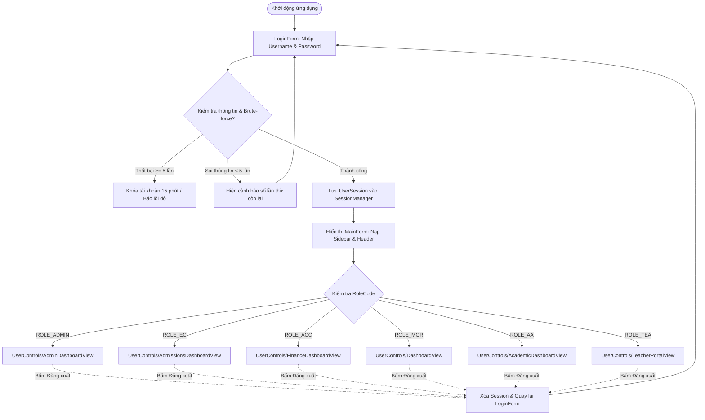
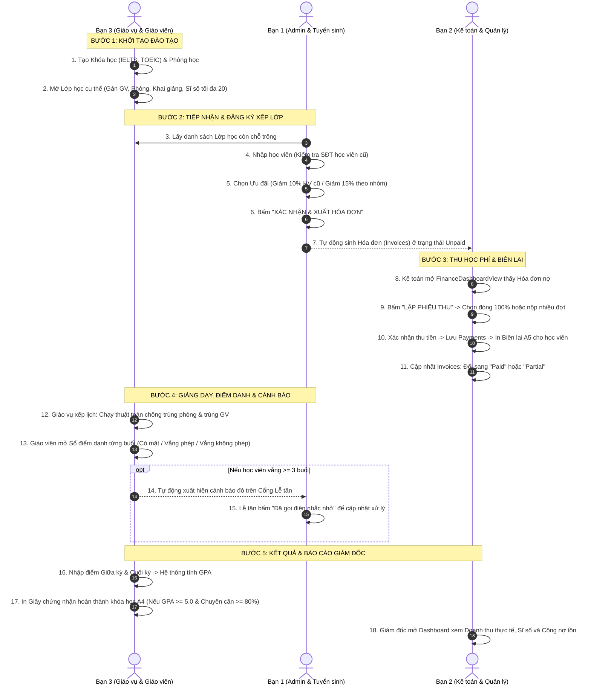
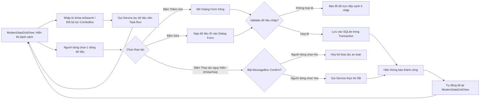

# HƯỚNG DẪN THIẾT KẾ GIAO DIỆN KÉO THẢ UI/UX CHUẨN DOANH NGHIỆP
## DỰ ÁN: ENGLISH CENTER MANAGEMENT SYSTEM (ECMS)
### CÔNG NGHỆ: C# WinForms (.NET 10 LTS), SQLite 3 (WAL Mode), Layered Architecture 4 tầng
### PHƯƠNG PHÁP TRIỂN KHAI: Kéo thả trực quan trong Visual Studio / JetBrains Rider WinForms Designer với Bộ Component `ECMS.UI.Controls`

---

> [!IMPORTANT]
> **MỤC ĐÍCH CỦA TÀI LIỆU NÀY:**
> Tài liệu này là **bản thiết kế kỹ thuật UI/UX và cẩm nang hướng dẫn kéo thả (Drag & Drop) hoàn chỉnh** dành cho toàn bộ các thành viên dự án ECMS.
> Thay vì phải tự viết mã giao diện bằng tay hoặc tự suy nghĩ bố cục, nhà phát triển chỉ cần mở Visual Studio / JetBrains Rider Designer, đọc theo bảng thông số tọa độ `(X, Y)`, kích thước `(W, H)`, `Dock`, `Anchor` và thuộc tính `(Name)` để dựng xong toàn bộ 15+ màn hình chuẩn xác đến từng pixel, đảm bảo tính thẩm mỹ, nhất quán và liên thông nghiệp vụ 100%.

---

# MỤC LỤC TỔNG QUAN

1. [PHẦN I. UI/UX DESIGN SYSTEM](#phần-i-uiux-design-system)
   - [1.1. Triết lý thiết kế & Định hướng phong cách](#11-triết-lý-thiết-kế--định-hướng-phong-cách)
   - [1.2. Bảng màu chuẩn & Độ tương phản WCAG 2.1 Level AA](#12-bảng-màu-chuẩn--độ-tương-phản-wcag-21-level-aa)
   - [1.3. Hệ thống Typography](#13-hệ-thống-typography)
   - [1.4. Hệ lưới (Grid System), Khoảng cách (Spacing) & Padding/Margin](#14-hệ-lưới-grid-system-khoảng-cách-spacing--paddingmargin)
   - [1.5. Quy chuẩn Bo góc (Corner Radius), Viền (Border) & Đổ bóng (Shadow)](#15-quy-chuẩn-bo-góc-corner-radius-viền-border--đổ-bóng-shadow)
   - [1.6. Quy chuẩn Biểu tượng (Iconography)](#16-quy-chuẩn-biểu-tượng-iconography)
   - [1.7. Quy chuẩn Nút bấm, Ô nhập, Hộp chọn, Bảng dữ liệu, Thẻ & Hộp thoại](#17-quy-chuẩn-nút-bấm-ô-nhập-hộp-chọn-bảng-dữ-liệu-thẻ--hộp-thoại)
   - [1.8. Quy tắc đồng nhất giao diện (Consistency Rules)](#18-quy-tắc-đồng-nhất-giao-diện-consistency-rules)
2. [PHẦN II. COMPONENT INVENTORY (BỘ ĐIỀU KHIỂN `ECMS.UI.CONTROLS`)](#phần-ii-component-inventory-bộ-điều-khiển-ecmsuicontrols)
   - [2.1. Phân loại cấu trúc thành phần UI](#21-phân-loại-cấu-trúc-thành-phần-ui)
   - [2.2. Danh mục chi tiết các Custom Component trong `Controls`](#22-danh-mục-chi-tiết-các-custom-component-trong-controls)
   - [2.3. Hướng dẫn nạp Component lên Visual Studio / Rider Toolbox](#23-hướng-dẫn-nạp-component-lên-visual-studio--rider-toolbox)
3. [PHẦN III. SCREEN INVENTORY (DANH MỤC MÀN HÌNH THEO VAI TRÒ & NGHIỆP VỤ)](#phần-iii-screen-inventory-danh-mục-màn-hình-theo-vai-trò--nghiệp-vụ)
   - [3.1. Phân bổ vai trò & Ma trận quyền truy cập](#31-phân-bổ-vai-trò--ma-trận-quyền-truy-cập)
   - [3.2. Danh mục Form & UserControl đầy đủ](#32-danh-mục-form--usercontrol-đầy-đủ)
   - [3.3. Đặc tả chi tiết từng màn hình](#33-đặc-tả-chi-tiết-từng-màn-hình)
4. [PHẦN IV. UI FLOW & NAVIGATION FLOW (SƠ ĐỒ ĐIỀU HƯỚNG & LUỒNG LIÊN THÔNG)](#phần-iv-ui-flow--navigation-flow-sơ-đồ-điều-hướng--luồng-liên-thông)
   - [4.1. Luồng Đăng nhập & Điều hướng theo vai trò (Role-based Shell)](#41-luồng-đăng-nhập--điều-hướng-theo-vai-trò-role-based-shell)
   - [4.2. Luồng liên thông nghiệp vụ xương sống giữa 3 thành viên](#42-luồng-liên-thông-nghiệp-vụ-xương-sống-giữa-3-thành-viên)
   - [4.3. Luồng Thao tác CRUD, Tìm kiếm, Lọc dữ liệu & Xác nhận an toàn](#43-luồng-thao-tác-crud-tìm-kiếm-lọc-dữ-liệu--xác-nhận-an-toàn)
5. [PHẦN V. CHI TIẾT HƯỚNG DẪN KÉO THẢ TỪNG MÀN HÌNH (STEP-BY-STEP DESIGNER MANUAL)](#phần-v-chi-tiết-hướng-dẫn-kéo-thả-từng-màn-hình-step-by-step-designer-manual)
   - [5.1. Màn hình Đăng nhập: `LoginForm.cs`](#51-màn-hình-đăng-nhập-loginformcs)
   - [5.2. Khung Shell ứng dụng chính: `MainForm.cs`](#52-khung-shell-ứng-dụng-chính-mainformcs)
   - [5.3. Bàn làm việc Quản trị hệ thống: `AdminDashboardView.cs`](#53-bàn-làm-việc-quản-trị-hệ-thống-admindashboardviewcs)
   - [5.4. Hộp thoại Thêm/Sửa Người dùng: `UserEditDialog.cs`](#54-hộp-thoại-thêmsửa-người-dùng-usereditdialogcs)
   - [5.5. Hộp thoại Đặt lại & Đổi Mật khẩu: `ResetPasswordDialog.cs` & `ChangePasswordDialog.cs`](#55-hộp-thoại-đặt-lại--đổi-mật-khẩu-resetpassworddialogcs--changepassworddialogcs)
   - [5.6. Hộp thoại Giám sát Bảo mật & Mở khóa Brute-force: `BruteForceMonitorDialog.cs`](#56-hộp-thoại-giám-sát-bảo-mật--mở-khóa-brute-force-bruteforcemonitordialogcs)
   - [5.7. Hộp thoại Ma trận Phân quyền: `RbacMatrixDialog.cs`](#57-hộp-thoại-ma-trận-phân-quyền-rbacmatrixdialogcs)
   - [5.8. Hộp thoại Nhật ký Kiểm toán: `AuditLogViewerDialog.cs`](#58-hộp-thoại-nhật-ký-kiểm-toán-auditlogviewerdialogcs)
   - [5.9. Cổng Tư vấn Tuyển sinh & Lễ tân: `AdmissionsDashboardView.cs`](#59-cổng-tư-vấn-tuyển-sinh--lễ-tân-admissionsdashboardviewcs)
   - [5.10. Hộp thoại Thêm/Sửa Khách tiềm năng: `LeadEditDialog.cs`](#510-hộp-thoại-thêmsửa-khách-tiềm-năng-leadeditdialogcs)
   - [5.11. Hộp thoại Đăng ký Lớp & Áp dụng Ưu đãi: `StudentEnrollmentDialog.cs`](#511-hộp-thoại-đăng-ký-lớp--áp-dụng-ưu-đãi-studentenrollmentdialogcs)
   - [5.12. Màn hình Cảnh báo Chuyên cần Nguy hiểm (Vắng $\ge 3$ buổi): `AbsenceAlertDialog.cs`](#512-màn-hình-cảnh-báo-chuyên-cần-nguy-hiểm-vắng-ge-3-buổi-absencealertdialogcs)
   - [5.13. Cổng Kế toán & Quản lý Hóa đơn: `FinanceDashboardView.cs`](#513-cổng-kế-toán--quản-lý-hóa-đơn-financedashboardviewcs)
   - [5.14. Hộp thoại Thu tiền nhiều đợt & In Biên lai A5: `PaymentReceiptDialog.cs`](#514-hộp-thoại-thu-tiền-nhiều-đợt--in-biên-lai-a5-paymentreceiptdialogcs)
   - [5.15. Bàn làm việc Giám đốc Điều hành: `DashboardView.cs`](#515-bàn-làm-việc-giám-đốc-điều-hành-dashboardviewcs)
   - [5.16. Cổng Giáo vụ Quản lý Khóa học & Lớp học: `AcademicDashboardView.cs`](#516-cổng-giáo-vụ-quản-lý-khóa-học--lớp-học-academicdashboardviewcs)
   - [5.17. Hộp thoại Xếp Lịch học & Chống trùng phòng/giáo viên: `ClassScheduleDialog.cs`](#517-hộp-thoại-xếp-lịch-học--chống-trùng-phònggiáo-viên-classscheduledialogcs)
   - [5.18. Cổng Giảng viên: Điểm danh & Bảng điểm & Chứng nhận A4: `TeacherPortalView.cs`](#518-cổng-giảng-viên-điểm-danh--bảng-điểm--chứng-nhận-a4-teacherportalviewcs)
   - [5.19. Tra cứu Danh sách Học viên toàn trung tâm: `StudentListView.cs`](#519-tra-cứu-danh-sách-học-viên-toàn-trung-tâm-studentlistviewcs)
6. [PHẦN VI. KIỂM TRA UI/UX & MA TRẬN ĐÁNH GIÁ CHUẨN MỰC](#phần-vi-kiểm-tra-uiux--ma-trận-đánh-giá-chuẩn-mực)
   - [6.1. Checklist đánh giá theo 8 Golden Rules (Ben Shneiderman)](#61-checklist-đánh-giá-theo-8-golden-rules-ben-shneiderman)
   - [6.2. Checklist đánh giá theo 10 Usability Heuristics (Jakob Nielsen)](#62-checklist-đánh-giá-theo-10-usability-heuristics-jakob-nielsen)
   - [6.3. Checklist Kiểm thử co giãn (Responsive Anchoring & DPI Scaling)](#63-checklist-kiểm-thử-co-giãn-responsive-anchoring--dpi-scaling)
   - [6.4. Bảng tổng kết nghiệm thu giao diện trước khi bảo vệ](#64-bảng-tổng-kết-nghiệm-thu-giao-diện-trước-khi-bảo-vệ)

---

# PHẦN I. UI/UX DESIGN SYSTEM

## 1.1. Triết lý thiết kế & Định hướng phong cách

Hệ thống **ECMS (English Center Management System)** được định hướng theo phong cách **Modern Enterprise Frosted Glassmorphism (Kính mờ hiện đại chuẩn Doanh nghiệp)** kết hợp nguyên lý thiết kế phẳng tinh giản (Flat Minimalist Design).

Giao diện hướng tới 3 mục tiêu cốt lõi:
1. **Chuyên nghiệp & Đáng tin cậy (Professional & Trustworthy):** Tông màu chủ đạo Xanh hải quân sâu (Executive Deep Navy) kết hợp Trắng mờ Acrylic tạo cảm giác một phần mềm quản trị giáo dục chuẩn quốc tế, không lòe loẹt hay tạo cảm giác đồ họa đồ chơi.
2. **Rõ ràng & Giảm tải nhận thức (Clarity & Low Cognitive Load):** Bố cục được phân cấp trực quan theo hệ phân tầng: Header chứa tiêu đề và ngữ cảnh $\rightarrow$ Thẻ KPI hiển thị số liệu tức thời $\rightarrow$ Thanh công cụ lọc/tìm kiếm $\rightarrow$ Bảng dữ liệu trung tâm.
3. **Thân thiện với người dùng văn phòng:** Các nút bấm to, rõ ràng, có hiệu ứng đổi màu khi rê chuột (Hover) và bấm chuột (Click); các ô nhập liệu có nhãn hướng dẫn, chữ gợi ý (Placeholder) và viền đổi màu xanh khi người dùng nhấp chọn (Focus Ring).

---

## 1.2. Bảng màu chuẩn & Độ tương phản WCAG 2.1 Level AA

Mọi màu sắc sử dụng trong ECMS đều được đo lường độ tương phản theo chuẩn **Web Content Accessibility Guidelines (WCAG) 2.1 Level AA** (tỷ lệ tương phản chữ trên nền tối thiểu $\ge 4.5:1$ đối với văn bản thông thường và $\ge 3.0:1$ đối với văn bản lớn/nút bấm).

Tất cả các màu này đã được định nghĩa tập trung trong lớp `ECMS.UI.Controls.ThemeColors`:

| Nhóm màu | Tên màu (Token) | Mã Hex / RGB | Mô tả công dụng thực tế | Tỷ lệ tương phản |
| :--- | :--- | :--- | :--- | :---: |
| **Nền ứng dụng** | `AppBackground` | `#F5F7FA`<br>`(245, 247, 250)` | Nền xám mát mờ cho toàn bộ UserControl và Form, giảm chói mắt khi làm việc nhiều giờ | Nền chuẩn |
| **Nền Sidebar** | `SidebarBackground` | `#101826`<br>`(16, 24, 38)` | Deep Navy sang trọng làm nền cho thanh điều hướng bên trái của `MainForm` | Nền tối chuẩn |
| **Thẻ kính Acrylic** | `GlassCardBg` | `rgba(255,255,255, 0.96)`<br>`(245, 255, 255, 255)` | Trắng mờ 96% làm nền cho các khối chức năng, bảng dữ liệu và thẻ KPI | Nền sáng nổi |
| **Viền vi tính** | `GlassBorder` | `#CBD5E1`<br>`(203, 213, 225)` | Viền hairline 1px bao quanh thẻ kính, ô nhập liệu và phân cách các khu vực | Viền chuẩn |
| **Chữ chính** | `TextPrimary` | `#0F172A`<br>`(15, 23, 42)` | Slate 900 dùng cho toàn bộ tiêu đề, dữ liệu số trong bảng và nhãn trường | **14.2:1** (Đạt AAA) |
| **Chữ phụ** | `TextSecondary` | `#475569`<br>`(71, 85, 105)` | Slate 600 dùng cho phụ đề, nhãn phụ, ngày giờ tạo | **7.5:1** (Đạt AAA) |
| **Chữ mờ / Gợi ý** | `TextMuted` | `#64748B`<br>`(100, 116, 139)` | Slate 500 dùng cho Placeholder, ghi chú chú thích chân trang | **4.8:1** (Đạt AA) |
| **Chữ trên nền tối** | `TextOnDark` | `#F8FAFC`<br>`(248, 250, 252)` | Trắng sữa dùng trên Sidebar hoặc nút bấm màu đậm | **15.1:1** (Đạt AAA) |
| **Màu thương hiệu** | `Primary` | `#1F4E79`<br>`(31, 78, 121)` | Executive Deep Blue cho nút hành động chính (Tìm, Lưu, Sửa, Header bảng) | **6.8:1** (Đạt AA) |
| **Hover thương hiệu**| `PrimaryHover` | `#2F5597`<br>`(47, 85, 151)` | Màu xanh sáng hơn khi rê chuột vào nút chính | - |
| **Thành công** | `Success` (Nút) | `#10B981`<br>`(16, 185, 129)` | Emerald Green dùng cho nút "+ THÊM MỚI", "XÁC NHẬN ĐĂNG KÝ", "THU TIỀN" | **4.6:1** |
| | `SuccessBg` (Huy hiệu) | `#DCFCE7`<br>`(220, 252, 231)` | Nền xanh lá nhạt cho trạng thái: "Đang học", "Đã thu đủ", "Online" | - |
| | `SuccessText` | `#15803D`<br>`(21, 128, 61)` | Màu chữ xanh lá đậm trên nền `SuccessBg` | **5.2:1** (Đạt AA) |
| **Cảnh báo** | `Warning` (Nút) | `#D97706`<br>`(217, 119, 6)` | Amber Orange dùng cho nút "RESET MẬT KHẨU", "BẢO LƯU" | **4.5:1** |
| | `WarningBg` (Huy hiệu) | `#FEF3C7`<br>`(254, 243, 199)` | Nền vàng cam nhạt cho trạng thái: "Chờ nộp phí", "Vắng có phép", "Partial" | - |
| | `WarningText` | `#B45309`<br>`(180, 83, 9)` | Màu chữ cam đậm trên nền `WarningBg` | **5.0:1** (Đạt AA) |
| **Nguy hiểm / Lỗi** | `Danger` (Nút) | `#E11D48`<br>`(225, 29, 72)` | Rose Red cho nút "KHÓA TÀI KHOẢN", "XÓA", "CẢNH BÁO VẮNG $\ge 3$" | **4.9:1** |
| | `DangerBg` (Huy hiệu) | `#FEE2E2`<br>`(254, 226, 226)` | Nền đỏ hồng nhạt cho trạng thái: "Đã khóa", "Vắng không phép", "Hết chỗ" | - |
| | `DangerText` | `#B91C1C`<br>`(185, 28, 28)` | Màu chữ đỏ đậm trên nền `DangerBg` | **5.4:1** (Đạt AA) |
| **Thông tin / Chức năng**| `Info` (Nút) | `#4F46E5`<br>`(79, 70, 229)` | Indigo Blue cho nút "RBAC MATRIX", "IN CHỨNG NHẬN", "ĐỔI TRẠNG THÁI" | **6.1:1** |
| | `InfoBg` (Huy hiệu) | `#E0F2FE`<br>`(224, 242, 254)` | Nền xanh da trời nhạt cho trạng thái: "Mới tiếp nhận", "Đang học" | - |
| | `InfoText` | `#0369A1`<br>`(3, 105, 161)` | Màu chữ xanh da trời đậm trên nền `InfoBg` | **5.1:1** (Đạt AA) |
| **Hủy / Trung tính** | `Neutral` (Nút) | `#64748B`<br>`(100, 116, 139)` | Slate Gray dùng cho nút "HỦY BỎ", "ĐÓNG", "LÀM MỚI" | **4.8:1** |

---

## 1.3. Hệ thống Typography

Phần mềm sử dụng một font chữ hệ thống tiêu chuẩn duy nhất: **`Segoe UI`**. Font này có sẵn trên 100% các phiên bản Windows (từ Windows 7 đến Windows 11), hỗ trợ hiển thị Tiếng Việt Unicode hoàn hảo không bị lỗi chân chữ (font clipping).

Quy chuẩn kiểu chữ trong `ThemeColors`:
- **`FontHeader`:** `new Font("Segoe UI", 16f, FontStyle.Bold)` — Tiêu đề màn hình chính (Section Header), tiêu đề Form.
- **`FontSubHeader`:** `new Font("Segoe UI", 11.5f, FontStyle.Bold)` — Tiêu đề nhóm chức năng, tiêu đề thẻ lớn.
- **`FontBody`:** `new Font("Segoe UI", 9.5f, FontStyle.Regular)` — Nội dung dòng trong DataGridView, nội dung văn bản thường, chữ gõ trong TextBox/ComboBox.
- **`FontBodyBold`:** `new Font("Segoe UI", 9.5f, FontStyle.Bold)` — Tiêu đề cột DataGridView, nhãn trường bắt buộc, chữ trên nút bấm `CustomButton`.
- **`FontCaption`:** `new Font("Segoe UI", 8.2f, FontStyle.Regular)` — Phụ đề chú thích dưới tiêu đề, nhãn phụ đơn vị đo (`VNĐ`, `học viên`).
- **`FontBadge`:** `new Font("Segoe UI", 8.5f, FontStyle.Bold)` — Chữ trên huy hiệu trạng thái `StatusBadge` và tiêu đề thẻ `StatKpiCard`.
- **`FontKpiValue`:** `new Font("Segoe UI", 16f, FontStyle.Bold)` — Con số thống kê lớn trên thẻ KPI.

---

## 1.4. Hệ lưới (Grid System), Khoảng cách (Spacing) & Padding/Margin

Để giao diện không bị lệch hoặc chồng chéo khi chạy trên nhiều máy tính có độ phân giải khác nhau:
1. **Hệ số bước nhảy khoảng cách (8-point Grid):**
   - Khoảng cách cơ sở: `8px` hoặc `4px`.
   - Khoảng cách lề viền màn hình (Screen Margin): `20px` cách đều 4 cạnh.
   - Khoảng cách giữa các thành phần liền kề (Gutter): `12px` đến `16px`.
   - Khoảng cách đệm bên trong thẻ chứa (Card Padding): `16px` cho `GlassCard` lớn, `10px` cho `RoundedPanel`.
2. **Kích thước chiều cao chuẩn cho thành phần nhập liệu:**
   - Hàng nhập liệu (TextBox, ComboBox, DatePicker): **`Height = 36px`** (hoặc `34px - 38px`).
   - Nút bấm thao tác (CustomButton): **`Height = 36px`** trên thanh công cụ; **`Height = 42px`** cho nút hành động chính ở chân hộp thoại (Save/Confirm).
   - Chiều cao dòng tiêu đề bảng (ColumnHeadersHeight): **`44px`**.
   - Chiều cao mỗi dòng dữ liệu (RowTemplate.Height): **`38px`** (đảm bảo không bị chạm mép chữ, click chuột dễ dàng).
   - Khoảng cách giữa các dòng nhập liệu trong hộp thoại Dialog: **`44px`** tính từ mép trên của dòng này đến mép trên của dòng tiếp theo.

---

## 1.5. Quy chuẩn Bo góc (Corner Radius), Viền (Border) & Đổ bóng (Shadow)

- **Bo góc (Corner Radius):**
  - Nút bấm (`CustomButton`), Ô nhập (`ModernTextBox`), Hộp chọn (`ModernComboBox`), Chọn ngày (`ModernDatePicker`): **`CornerRadius = 8px`**.
  - Thẻ thông tin nhỏ, ô icon: **`CornerRadius = 10px`**.
  - Thẻ chứa nội dung lớn (`GlassCard`), thẻ KPI (`StatKpiCard`): **`CornerRadius = 14px`**.
  - Thanh Sidebar nổi trên `MainForm`: **`CornerRadius = 18px`**.
  - Huy hiệu trạng thái (`StatusBadge`): Dạng viên thuốc Capsule (**`Radius = Height / 2 = 13px`**).
- **Viền (Border):**
  - Viền tĩnh: Đường nét vi tính mảnh **`1px`**, màu xám trung tính `#CBD5E1` (`BorderGlowColor`).
  - Viền khi Focus: Ô nhập liệu và combobox khi người dùng trỏ chuột vào sẽ phát sáng viền dày **`1.8px`** màu xanh dương `#2563EB` (`FocusBorderColor`).
- **Đổ bóng (Ambient Soft Drop Shadow):**
  - Thuộc tính `EnableShadow = true` trong `GlassCard` sử dụng thuật toán vẽ 3 lớp bóng mờ với alpha mờ dần (`Color.FromArgb(10/i, 15, 23, 42)`), tạo độ sâu thị giác (elevation) mà không làm nặng GPU hay gây giật khung hình.

---

## 1.6. Quy chuẩn Biểu tượng (Iconography)

ECMS hỗ trợ hiển thị biểu tượng thông qua:
1. **Segoe UI Emoji / Unicode Icons (Ưu tiên số 1):** Được tích hợp sẵn trong mọi bản Windows, hiển thị trực quan trong `Text` của `Label`, `Button` hoặc thẻ `StatKpiCard` mà không phụ thuộc file ảnh ngoài:
   - Thống kê / Báo cáo: `📊`
   - Tài khoản / Học viên: `👥`, `👤`, `🎓`
   - CSDL / Khóa học: `🗄️`, `📚`, `🏫`
   - Lịch học / Thời gian: `📅`, `⏰`
   - Tài chính / Hóa đơn: `💵`, `💳`, `🧾`
   - Bảo mật / Khóa: `🔒`, `🛡️`
   - Cảnh báo chuyên cần: `🚨`, `⚠️`
   - Kiểm toán / Nhật ký: `📜`, `📋`
   - Tác vụ: `➕`, `✏️`, `🗑️`, `🔍`, `💾`, `🖨️`, `🔄`
2. **FontAwesome.Sharp:** Dự án đã cài sẵn thư viện `FontAwesome.Sharp.dll`. Có thể sử dụng `IconButton` khi cần các biểu tượng vector phẳng phức tạp.

---

## 1.7. Quy chuẩn Nút bấm, Ô nhập, Hộp chọn, Bảng dữ liệu, Thẻ & Hộp thoại

| Thành phần | Tiêu chuẩn thiết kế | Quy tắc tương tác |
| :--- | :--- | :--- |
| **Nút bấm chính (Primary Button)** | Màu `Primary` (#1F4E79) hoặc `Success` (#10B981), chữ trắng, bo góc 8px. | Luôn đặt ở vị trí dễ quan sát nhất (góc phải hộp thoại hoặc nhóm nút trên toolbar). Chỉ có tối đa 1-2 nút chính nổi bật trên mỗi khu vực. |
| **Nút bấm phụ (Secondary/Neutral)**| Màu xám `Slate Gray` (#64748B) hoặc nền trong suốt viền hairline. | Dùng cho hành động "HỦY BỎ", "ĐÓNG", "LÀM MỚI". |
| **Nút bấm nguy hiểm (Destructive)**| Màu đỏ `Rose Red` (#E11D48), chữ trắng. | Dùng cho "XÓA", "KHÓA TÀI KHOẢN". **Bắt buộc phải bật thông báo xác nhận `MessageBox.Show`** trước khi thực thi! |
| **Ô nhập liệu (Text Input)** | Nền trắng, bo góc 8px, có Placeholder in nghiêng xám, viền chuyển xanh khi focus. | Dữ liệu mật khẩu bắt buộc gán `UseSystemPasswordChar = true`. Ô chỉ đọc chuyển nền xám `#F1F5F9`. |
| **Hộp chọn (ComboBox)** | DropDownStyle = `DropDownList` (chặn người dùng gõ linh tinh gây lỗi CSDL), bo góc 8px. | Mục đầu tiên luôn là tùy chọn mặc định (Ví dụ: `"-- Tất cả vai trò --"` hoặc `"-- Chọn lớp học --"`). |
| **Bảng dữ liệu (Grid)** | Dùng `ModernDataGridView`: Header xanh Navy chữ trắng, sọc xen kẽ (Zebra striping), không hiện viền 3D xám cũ, chọn nguyên dòng (`FullRowSelect`), không cho sửa trực tiếp trên ô. | Độ rộng cột căn chỉnh theo tỷ lệ nội dung (`AutoSizeColumnsMode = Fill`). Cột mã và trạng thái căn giữa, cột tiền căn phải. |
| **Thẻ chứa (Card Container)** | Dùng `GlassCard` hoặc `RoundedPanel` nền trắng mờ bo góc 14px. | Phân nhóm các thông tin liên quan lại với nhau (Ví dụ: Nhóm thông tin cá nhân, Nhóm thông tin lớp học, Nhóm ưu đãi học phí). |
| **Hộp thoại (Dialog)** | `StartPosition = CenterParent`, `FormBorderStyle = FixedDialog`, `MaximizeBox = False`. | Chiều rộng chuẩn từ `500px` đến `800px`. Có nút `[X]` hoặc nút `HỦY BỎ` để người dùng dễ dàng thoát ra an toàn. |

---

## 1.8. Quy tắc đồng nhất giao diện (Consistency Rules)

Mọi màn hình trong toàn bộ dự án phải tuân thủ nghiêm ngặt **Quy tắc khung mẫu chuẩn (Master Layout Pattern)**:
- **Kích thước màn hình UserControl chuẩn:** Luôn đặt `Size = (1070, 730)` và `BackColor = Color.FromArgb(245, 247, 250)`.
- **Thanh tiêu đề phân mục (`ModernSectionHeader`):** Luôn đặt tại `Location = (20, 15)`, `Size = (900, 48)`.
- **Hàng 4 thẻ KPI (`StatKpiCard`):** Đặt tại độ cao `Y = 75`, chiều cao `120px`, chia đều bề ngang từ `X = 20` đến `X = 1050`.
- **Thanh công cụ lọc/thao tác (`GlassCard Toolbar`):** Đặt tại `Location = (20, 210)`, `Size = (1030, 68)`, `Anchor = Top, Left, Right`.
- **Bảng dữ liệu trung tâm (`ModernDataGridView`):** Đặt tại `Location = (20, 290)`, `Size = (1030, 420)`, `Anchor = Top, Bottom, Left, Right` (tự co giãn khi phóng to cửa sổ).
- **Hộp thoại Form Dialog:** Bên trong luôn chứa 1 `GlassCard` cách mép Form `14px - 16px`, các nút bấm xác nhận/hủy đặt cố định ở chân hộp thoại.

---

# PHẦN II. COMPONENT INVENTORY (BỘ ĐIỀU KHIỂN `ECMS.UI.CONTROLS`)

## 2.1. Phân loại cấu trúc thành phần UI

Để nhà phát triển nắm rõ bản chất và cách sử dụng, thư mục `ECMS.UI` được chia tách rõ ràng thành 3 nhóm:

1. **Custom Components (`Controls/`):**
   - Là các điều khiển tùy biến chuyên dụng kế thừa từ `Control`, `Button`, `Panel`, `UserControl`, `DataGridView`, `CheckBox` hoặc `Label`.
   - Được biên dịch trực tiếp vào DLL của project `ECMS.UI` và **xuất hiện trên thanh công cụ Toolbox** của Visual Studio / JetBrains Rider để kéo thả trực tiếp như Button mặc định.
2. **Composite Views (`UserControls/`):**
   - Là các thành phần giao diện lớn (View) đại diện cho một màn hình chức năng độc lập (ví dụ `AdminDashboardView`, `FinanceDashboardView`).
   - Được nạp động vào khu vực nội dung chính (`pnlContent`) của `MainForm` khi người dùng bấm vào menu điều hướng bên Sidebar.
3. **Standard WinForms Controls tận dụng sẵn:**
   - Dự án không phát minh lại bánh xe cho những control WinForms mặc định đã hoạt động hoàn hảo: `Panel`, `Label`, `TabControl`, `TextBox` (Multiline ghi chú), `ToolTip`, `PrintPreviewDialog`. Các control này được kết hợp khéo léo với CSS Tokens trong `ThemeColors`.

---

## 2.2. Danh mục chi tiết các Custom Component trong `Controls`

Dưới đây là danh sách 11 component nạp sẵn trong thư mục `ECMS.UI/Controls`:

### 1. `CustomButton` (Nút bấm phẳng bo góc hiện đại)
- **Kế thừa:** `System.Windows.Forms.Button`.
- **Mục đích:** Thay thế nút bấm xám 3D vuông vức cổ điển bằng nút bấm phẳng bo góc, hỗ trợ tự động đổi màu khi Hover và Pressed.
- **Thuộc tính cần chỉnh trong Properties:**
  - `CornerRadius` (int): Bán kính bo góc (Mặc định `8`).
  - `NormalColor` (Color): Màu nền bình thường (Mặc định `ThemeColors.Primary` - Xanh Navy `#1F4E79`).
  - `HoverColor` (Color): Màu khi rê chuột vào (Mặc định `#2F5597`).
  - `ClickColor` (Color): Màu khi nhấp chuột (Mặc định `#14375A`).
  - `ForeColor` (Color): Màu chữ (Mặc định `Color.White`).
  - `Font`: `Segoe UI, 9.5pt, Bold`.
- **Kích thước đề xuất:** `Size = (130, 36)` trên thanh công cụ; `Size = (180, 42)` cho nút hành động chính ở Dialog.
- **Sự kiện cần xử lý:** `Click`.
- **Màn hình sử dụng:** Xuất hiện trên 100% màn hình và hộp thoại của hệ thống.

---

### 2. `GlassCard` (Thẻ nền kính mờ bo góc Acrylic)
- **Kế thừa:** `System.Windows.Forms.Panel`.
- **Mục đích:** Đóng vai trò làm khung chứa nổi (Container) cho các nhóm điều khiển, thanh Toolbar, thẻ xem trước hoặc nền Form Dialog.
- **Thuộc tính cần chỉnh trong Properties:**
  - `CornerRadius` (int): Bán kính bo góc (Mặc định `14`, Toolbar dùng `10`, Form nền dùng `14`).
  - `GlassColor` (Color): Màu nền mờ Acrylic (Mặc định `245, 255, 255, 255` - Trắng mờ 96%).
  - `BorderGlowColor` (Color): Màu viền Hairline tinh tế (Mặc định `#D7E2EE`).
  - `BorderGlowWidth` (int): Độ dày viền (Mặc định `1`).
  - `EnableShadow` (bool): Bật đổ bóng mờ 3 lớp (Đặt `True` cho thẻ nội dung và Dialog; đặt `False` cho thanh Toolbar bên trong màn hình).
- **Kích thước đề xuất:** Linh hoạt theo khu vực chứa (Toolbar: `1030 x 68`; Khung Dialog: `W-30, H-30`).
- **Màn hình sử dụng:** Dùng làm khung chứa cho Toolbar, Sidebar, Dialog và Preview Card trên mọi màn hình.

---

### 3. `StatKpiCard` (Thẻ KPI hiển thị số liệu thống kê)
- **Kế thừa:** `GlassCard`.
- **Mục đích:** Hiển thị tức thời các chỉ số đo lường hiệu suất (KPI) ở đầu màn hình (Doanh thu, Sĩ số, Số ca vắng, CSDL Online). Đã đóng gói sẵn ô Icon bo góc, tiêu đề và số liệu lớn.
- **Thuộc tính cần chỉnh trong Properties (Mục `ECMS Modern Design`):**
  - `CardTitle` (string): Tiêu đề nhỏ (Ví dụ: `"TỔNG HỌC VIÊN"`, `"DOANH THU THỰC THU"`).
  - `CardValue` (string): Giá trị số liệu lớn (Ví dụ: `"1,240"`, `"145,000,000 đ"`).
  - `IconSymbol` (string): Ký tự biểu tượng Emoji (Ví dụ: `"👥"`, `"💵"`, `"🚨"`).
  - `AccentBackColor` (Color): Màu nền cho ô vuông biểu tượng (Ví dụ: `#E0F2FE` cho Info, `#DCFCE7` cho Thành công, `#FEE2E2` cho Nguy hiểm).
  - `AccentForeColor` (Color): Màu chữ của biểu tượng và số liệu.
- **Kích thước đề xuất:** Chuẩn `Size = (245, 120)` (khi xếp 4 thẻ nằm ngang trên màn hình rộng 1070px).
- **Sự kiện cần xử lý:** `Click` (Ví dụ click vào thẻ "Cảnh báo vắng $\ge 3$" để mở danh sách chi tiết).
- **Màn hình sử dụng:** `AdminDashboardView`, `AdmissionsDashboardView`, `FinanceDashboardView`, `DashboardView`, `AcademicDashboardView`, `AuditLogViewerDialog`.

---

### 4. `RoundedPanel` (Khung bảng con bo góc)
- **Kế thừa:** `System.Windows.Forms.Panel`.
- **Mục đích:** Làm khung tóm tắt thông tin con bên trong hộp thoại (ví dụ: Khung chi tiết lớp học đã chọn, Khung tổng hợp tiền học phí & giảm giá).
- **Thuộc tính cần chỉnh trong Properties:**
  - `CornerRadius` (int): Bo góc (Mặc định `10` hoặc `12`).
  - `BorderColor` (Color): Màu viền (Mặc định `#DCE0E6`).
  - `BorderWidth` (int): Độ dày viền (`1`).
  - `BackColor`: Thường đặt `Color.White` hoặc `#F8FAFC`.
- **Kích thước đề xuất:** Phụ thuộc vào cụm thông tin bên trong Form (Ví dụ: `490 x 95`).
- **Màn hình sử dụng:** `StudentEnrollmentDialog`, `PaymentReceiptDialog`, `UserEditDialog`.

---

### 5. `ModernTextBox` (Ô nhập liệu bo góc hỗ trợ Placeholder)
- **Kế thừa:** `System.Windows.Forms.UserControl` (Bọc lõi `TextBox` phẳng bên trong).
- **Mục đích:** Nhập liệu văn bản, mật khẩu, tìm kiếm. Khắc phục nhược điểm méo viền của TextBox WinForms cũ, hỗ trợ chữ mờ gợi ý (Placeholder) và đổi viền xanh khi Focus.
- **Thuộc tính cần chỉnh trong Properties:**
  - `Placeholder` (string): Dòng chữ gợi ý mờ (Ví dụ: `"Nhập số điện thoại..."`, `"Tìm theo họ tên, mã..."`).
  - `Text` (string): Nội dung văn bản gõ vào.
  - `UseSystemPasswordChar` (bool): Đặt `True` nếu là ô nhập mật khẩu.
  - `ReadOnly` (bool): Đặt `True` cho các ô chỉ xem (Tự động đổi nền sang xám nhạt).
  - `CornerRadius` (int): Bo góc (Mặc định `8`).
  - `BorderColor` (Color): Màu viền thường (`#CBD5E1`).
  - `FocusBorderColor` (Color): Màu viền khi người dùng focus (`#2563EB`).
- **Kích thước đề xuất:** Chiều cao chuẩn `36px` (hoặc `38px`); chiều rộng từ `180px` đến `490px` tùy vị trí.
- **Sự kiện cần xử lý:** `TextChanged`, `KeyDown` (bắt phím Enter để tìm kiếm).
- **Màn hình sử dụng:** Mọi Form và thanh Toolbar tìm kiếm.

---

### 6. `ModernComboBox` (Hộp chọn thả xuống phẳng bo góc)
- **Kế thừa:** `System.Windows.Forms.UserControl` (Bọc `ComboBox Style = DropDownList` bên trong).
- **Mục đích:** Chọn danh mục từ danh sách thả xuống (Chọn vai trò, Chọn phòng học, Chọn lớp, Chọn ưu đãi giảm giá). Đồng bộ kích thước và viền với `ModernTextBox`.
- **Thuộc tính cần chỉnh trong Properties:**
  - `CornerRadius` (int): Bo góc `8`.
  - `BorderColor` (Color): `#CBD5E1`.
  - `DisplayMember` / `ValueMember` (string): Cấu hình gán dữ liệu Backend.
  - `SelectedIndex` / `SelectedItem` / `SelectedValue`: Thuộc tính điều khiển dòng chọn.
- **Kích thước đề xuất:** Chiều cao chuẩn `36px`; chiều rộng `120px - 220px` trên toolbar; `490px` trong Form.
- **Sự kiện cần xử lý:** `SelectedIndexChanged`.
- **Màn hình sử dụng:** Hầu hết các màn hình lọc và các hộp thoại đăng ký.

---

### 7. `ModernDatePicker` (Hộp chọn ngày tháng chuẩn định dạng Việt Nam)
- **Kế thừa:** `System.Windows.Forms.UserControl` (Bọc `DateTimePicker` bên trong).
- **Mục đích:** Chọn ngày sinh, ngày khai giảng, ngày điểm danh, ngày thu tiền. Định dạng chuẩn cố định `dd/MM/yyyy`.
- **Thuộc tính cần chỉnh trong Properties:**
  - `Value` (DateTime): Ngày tháng đang chọn.
  - `CornerRadius` (int): Bo góc `8`.
  - `BorderColor` (Color): `#CBD5E1`.
- **Kích thước đề xuất:** `Size = (165, 36)`.
- **Sự kiện cần xử lý:** `ValueChanged`.
- **Màn hình sử dụng:** `StudentEnrollmentDialog`, `ClassScheduleDialog`, `TeacherPortalView`, `AuditLogViewerDialog`.

---

### 8. `ModernDataGridView` (Bảng dữ liệu phẳng chuẩn Enterprise)
- **Kế thừa:** `System.Windows.Forms.DataGridView`.
- **Mục đích:** Hiển thị danh sách bảng dữ liệu nghiệp vụ (Danh sách tài khoản, Danh sách học viên, Danh sách hóa đơn, Bảng điểm danh).
- **Đặc điểm tích hợp sẵn:** Tự động gọi `ModernGridHelper.ApplyStyle(this)` khi khởi tạo: Tiêu đề cột màu Navy chữ trắng cao `44px`, hàng dữ liệu cao `38px`, sọc xen kẽ (Zebra striping), viền phẳng mờ, chọn nguyên dòng `FullRowSelect`, chống giật đồ họa (`DoubleBuffered = true`).
- **Thuộc tính cần chỉnh trong Properties:**
  - `Anchor`: Luôn gán `Top, Bottom, Left, Right` để tự co giãn theo độ rộng cửa sổ.
  - `ReadOnly`: Luôn là `True`.
  - `AllowUserToAddRows`: `False`.
  - `AllowUserToDeleteRows`: `False`.
- **Kích thước đề xuất:** `Location = (20, 290)`, `Size = (1030, 420)` trên các trang Dashboard.
- **Sự kiện cần xử lý:** `CellClick`, `CellDoubleClick`, `SelectionChanged`.
- **Màn hình sử dụng:** Xuất hiện ở trung tâm mọi màn hình quản lý nghiệp vụ.

---

### 9. `ModernSectionHeader` (Thanh tiêu đề phân mục có vạch nhấn màu)
- **Kế thừa:** `System.Windows.Forms.UserControl`.
- **Mục đích:** Đặt ở đầu màn hình hoặc đầu các nhóm chức năng lớn, cung cấp vạch nhấn màu xanh thương hiệu ở cạnh trái cùng tiêu đề lớn in đậm và phụ đề hướng dẫn.
- **Thuộc tính cần chỉnh trong Properties:**
  - `HeaderText` (string): Tiêu đề chính in hoa (Ví dụ: `"QUẢN TRỊ HỆ THỐNG (ADMIN PORTAL)"`).
  - `SubtitleText` (string): Phụ đề hướng dẫn ngắn gọn (Ví dụ: `"Quản trị tài khoản, phân quyền RBAC và kiểm toán hệ thống"`).
  - `AccentColor` (Color): Màu vạch nhấn cạnh trái (Mặc định `ThemeColors.Primary` `#1F4E79`).
- **Kích thước đề xuất:** `Size = (900, 48)`.
- **Màn hình sử dụng:** Đầu trang của mọi `UserControl` và đầu các Form Dialog.

---

### 10. `ModernToggleSwitch` (Công tắc gạt bật/tắt dạng viên thuốc)
- **Kế thừa:** `System.Windows.Forms.CheckBox`.
- **Mục đích:** Dùng thay cho CheckBox truyền thống đối với các thao tác chuyển đổi trạng thái quan trọng (Kích hoạt/Khóa tài khoản, Bật lọc theo ngày, Đóng 100% học phí).
- **Thuộc tính cần chỉnh trong Properties:**
  - `Checked` (bool): Trạng thái Bật (`True`) hoặc Tắt (`False`).
  - `Text` (string): Nhãn hiển thị bên phải công tắc (Ví dụ: `"Kích hoạt tài khoản"`, `"Đóng toàn bộ 100%"`).
  - `OnBackColor` (Color): Màu nền khi bật (Mặc định `#10B981` - Xanh ngọc lục bảo).
  - `OffBackColor` (Color): Màu nền khi tắt (Mặc định `#CBD5E1` - Xám nhạt).
- **Kích thước đề xuất:** `Size = (220, 28)`.
- **Sự kiện cần xử lý:** `CheckedChanged`.
- **Màn hình sử dụng:** `UserEditDialog`, `PaymentReceiptDialog`, `AuditLogViewerDialog`.

---

### 11. `StatusBadge` (Huy hiệu trạng thái dạng viên thuốc)
- **Kế thừa:** `System.Windows.Forms.Label`.
- **Mục đích:** Hiển thị các nhãn trạng thái nhỏ gọn trong Form chi tiết hoặc trong các cell của bảng. Tự động phối màu nền nhạt và chữ đậm chuẩn WCAG theo Enum.
- **Thuộc tính cần chỉnh trong Properties:**
  - `Variant` (BadgeVariant): `Success`, `Warning`, `Danger`, `Info`, `Neutral`.
  - `Text` (string): Chữ hiển thị (Ví dụ: `"ĐANG HỌC"`, `"CHỜ NỘP TIỀN"`, `"ĐÃ KHÓA"`).
- **Kích thước đề xuất:** `Size = (110, 26)`.
- **Màn hình sử dụng:** `MainForm` (Role Badge), các hộp thoại chi tiết.

---

## 2.3. Hướng dẫn nạp Component lên Visual Studio / Rider Toolbox

Để các component trên xuất hiện đầy đủ trong cửa sổ **Toolbox** của WinForms Designer:

1. **Trong JetBrains Rider:**
   - Mở Solution `ECMS.sln`.
   - Bấm tổ hợp phím **`Ctrl + Shift + B`** (hoặc menu `Build` $\rightarrow$ `Build Solution`) để biên dịch toàn bộ mã nguồn.
   - Nhấp đúp chuột mở bất kỳ Form hoặc UserControl nào (ví dụ `LoginForm.cs` hoặc `AdminDashboardView.cs`).
   - Mở tab **Toolbox** ở thanh cạnh bên. Nhóm **`ECMS.UI.Controls`** sẽ tự động hiển thị với đầy đủ 11 component trên.
2. **Trong Visual Studio:**
   - Sau khi Build Solution thành công, mở Form Designer.
   - Trong cửa sổ Toolbox, chuột phải vào khoảng trống $\rightarrow$ chọn **`Choose Items...`**.
   - Tại tab *.NET Framework / .NET Core Components*, chọn `Browse...` trỏ tới file:  
     `ECMS.UI\bin\Debug\net10.0-windows\ECMS.UI.dll`.
   - Tích chọn tất cả các control mang tiền tố `CustomButton`, `GlassCard`, `Modern...`, `StatKpiCard` $\rightarrow$ Bấm `OK`.
   - Giờ đây, bạn có thể nhấp chuột giữ và kéo thả trực tiếp các control này vào Form như các control cơ bản của Windows!

---

# PHẦN III. SCREEN INVENTORY (DANH MỤC MÀN HÌNH THEO VAI TRÒ & NGHIỆP VỤ)

## 3.1. Phân bổ vai trò & Ma trận quyền truy cập

Căn cứ theo tài liệu phân công nhiệm vụ và hệ thống phân quyền trong `ECMS.Core.Enums.UserRoleType`, hệ thống phục vụ **6 nhóm người dùng nội bộ chính thức**:

| STT | Mã Vai trò (RoleCode) | Tên vai trò | Người phụ trách trong nhóm | Phạm vi chức năng được phép truy cập |
| :---: | :--- | :--- | :---: | :--- |
| **1** | `ROLE_ADMIN` | **Quản trị hệ thống** | **Bạn 1 (Lead)** | Toàn quyền cấu hình tài khoản, mở khóa brute-force, phân quyền RBAC, xem nhật ký kiểm toán hệ thống. |
| **2** | `ROLE_EC` | **Tư vấn tuyển sinh & Lễ tân** | **Bạn 1 (Lead)** | Quản lý khách tiềm năng (Leads), tiếp nhận đăng ký lớp, áp dụng chính sách ưu đãi 10%, theo dõi cảnh báo học viên vắng $\ge 3$ buổi. |
| **3** | `ROLE_ACC` | **Kế toán & Thu ngân** | **Bạn 2** | Quản lý hóa đơn học phí, lập phiếu thu tiền (1 lần hoặc nhiều đợt), in biên lai thu tiền A5, theo dõi công nợ quá hạn. |
| **4** | `ROLE_MGR` | **Quản lý / Giám đốc điều hành**| **Bạn 2** | Xem Dashboard tổng thể trung tâm: Doanh thu thực thu tháng, tổng số học viên toàn trường, tình hình sĩ số lớp học và công nợ. |
| **5** | `ROLE_AA` | **Giáo vụ đào tạo** | **Bạn 3** | Quản lý danh mục Khóa học, Phòng học, Mở lớp học cụ thể, Xếp lịch học và kiểm tra xung đột trùng phòng/giáo viên. |
| **6** | `ROLE_TEA` | **Giảng viên giảng dạy** | **Bạn 3** | Xem lịch dạy cá nhân, mở sổ điểm danh từng buổi học (Có mặt/Vắng), nhập điểm thi Giữa kỳ - Cuối kỳ, in Chứng nhận hoàn thành A4. |

> [!NOTE]
> **Loại trừ phạm vi:** Vai trò Cổng Phụ huynh (`ROLE_PAR`) và Cổng Học viên (`ROLE_STU`) đã được loại bỏ khỏi phạm vi triển khai theo đúng quyết định thống nhất trong tài liệu phân công của nhóm để tập trung 100% chất lượng vào 3 khối nghiệp vụ xương sống.

---

## 3.2. Danh mục Form & UserControl đầy đủ

| STT | Tên Form / UserControl | Loại màn hình | Vai trò truy cập | File mã nguồn |
| :---: | :--- | :---: | :---: | :--- |
| **1** | Cửa sổ Đăng nhập | `Form` (Cửa sổ chính 1) | Toàn bộ vai trò | `Forms/LoginForm.cs` |
| **2** | Khung Shell Ứng dụng chính | `Form` (Cửa sổ chính 2) | Toàn bộ vai trò | `Forms/MainForm.cs` |
| **3** | Bàn làm việc Quản trị hệ thống | `UserControl` | `ROLE_ADMIN` | `UserControls/AdminDashboardView.cs` |
| **4** | Hộp thoại Thêm/Sửa Người dùng | `Form` (Modal Dialog) | `ROLE_ADMIN` | `Forms/UserEditDialog.cs` |
| **5** | Hộp thoại Đặt lại Mật khẩu | `Form` (Modal Dialog) | `ROLE_ADMIN` | `Forms/ResetPasswordDialog.cs` |
| **6** | Hộp thoại Đổi Mật khẩu cá nhân | `Form` (Modal Dialog) | Toàn bộ vai trò | `Forms/ChangePasswordDialog.cs` |
| **7** | Giám sát & Mở khóa Brute-force | `Form` (Modal Dialog) | `ROLE_ADMIN` | `Forms/BruteForceMonitorDialog.cs` |
| **8** | Ma trận Phân quyền RBAC | `Form` (Modal Dialog) | `ROLE_ADMIN` | `Forms/RbacMatrixDialog.cs` |
| **9** | Tra cứu Nhật ký Kiểm toán Audit | `Form` (Modal Dialog) | `ROLE_ADMIN` | `Forms/AuditLogViewerDialog.cs` |
| **10**| Cổng Tư vấn Tuyển sinh & Lễ tân | `UserControl` | `ROLE_EC`, `ROLE_ADMIN` | `UserControls/AdmissionsDashboardView.cs` |
| **11**| Hộp thoại Thêm/Sửa Khách tiềm năng | `Form` (Modal Dialog) | `ROLE_EC`, `ROLE_ADMIN` | `Forms/LeadEditDialog.cs` |
| **12**| Đăng ký Lớp & Áp dụng Ưu đãi | `Form` (Modal Dialog) | `ROLE_EC`, `ROLE_ADMIN` | `Forms/StudentEnrollmentDialog.cs` |
| **13**| Màn hình Cảnh báo Vắng $\ge 3$ buổi | `Form` (Modal Dialog) | `ROLE_EC`, `ROLE_ADMIN` | `Forms/AbsenceAlertDialog.cs` |
| **14**| Cổng Kế toán & Quản lý Hóa đơn | `UserControl` | `ROLE_ACC`, `ROLE_MGR` | `UserControls/FinanceDashboardView.cs` |
| **15**| Hộp thoại Thu học phí & In Biên lai A5| `Form` (Modal Dialog) | `ROLE_ACC` | `Forms/PaymentReceiptDialog.cs` |
| **16**| Bàn làm việc Giám đốc Điều hành | `UserControl` | `ROLE_MGR` | `UserControls/DashboardView.cs` |
| **17**| Cổng Giáo vụ Quản lý Khóa & Lớp | `UserControl` | `ROLE_AA`, `ROLE_ADMIN` | `UserControls/AcademicDashboardView.cs` |
| **18**| Xếp Lịch học & Chống trùng lịch | `Form` (Modal Dialog) | `ROLE_AA` | `Forms/ClassScheduleDialog.cs` |
| **19**| Cổng Giảng viên (Điểm danh & Điểm) | `UserControl` | `ROLE_TEA`, `ROLE_AA` | `UserControls/TeacherPortalView.cs` |
| **20**| Tra cứu Danh sách Học viên | `UserControl` | Toàn bộ vai trò | `UserControls/StudentListView.cs` |

---

## 3.3. Đặc tả chi tiết từng màn hình

*(Mỗi màn hình được mô tả đầy đủ 10 tiêu chí: Tên, Vai trò, Mục đích, Chức năng chính, Khu vực giao diện, Component sử dụng, Dữ liệu hiển thị, Thao tác người dùng, Trạng thái hệ thống và Xử lý lỗi/Xác nhận an toàn)*.

---

# PHẦN IV. UI FLOW & NAVIGATION FLOW (SƠ ĐỒ ĐIỀU HƯỚNG & LUỒNG LIÊN THÔNG)

## 4.1. Luồng Đăng nhập & Điều hướng theo vai trò (Role-based Shell)

Khi ứng dụng khởi chạy, `LoginForm` được hiển thị đầu tiên. Sau khi người dùng xác thực thông tin đăng nhập thành công, phiên làm việc (`UserSession`) được kích hoạt và nạp vào `MainForm`. Thanh Sidebar của `MainForm` sẽ tự động lọc danh mục menu tương ứng chính xác với vai trò được phân quyền.



---

## 4.2. Luồng liên thông nghiệp vụ xương sống giữa 3 thành viên

Chu trình hoạt động của trung tâm Anh ngữ được vận hành khép kín, phụ thuộc lẫn nhau một cách mạch lạc giữa 3 bạn sinh viên:



---

## 4.3. Luồng Thao tác CRUD, Tìm kiếm, Lọc dữ liệu & Xác nhận an toàn

Mọi màn hình quản lý danh sách đều tuân thủ luồng thao tác chuẩn nhằm đảm bảo tính toàn vẹn dữ liệu:



---

# PHẦN V. CHI TIẾT HƯỚNG DẪN KÉO THẢ TỪNG MÀN HÌNH (STEP-BY-STEP DESIGNER MANUAL)

Đây là cẩm nang hướng dẫn kéo thả chi tiết từng màn hình trên Visual Studio / JetBrains Rider Designer.

---

## 5.1. Màn hình Đăng nhập: `LoginForm.cs`

### 1. Layout tổng thể
- **Loại:** `Windows Form` | **`Name`:** `LoginForm`.
- **Kích thước:** `ClientSize = (900, 540)`.
- **Thuộc tính Form:** `StartPosition = CenterScreen`, `FormBorderStyle = FixedDialog`, `MaximizeBox = False`, `MinimizeBox = False`, `BackColor = Color.FromArgb(245, 247, 250)`.
- **Bố cục 2 cột:**
  - Cột trái: `Panel pnlLeftBrand` làm nền thương hiệu đậm màu Deep Navy (`Width = 420`, `Dock = Left`).
  - Cột phải: Thẻ kính nổi `GlassCard cardLogin` chứa khung đăng nhập (`Location = (450, 30)`, `Size = (420, 480)`).

### 2. Sơ đồ bố cục ASCII
```text
+-----------------------------------------------------------------------------------+
|  [pnlLeftBrand: 420 x 540]                |  [cardLogin: 420 x 480]               |
|  BackColor: (16, 24, 38) Deep Navy        |  Location: (450, 30)                  |
|                                           |                                       |
|     ✦ ECMS PORTAL                         |  [ModernSectionHeader: ĐĂNG NHẬP]     |
|     ENGLISH CENTER MANAGEMENT             |  Vui lòng sử dụng tài khoản nội bộ    |
|                                           |                                       |
|     "Hệ thống Quản lý Đào tạo             |  Tên đăng nhập:                       |
|      và Vận hành Trung tâm                |  [ ModernTextBox txtUsername       ]  |
|      Anh ngữ Chuyên nghiệp"               |                                       |
|                                           |  Mật khẩu:                            |
|     Tài khoản mẫu:                        |  [ ModernTextBox txtPassword       ]  |
|     • admin / counselor                   |                                       |
|     • accountant / academic               |  [ CustomButton btnLogin          ]  |
|     • teacher / manager                   |  [ Label lblErrorMessage          ]  |
+-------------------------------------------+---------------------------------------+
```

### 3. Bảng Mapping Component kéo thả
| STT | Component kéo thả | Toolbox Item | Parent Container | Tên biến `(Name)` | Thiết lập Properties trên Designer |
| :---: | :--- | :--- | :--- | :--- | :--- |
| **1** | Panel Thương hiệu Trái | `Panel` | `LoginForm` | `pnlLeftBrand` | `Dock = Left`, `Width = 420`, `BackColor = 16, 24, 38` |
| **2** | Logo Biểu tượng | `Label` | `pnlLeftBrand` | `lblLogoIcon` | `Location = (40, 120)`, `Size = (45, 45)`, `Text = "✦"`, `Font = Segoe UI, 24pt, Bold`, `ForeColor = 99, 102, 241` |
| **3** | Tiêu đề Thương hiệu | `Label` | `pnlLeftBrand` | `lblBrandTitle` | `Location = (95, 125)`, `AutoSize = True`, `Text = "ECMS PORTAL"`, `Font = Segoe UI, 20pt, Bold`, `ForeColor = White` |
| **4** | Phụ đề Thương hiệu | `Label` | `pnlLeftBrand` | `lblBrandSubtitle` | `Location = (40, 180)`, `Size = (340, 50)`, `Text = "Hệ thống Quản trị & Vận hành Trung tâm Anh ngữ Hiện đại"`, `Font = Segoe UI, 10pt`, `ForeColor = 203, 213, 225` |
| **5** | Khung Gợi ý Tài khoản | `RoundedPanel` | `pnlLeftBrand` | `pnlDemoAccounts` | `Location = (40, 300)`, `Size = (340, 180)`, `BackColor = 24, 34, 53`, `BorderColor = 45, 55, 75`, `CornerRadius = 12` |
| **6** | Tiêu đề Gợi ý TK | `Label` | `pnlDemoAccounts` | `lblDemoTitle` | `Location = (15, 12)`, `Text = "TÀI KHOẢN TRẢI NGHIỆM HỆ THỐNG:"`, `Font = Segoe UI, 8.5pt, Bold`, `ForeColor = 148, 163, 184` |
| **7** | Danh sách TK Demo | `Label` | `pnlDemoAccounts` | `lblDemoContent` | `Location = (15, 38)`, `Size = (310, 130)`, `Text = "• admin / Admin@123 (Quản trị)\n• counselor / Counselor@123 (Tuyển sinh)\n• accountant / Accountant@123 (Kế toán)\n• academic / Academic@123 (Giáo vụ)\n• teacher / Teacher@123 (Giảng viên)\n• manager / Manager@123 (Giám đốc)"`, `Font = Segoe UI, 8.5pt`, `ForeColor = 226, 232, 240` |
| **8** | Khung Đăng nhập Kính | `GlassCard` | `LoginForm` | `cardLogin` | `Location = (450, 30)`, `Size = (420, 480)`, `CornerRadius = 16`, `EnableShadow = True` |
| **9** | Tiêu đề Đăng nhập | `ModernSectionHeader`| `cardLogin` | `hdrLogin` | `Location = (20, 25)`, `Size = (380, 48)`, `HeaderText = "ĐĂNG NHẬP HỆ THỐNG"`, `SubtitleText = "Sử dụng tài khoản được cấp quyền để truy cập"` |
| **10**| Nhãn Tên đăng nhập | `Label` | `cardLogin` | `lblUsername` | `Location = (20, 100)`, `AutoSize = True`, `Text = "Tên đăng nhập hoặc Email:"`, `Font = Segoe UI, 9.5pt, Bold`, `ForeColor = 15, 23, 42` |
| **11**| Ô nhập Tên đăng nhập | `ModernTextBox` | `cardLogin` | `txtUsername` | `Location = (20, 125)`, `Size = (380, 38)`, `Placeholder = "Nhập username (VD: admin, counselor)..."` |
| **12**| Nhãn Mật khẩu | `Label` | `cardLogin` | `lblPassword` | `Location = (20, 185)`, `AutoSize = True`, `Text = "Mật khẩu bảo vệ:"`, `Font = Segoe UI, 9.5pt, Bold`, `ForeColor = 15, 23, 42` |
| **13**| Ô nhập Mật khẩu | `ModernTextBox` | `cardLogin` | `txtPassword` | `Location = (20, 210)`, `Size = (380, 38)`, `Placeholder = "Nhập mật khẩu..."`, `UseSystemPasswordChar = True` |
| **14**| Nút Bấm Đăng nhập | `CustomButton` | `cardLogin` | `btnLogin` | `Location = (20, 280)`, `Size = (380, 44)`, `Text = "ĐĂNG NHẬP NGAY"`, `NormalColor = 31, 78, 121`, `CornerRadius = 8` |
| **15**| Nhãn Thông báo Lỗi | `Label` | `cardLogin` | `lblErrorMessage` | `Location = (20, 340)`, `Size = (380, 50)`, `Text = ""`, `Font = Segoe UI, 9pt, Italic`, `ForeColor = 185, 28, 28`, `TextAlign = TopCenter` |

### 4. Bảng Mapping Sự kiện (Event Mapping)
- `btnLogin.Click`: Kiểm tra rỗng $\rightarrow$ Gọi `AuthService.LoginAsync(user, pass)` $\rightarrow$ Nếu thất bại: tăng đếm lỗi, hiện số lần thử còn lại lên `lblErrorMessage` $\rightarrow$ Nếu thành công: `DialogResult = DialogResult.OK; Close();`.
- `txtUsername.KeyDown` & `txtPassword.KeyDown`: Bắt phím `Keys.Enter` để tự động kích hoạt `btnLogin.PerformClick()`.

---

## 5.2. Khung Shell ứng dụng chính: `MainForm.cs`

### 1. Layout tổng thể
- **Loại:** `Windows Form` | **`Name`:** `MainForm`.
- **Kích thước:** `ClientSize = (1360, 840)`, `MinimumSize = (1180, 720)`.
- **Nền Form:** Ảnh mờ Acrylic bokeh (`BackgroundImage = WallpaperHelper.GetAmbientWallpaper()`, `BackgroundImageLayout = Stretch`).
- **3 Khu vực phân vùng chính:**
  1. `GlassCard cardSidebar`: Thanh điều hướng nổi bên trái (`Location = (16, 16)`, `Size = (240, Height - 32)`, `Anchor = Top, Bottom, Left`).
  2. `GlassCard cardHeader`: Thanh Header nổi bên trên (`Location = (272, 16)`, `Size = (Width - 288, 64)`, `Anchor = Top, Left, Right`).
  3. `Panel pnlContent`: Vùng chứa nạp UserControl chính (`Location = (272, 92)`, `Size = (Width - 288, Height - 108)`, `Anchor = Top, Bottom, Left, Right`, `BackColor = Transparent`).

### 2. Sơ đồ bố cục ASCII
```text
+----------------------------------------------------------------------------------------------------+
|  [cardSidebar: 240 x 808]       |  [cardHeader: 1072 x 64]                                         |
|  Location: (16, 16)             |  Location: (272, 16) - Anchor: Top, Left, Right                  |
|  Anchor: Top, Bottom, Left      |  lblGreeting: "Xin chào, Nguyễn Văn A" | [StatusBadge] | btnLogout|
|                                 +------------------------------------------------------------------+
|  [Logo & Tên ECMS: Top]         |  [pnlContent: 1072 x 732]                                        |
|                                 |  Location: (272, 92) - Anchor: Top, Bottom, Left, Right         |
|  [pnlNavContainer: Fill]        |                                                                  |
|  Các nút menu tùy biến          |  (Nơi nạp động các UserControl tương ứng:                        |
|  theo vai trò:                  |   • AdminDashboardView                                           |
|  • Dashboard                    |   • AdmissionsDashboardView                                      |
|  • Tuyển sinh / Học viên        |   • FinanceDashboardView                                         |
|  • Kế toán / Hóa đơn            |   • DashboardView                                                |
|  • Lịch học / Điểm danh         |   • AcademicDashboardView                                        |
|                                 |   • TeacherPortalView                                            |
|  [cardUserMini: Bottom 65px]    |   • StudentListView)                                             |
|  Avatar | Họ tên | Vai trò      |                                                                  |
+---------------------------------+------------------------------------------------------------------+
```

### 3. Bảng Mapping Component kéo thả
| STT | Component kéo thả | Toolbox Item | Parent Container | Tên biến `(Name)` | Thiết lập Properties trên Designer |
| :---: | :--- | :--- | :--- | :--- | :--- |
| **1** | Thanh Sidebar Nổi | `GlassCard` | `MainForm` | `cardSidebar` | `Location = (16, 16)`, `Size = (240, 808)`, `Anchor = Top, Bottom, Left`, `CornerRadius = 18`, `Padding = 12` |
| **2** | Khung Logo Cạnh trên | `Panel` | `cardSidebar` | `pnlLogo` | `Dock = Top`, `Height = 70`, `BackColor = Transparent` |
| **3** | Nhãn Logo Chữ | `Label` | `pnlLogo` | `lblLogo` | `Location = (50, 12)`, `Text = "ecms"`, `Font = Segoe UI, 16pt, Bold`, `ForeColor = 15, 23, 42` |
| **4** | Phụ đề Logo | `Label` | `pnlLogo` | `lblPortalSubtitle` | `Location = (52, 36)`, `Text = "ENGLISH CENTER"`, `Font = Segoe UI, 7.5pt, Bold`, `ForeColor = 100, 116, 139` |
| **5** | Khung Nạp Menu Nút | `Panel` | `cardSidebar` | `pnlNavContainer` | `Dock = Fill`, `AutoScroll = True`, `BackColor = Transparent` |
| **6** | Khung Người dùng Mini | `GlassCard` | `cardSidebar` | `cardUserMini` | `Dock = Bottom`, `Height = 65`, `CornerRadius = 12`, `EnableShadow = False`, `Padding = 8` |
| **7** | Nhãn Tên User Sidebar | `Label` | `cardUserMini` | `lblSidebarUserName` | `Location = (50, 12)`, `Size = (130, 18)`, `Font = Segoe UI, 9pt, Bold`, `ForeColor = 15, 23, 42` |
| **8** | Nhãn Quyền User Sidebar| `Label` | `cardUserMini` | `lblSidebarUserRole` | `Location = (50, 30)`, `Size = (130, 16)`, `Font = Segoe UI, 8pt`, `ForeColor = 100, 116, 139` |
| **9** | Thanh Header Nổi | `GlassCard` | `MainForm` | `cardHeader` | `Location = (272, 16)`, `Size = (1072, 64)`, `Anchor = Top, Left, Right`, `CornerRadius = 14`, `EnableShadow = True` |
| **10**| Lời chào Người dùng | `Label` | `cardHeader` | `lblGreeting` | `Location = (20, 20)`, `AutoSize = True`, `Text = "Xin chào, Quản trị viên"`, `Font = Segoe UI, 11pt, Bold`, `ForeColor = 15, 23, 42` |
| **11**| Huy hiệu Vai trò | `StatusBadge` | `cardHeader` | `badgeRole` | `Location = (260, 18)`, `Size = (120, 28)`, `Variant = Info`, `Text = "ROLE_ADMIN"` |
| **12**| Nút Đổi Mật khẩu | `CustomButton` | `cardHeader` | `btnChangePwd` | `Anchor = Top, Right`, `Location = (830, 14)`, `Size = (110, 36)`, `Text = "ĐỔI MK"`, `NormalColor = 100, 116, 139` |
| **13**| Nút Đăng xuất | `CustomButton` | `cardHeader` | `btnLogout` | `Anchor = Top, Right`, `Location = (950, 14)`, `Size = (105, 36)`, `Text = "ĐĂNG XUẤT"`, `NormalColor = 225, 29, 72` |
| **14**| Vùng Chứa Nội dung chính| `Panel` | `MainForm` | `pnlContent` | `Location = (272, 92)`, `Size = (1072, 732)`, `Anchor = Top, Bottom, Left, Right`, `BackColor = Transparent` |

### 4. Bảng Mapping Sự kiện
- `MainForm.Load`: Đọc `SessionManager.CurrentUser` $\rightarrow$ Gán tên lên `lblGreeting`, `lblSidebarUserName` $\rightarrow$ Gọi hàm sinh menu điều hướng theo vai trò vào `pnlNavContainer`.
- `btnChangePwd.Click`: Mở hộp thoại `new ChangePasswordDialog().ShowDialog(this)`.
- `btnLogout.Click`: Xác nhận `MessageBox.Show("Bạn có chắc chắn muốn đăng xuất?", ...)` $\rightarrow$ Xóa phiên làm việc `SessionManager.ClearSession()` $\rightarrow$ Ẩn `MainForm` $\rightarrow$ Mở lại `LoginForm`.

---

## 5.3. Bàn làm việc Quản trị hệ thống: `AdminDashboardView.cs`

### 1. Layout tổng thể
- **Loại:** `UserControl` | **`Name`:** `AdminDashboardView`.
- **Kích thước chuẩn:** `Size = (1070, 730)`.
- **Bố cục 4 tầng dọc:**
  1. Header: `ModernSectionHeader hdrAdmin` ở `(20, 15)`, `Size = (900, 48)`.
  2. Hàng 4 thẻ KPI: `StatKpiCard` ở độ cao `Y = 75`, chiều cao `120px` (`X = 20, 281, 542, 803`).
  3. Thanh Toolbar: `GlassCard cardToolbar` ở `(20, 210)`, `Size = (1030, 68)`, `Anchor = Top, Left, Right`.
  4. Bảng dữ liệu: `ModernDataGridView dgvUsers` ở `(20, 290)`, `Size = (1030, 420)`, `Anchor = Top, Bottom, Left, Right`.

### 2. Sơ đồ bố cục ASCII
```text
+----------------------------------------------------------------------------------------------------+
|  [ModernSectionHeader: QUẢN TRỊ HỆ THỐNG & HẠ TẦNG KỸ THUẬT (ADMIN PORTAL)]                        |
+----------------------------------------------------------------------------------------------------+
|  [StatKpiCard 1]          [StatKpiCard 2]          [StatKpiCard 3]          [StatKpiCard 4]        |
|  TÀI KHOẢN NGƯỜI DÙNG     CSDL SQLITE (WAL)        NHẬT KÝ AUDIT LOGS       BẢO MẬT BRUTE-FORCE    |
|  Icon: 👥  Val: 18        Icon: 🗄️  Val: Online     Icon: 📜  Val: 1,420     Icon: 🔒  Val: 0 Khóa  |
+----------------------------------------------------------------------------------------------------+
|  [GlassCard Toolbar: 1030 x 68] - Anchor: Top, Left, Right                                         |
|  [txtSearch] [cboRole] [cboStatus] [btnSearch] [+ THÊM] [SỬA] [KHÓA/MỞ] [RESET MK] [MỞ KHÓA] [RBAC]|
+----------------------------------------------------------------------------------------------------+
|  [ModernDataGridView dgvUsers: 1030 x 420] - Anchor: Top, Bottom, Left, Right                     |
|  UserID | Tên đăng nhập | Họ và tên | Email | Vai trò chính | Trạng thái hoạt động | Khóa tạm thời  |
|  1      | admin         | Nguyễn Admin | admin@ecms.vn | Admin         | Active               | Bình thường   |
|  2      | counselor     | Lê Tuyển Sinh| le@ecms.vn   | Counselor     | Active               | Bình thường   |
+----------------------------------------------------------------------------------------------------+
```

### 3. Bảng Mapping Component kéo thả
| STT | Component kéo thả | Toolbox Item | Parent Container | Tên biến `(Name)` | Thiết lập Properties trên Designer |
| :---: | :--- | :--- | :--- | :--- | :--- |
| **1** | Thanh Tiêu đề Trang | `ModernSectionHeader`| `AdminDashboardView` | `hdrAdmin` | `Location = (20, 15)`, `Size = (900, 48)`, `HeaderText = "QUẢN TRỊ HỆ THỐNG (ADMINISTRATOR PORTAL)"`, `SubtitleText = "Quản trị người dùng, phân quyền RBAC, kiểm toán Audit Logs & an toàn Brute-force"` |
| **2** | Thẻ KPI Tổng User | `StatKpiCard` | `AdminDashboardView` | `kpiTotalUsers` | `Location = (20, 75)`, `Size = (245, 120)`, `CardTitle = "TÀI KHOẢN NGƯỜI DÙNG"`, `IconSymbol = "👥"`, `AccentBackColor = 224, 242, 254` |
| **3** | Thẻ KPI CSDL SQLite | `StatKpiCard` | `AdminDashboardView` | `kpiDbStatus` | `Location = (281, 75)`, `Size = (245, 120)`, `CardTitle = "CSDL SQLITE (WAL)"`, `CardValue = "Online"`, `IconSymbol = "🗄️"`, `AccentBackColor = 220, 252, 231` |
| **4** | Thẻ KPI Audit Logs | `StatKpiCard` | `AdminDashboardView` | `kpiAuditLogs` | `Location = (542, 75)`, `Size = (245, 120)`, `CardTitle = "NHẬT KÝ KIỂM TOÁN"`, `IconSymbol = "📜"`, `AccentBackColor = 254, 243, 199` |
| **5** | Thẻ KPI Khóa BruteForce| `StatKpiCard`| `AdminDashboardView` | `kpiLockedUsers` | `Location = (803, 75)`, `Size = (247, 120)`, `CardTitle = "BẢO MẬT BRUTE-FORCE"`, `IconSymbol = "🔒"`, `AccentBackColor = 254, 226, 226`, `AccentForeColor = 185, 28, 28` |
| **6** | Thanh Toolbar Thao tác | `GlassCard` | `AdminDashboardView` | `cardToolbar` | `Location = (20, 210)`, `Size = (1030, 68)`, `Anchor = Top, Left, Right`, `CornerRadius = 10`, `EnableShadow = False` |
| **7** | Ô Tìm kiếm User | `ModernTextBox` | `cardToolbar` | `txtSearch` | `Location = (10, 16)`, `Size = (175, 36)`, `Placeholder = "Tìm username, tên..."` |
| **8** | Hộp Lọc Vai trò | `ModernComboBox` | `cardToolbar` | `cboRoleFilter` | `Location = (192, 16)`, `Size = (115, 36)` |
| **9** | Hộp Lọc Trạng thái | `ModernComboBox` | `cardToolbar` | `cboStatusFilter` | `Location = (313, 16)`, `Size = (115, 36)` |
| **10**| Nút Tìm kiếm | `CustomButton` | `cardToolbar` | `btnSearch` | `Location = (434, 16)`, `Size = (50, 36)`, `Text = "TÌM"`, `NormalColor = 31, 78, 121` |
| **11**| Nút Thêm User | `CustomButton` | `cardToolbar` | `btnAddUser` | `Location = (490, 16)`, `Size = (75, 36)`, `Text = "+ THÊM"`, `NormalColor = 16, 185, 129` |
| **12**| Nút Sửa User | `CustomButton` | `cardToolbar` | `btnEditUser` | `Location = (571, 16)`, `Size = (60, 36)`, `Text = "SỬA"`, `NormalColor = 31, 78, 121` |
| **13**| Nút Khóa / Mở Active | `CustomButton` | `cardToolbar` | `btnToggleActive`| `Location = (637, 16)`, `Size = (80, 36)`, `Text = "KHÓA/MỞ"`, `NormalColor = 225, 29, 72` |
| **14**| Nút Reset Mật khẩu | `CustomButton` | `cardToolbar` | `btnResetPwd` | `Location = (723, 16)`, `Size = (78, 36)`, `Text = "RESET MK"`, `NormalColor = 217, 119, 6` |
| **15**| Nút Mở khóa BruteForce | `CustomButton` | `cardToolbar` | `btnUnlock` | `Location = (807, 16)`, `Size = (75, 36)`, `Text = "MỞ KHÓA"`, `NormalColor = 13, 148, 136` |
| **16**| Nút Ma trận Phân quyền | `CustomButton` | `cardToolbar` | `btnRbac` | `Location = (888, 16)`, `Size = (62, 36)`, `Text = "RBAC"`, `NormalColor = 79, 70, 229` |
| **17**| Nút Xem Audit Logs | `CustomButton` | `cardToolbar` | `btnAuditLog` | `Location = (956, 16)`, `Size = (64, 36)`, `Text = "LOGS"`, `NormalColor = 14, 116, 144` |
| **18**| Bảng Danh sách Tài khoản | `ModernDataGridView`| `AdminDashboardView` | `dgvUsers` | `Location = (20, 290)`, `Size = (1030, 420)`, `Anchor = Top, Bottom, Left, Right` |

### 4. Bảng Mapping Sự kiện
- `AdminDashboardView.Load`: Nạp danh sách Role vào `cboRoleFilter`, gán `cboStatusFilter`, gọi `LoadUsersAsync()` và `LoadKpiAsync()`.
- `btnSearch.Click` & `txtSearch.TextChanged`: Lọc danh sách theo từ khóa.
- `btnAddUser.Click`: Mở `new UserEditDialog(null).ShowDialog()` $\rightarrow$ Nếu DialogResult.OK: Tải lại Grid.
- `btnEditUser.Click` & `dgvUsers.CellDoubleClick`: Lấy `UserId` dòng chọn $\rightarrow$ Mở `new UserEditDialog(selectedUserId).ShowDialog()`.
- `btnToggleActive.Click`: Bật xác nhận $\rightarrow$ Gọi `UserService.ToggleUserActiveAsync(userId)`.
- `btnResetPwd.Click`: Lấy `UserId` $\rightarrow$ Mở `new ResetPasswordDialog(userId).ShowDialog()`.
- `btnUnlock.Click`: Mở `new BruteForceMonitorDialog().ShowDialog()`.
- `btnRbac.Click`: Mở `new RbacMatrixDialog().ShowDialog()`.
- `btnAuditLog.Click`: Mở `new AuditLogViewerDialog().ShowDialog()`.

---

## 5.4. Hộp thoại Thêm/Sửa Người dùng: `UserEditDialog.cs`

- **Loại:** `Form` | **`ClientSize`:** `560 x 580` | `StartPosition = CenterParent`, `FormBorderStyle = FixedDialog`.
- **Cấu trúc:** 1 `GlassCard cardMain` ở `(14, 14)`, `Size = (532, 552)`.
- **Bảng Mapping Component:**
  - `ModernSectionHeader hdrUser`: `(20, 16)`, `Size = (490, 48)`, `HeaderText = "THÔNG TIN TÀI KHOẢN NGƯỜI DÙNG"`.
  - `Label lblUsername`: `(24, 75)`, `Text = "Tên đăng nhập (Username) *:"`.
  - `ModernTextBox txtUsername`: `(24, 98)`, `Size = (480, 36)`, `Placeholder = "Nhập username viết liền không dấu..."`.
  - `Label lblFullName`: `(24, 145)`, `Text = "Họ và tên đầy đủ *:"`.
  - `ModernTextBox txtFullName`: `(24, 168)`, `Size = (480, 36)`, `Placeholder = "Ví dụ: Nguyễn Văn An"`.
  - `Label lblEmail`: `(24, 215)`, `Text = "Địa chỉ Email liên hệ *:"`.
  - `ModernTextBox txtEmail`: `(24, 238)`, `Size = (480, 36)`, `Placeholder = "name@ecms.vn"`.
  - `Label lblPassword`: `(24, 285)`, `Text = "Mật khẩu ban đầu (Bỏ trống nếu giữ nguyên khi sửa):"`.
  - `ModernTextBox txtPassword`: `(24, 308)`, `Size = (480, 36)`, `Placeholder = "Tối thiểu 6 ký tự...", UseSystemPasswordChar = True`.
  - `Label lblRole`: `(24, 355)`, `Text = "Vai trò phân quyền hệ thống *:"`.
  - `ModernComboBox cboRole`: `(24, 378)`, `Size = (480, 36)`.
  - `ModernToggleSwitch swActive`: `(24, 430)`, `Size = (250, 28)`, `Text = "Kích hoạt hoạt động ngay"`, `Checked = True`.
  - `CustomButton btnSave`: `(240, 485)`, `Size = (140, 42)`, `Text = "LƯU THÔNG TIN"`, `NormalColor = 16, 185, 129`.
  - `CustomButton btnCancel`: `(390, 485)`, `Size = (114, 42)`, `Text = "HỦY BỎ"`, `NormalColor = 100, 116, 139`.

---

## 5.5. Hộp thoại Đặt lại & Đổi Mật khẩu: `ResetPasswordDialog.cs` & `ChangePasswordDialog.cs`

- **`ResetPasswordDialog` (Dành cho Admin):** `ClientSize = (480, 340)`.
  - Chứa: `ModernSectionHeader` (`"ĐẶT LẠI MẬT KHẨU TÀI KHOẢN"`), `Label lblUserInfo` (Hiển thị username cần reset), 2 `ModernTextBox` (`txtNewPassword`, `txtConfirmPassword`), `btnConfirmReset` (Màu Amber `#D97706`), `btnCancel`.
- **`ChangePasswordDialog` (Dành cho cá nhân):** `ClientSize = (480, 410)`.
  - Chứa: `ModernSectionHeader` (`"THAY ĐỔI MẬT KHẨU CÁ NHÂN"`), 3 `ModernTextBox` (`txtOldPassword`, `txtNewPassword`, `txtConfirmNewPassword` đều gán `UseSystemPasswordChar = True`), `btnSaveChange` (Màu Navy `#1F4E79`), `btnCancel`.

---

## 5.6. Hộp thoại Giám sát Bảo mật & Mở khóa Brute-force: `BruteForceMonitorDialog.cs`

- **Loại:** `Form` | **`ClientSize`:** `880 x 600` | `StartPosition = CenterParent`.
- **Mục đích:** Admin quan sát danh sách các tài khoản đang bị khóa tạm 15 phút do nhập sai mật khẩu quá 5 lần; cung cấp nút mở khóa tức thời.
- **Bố cục:**
  - Header: `ModernSectionHeader` ở `(15, 15)`.
  - 2 Thẻ KPI: `kpiLockedCount` (`CardTitle = "ĐANG BỊ KHÓA"`, màu đỏ `#FEE2E2`), `kpiFailedAttempts` (`CardTitle = "TỔNG LƯỢT SAI MẬT KHẨU"`).
  - Thanh nút bấm: `CustomButton btnUnlockSelected` (`"MỞ KHÓA TÀI KHOẢN ĐANG CHỌN"`, màu Teal `#0D9488`), `CustomButton btnUnlockAll` (`"MỞ KHÓA TOÀN BỘ"`, màu Slate `#64748B`).
  - Bảng dữ liệu: `ModernDataGridView dgvLockedUsers` (`Anchor = Top, Bottom, Left, Right`): Cột Username, Họ tên, Số lần sai, Thời điểm khóa, Thời gian tự mở khóa.

---

## 5.7. Hộp thoại Ma trận Phân quyền: `RbacMatrixDialog.cs`

- **Loại:** `Form` | **`ClientSize`:** `920 x 650` | `StartPosition = CenterParent`.
- **Mục đích:** Xem và phân bổ quyền năng chi tiết giữa các Nhóm quyền và Quyền hạn cụ thể.
- **Bố cục:**
  - Cột trái (`Width = 260`): `ListBox lstRoles` hoặc `ModernDataGridView` chọn vai trò.
  - Cột phải (`Width = 620`): Bảng danh mục quyền hạn với các CheckBox tích chọn theo nhóm: Nhóm Người dùng, Nhóm Học viên, Nhóm Lớp học, Nhóm Hóa đơn, Nhóm Điểm số.
  - Chân hộp thoại: `CustomButton btnSavePermissions` (Màu Indigo `#4F46E5`), `CustomButton btnClose`.

---

## 5.8. Hộp thoại Nhật ký Kiểm toán: `AuditLogViewerDialog.cs`

- **Loại:** `Form` | **`ClientSize`:** `1200 x 760` | `StartPosition = CenterScreen`.
- **Mục đích:** Truy vết toàn bộ hành vi thêm, sửa, xóa, khóa dữ liệu của từng nhân viên; hiển thị sự sai khác giữa giá trị cũ (`OldValues`) và giá trị mới (`NewValues`).
- **Bố cục:**
  - 4 `StatKpiCard` ở trên cùng: Tổng bản ghi, Thao tác Thêm (INSERT), Thao tác Sửa (UPDATE), Thao tác Xóa (DELETE).
  - Thanh lọc đa năng (`GlassCard`): `ModernToggleSwitch swDateFilter` (Bật/tắt lọc ngày), 2 `ModernDatePicker` (`dtpFrom`, `dtpTo`), `ModernComboBox cboActionFilter`, `ModernComboBox cboTableFilter`, `ModernTextBox txtKeywordSearch`, `CustomButton btnExportExcel`.
  - Bảng dữ liệu: `ModernDataGridView dgvAuditLogs` (LogId, Thời gian, Người thực hiện, Hành động, Bảng dữ liệu, Bản ghi ID, Địa chỉ IP).
  - Khung Preview chân trang: 2 ô `TextBox Multiline` hiển thị song song chuỗi JSON của `OldValues` (màu đỏ nhạt) và `NewValues` (màu xanh nhạt).

---

## 5.9. Cổng Tư vấn Tuyển sinh & Lễ tân: `AdmissionsDashboardView.cs`

### 1. Layout tổng thể
- **Loại:** `UserControl` | **`Name`:** `AdmissionsDashboardView`.
- **Kích thước chuẩn:** `Size = (1070, 730)`.
- **Bố cục 5 tầng dọc:**
  1. Header: `ModernSectionHeader hdrAdmissions` ở `(20, 15)`, `Size = (950, 48)`.
  2. Hàng 4 thẻ KPI: `StatKpiCard` ở độ cao `Y = 75`, chiều cao `120px` (`X = 20, 281, 542, 803`). Thẻ số 4 là thẻ cảnh báo chuyên cần vắng $\ge 3$ buổi màu đỏ.
  3. Thanh Toolbar: `GlassCard cardToolbar` ở `(20, 210)`, `Size = (1030, 68)`, `Anchor = Top, Left, Right`.
  4. Bảng dữ liệu: `ModernDataGridView dgvLeads` ở `(20, 290)`, `Size = (1030, 320)`, `Anchor = Top, Bottom, Left, Right`.
  5. Khung Xem trước Ghi chú: `GlassCard cardPreview` ở `(20, 620)`, `Size = (1030, 95)`, `Anchor = Bottom, Left, Right`.

### 2. Sơ đồ bố cục ASCII
```text
+----------------------------------------------------------------------------------------------------+
|  [ModernSectionHeader: CỔNG TƯ VẤN TUYỂN SINH & TIẾP NHẬN HỌC VIÊN]                                |
+----------------------------------------------------------------------------------------------------+
|  [StatKpiCard 1]          [StatKpiCard 2]          [StatKpiCard 3]          [StatKpiCard 4 - ĐỎ]   |
|  TỔNG KHÁCH TIỀM NĂNG     MỚI TIẾP NHẬN            ĐÃ CHỐT NHẬP HỌC         CẢNH BÁO VẮNG >= 3     |
|  Icon: 📋  Val: 154       Icon: ✨  Val: 28        Icon: 🎓  Val: 86        Icon: 🚨  Val: 4 HV    |
+----------------------------------------------------------------------------------------------------+
|  [GlassCard Toolbar: 1030 x 68] - Anchor: Top, Left, Right                                         |
|  [txtSearch] [cboStatus] [cboSource] [btnSearch] [+ THÊM LEAD] [SỬA] [ĐỔI STATUS] [🎓 ĐĂNG KÝ LỚP]  |
+----------------------------------------------------------------------------------------------------+
|  [ModernDataGridView dgvLeads: 1030 x 320] - Anchor: Top, Bottom, Left, Right                     |
|  LeadID | Họ tên khách hàng | Số điện thoại | Email | Kênh nguồn | Trạng thái tư vấn | Ngày tiếp nhận |
+----------------------------------------------------------------------------------------------------+
|  [GlassCard cardPreview: 1030 x 95] - Anchor: Bottom, Left, Right                                   |
|  Ghi chú chi tiết nguyện vọng & Lịch hẹn kiểm tra trình độ:                                         |
|  [TextBox txtPreviewNotes - ReadOnly, Multiline, Dock: Fill]                                       |
+----------------------------------------------------------------------------------------------------+
```

### 3. Bảng Mapping Component kéo thả
| STT | Component kéo thả | Toolbox Item | Parent Container | Tên biến `(Name)` | Thiết lập Properties trên Designer |
| :---: | :--- | :--- | :--- | :--- | :--- |
| **1** | Tiêu đề Phân hệ | `ModernSectionHeader`| `AdmissionsDashboardView` | `hdrAdmissions` | `Location = (20, 15)`, `Size = (950, 48)`, `HeaderText = "CỔNG TƯ VẤN TUYỂN SINH & LỄ TÂN"`, `SubtitleText = "Tiếp nhận học viên, đăng ký xếp lớp, chính sách ưu đãi & cảnh báo chuyên cần"` |
| **2** | Thẻ KPI Tổng Leads | `StatKpiCard` | `AdmissionsDashboardView` | `kpiTotalLeads` | `Location = (20, 75)`, `Size = (245, 120)`, `CardTitle = "TỔNG KHÁCH TIỀM NĂNG"`, `IconSymbol = "📋"`, `AccentBackColor = 224, 242, 254` |
| **3** | Thẻ KPI Mới Tiếp nhận | `StatKpiCard` | `AdmissionsDashboardView` | `kpiNewLeads` | `Location = (281, 75)`, `Size = (245, 120)`, `CardTitle = "MỚI TIẾP NHẬN"`, `IconSymbol = "✨"`, `AccentBackColor = 243, 232, 255` |
| **4** | Thẻ KPI Đã Nhập học | `StatKpiCard` | `AdmissionsDashboardView` | `kpiConverted` | `Location = (542, 75)`, `Size = (245, 120)`, `CardTitle = "ĐÃ CHỐT NHẬP HỌC"`, `IconSymbol = "🎓"`, `AccentBackColor = 220, 252, 231` |
| **5** | Thẻ KPI Cảnh báo Vắng | `StatKpiCard` | `AdmissionsDashboardView` | `kpiAbsenceAlerts` | `Location = (803, 75)`, `Size = (247, 120)`, `CardTitle = "CẢNH BÁO VẮNG >= 3"`, `IconSymbol = "🚨"`, `AccentBackColor = 254, 226, 226`, `AccentForeColor = 185, 28, 28` |
| **6** | Thanh Toolbar | `GlassCard` | `AdmissionsDashboardView` | `cardToolbar` | `Location = (20, 210)`, `Size = (1030, 68)`, `Anchor = Top, Left, Right`, `CornerRadius = 10`, `EnableShadow = False` |
| **7** | Ô Tìm kiếm Lead | `ModernTextBox` | `cardToolbar` | `txtSearch` | `Location = (10, 16)`, `Size = (185, 36)`, `Placeholder = "Tìm tên, SĐT, email..."` |
| **8** | Hộp Lọc Trạng thái | `ModernComboBox` | `cardToolbar` | `cboStatusFilter` | `Location = (202, 16)`, `Size = (135, 36)` |
| **9** | Hộp Lọc Kênh Nguồn | `ModernComboBox` | `cardToolbar` | `cboSourceFilter` | `Location = (344, 16)`, `Size = (125, 36)` |
| **10**| Nút Tìm kiếm | `CustomButton` | `cardToolbar` | `btnSearch` | `Location = (476, 16)`, `Size = (50, 36)`, `Text = "TÌM"`, `NormalColor = 31, 78, 121` |
| **11**| Nút Thêm Lead | `CustomButton` | `cardToolbar` | `btnAddLead` | `Location = (532, 16)`, `Size = (85, 36)`, `Text = "+ THÊM"`, `NormalColor = 16, 185, 129` |
| **12**| Nút Sửa Lead | `CustomButton` | `cardToolbar` | `btnEditLead` | `Location = (623, 16)`, `Size = (60, 36)`, `Text = "SỬA"`, `NormalColor = 31, 78, 121` |
| **13**| Nút Đổi Trạng thái | `CustomButton` | `cardToolbar` | `btnChangeStatus`| `Location = (689, 16)`, `Size = (105, 36)`, `Text = "ĐỔI STATUS"`, `NormalColor = 126, 34, 206` |
| **14**| Nút Đăng ký Lớp | `CustomButton` | `cardToolbar` | `btnEnroll` | `Location = (800, 16)`, `Size = (125, 36)`, `Text = "🎓 ĐĂNG KÝ LỚP"`, `NormalColor = 16, 185, 129` |
| **15**| Nút Mở DS Cảnh báo | `CustomButton` | `cardToolbar` | `btnAlerts` | `Location = (931, 16)`, `Size = (90, 36)`, `Text = "🚨 VẮNG >= 3"`, `NormalColor = 225, 29, 72` |
| **16**| Bảng Danh sách Leads | `ModernDataGridView`| `AdmissionsDashboardView` | `dgvLeads` | `Location = (20, 290)`, `Size = (1030, 320)`, `Anchor = Top, Bottom, Left, Right` |
| **17**| Khung Xem Ghi chú | `GlassCard` | `AdmissionsDashboardView` | `cardPreview` | `Location = (20, 620)`, `Size = (1030, 95)`, `Anchor = Bottom, Left, Right`, `CornerRadius = 10` |
| **18**| Ô Ghi chú Xem trước | `TextBox` | `cardPreview` | `txtPreviewNotes` | `Dock = Fill`, `Multiline = True`, `ReadOnly = True`, `BackColor = White`, `BorderStyle = None`, `Font = Segoe UI, 9.5pt` |

### 4. Bảng Mapping Sự kiện
- `AdmissionsDashboardView.Load`: Nạp dữ liệu vào các ComboBox lọc, gọi `LoadLeadsAsync()`, `LoadKpisAsync()`.
- `dgvLeads.SelectionChanged`: Lấy bản ghi dòng chọn $\rightarrow$ Gán `Notes` vào `txtPreviewNotes`.
- `btnAddLead.Click`: Mở `new LeadEditDialog(null).ShowDialog()`.
- `btnEditLead.Click` & `dgvLeads.CellDoubleClick`: Lấy `LeadId` dòng chọn $\rightarrow$ Mở `new LeadEditDialog(leadId).ShowDialog()`.
- `btnEnroll.Click`: Lấy thông tin Lead dòng chọn (Họ tên, SĐT, Email) $\rightarrow$ Khởi tạo và mở `new StudentEnrollmentDialog(selectedLead).ShowDialog()`.
- `btnAlerts.Click` & `kpiAbsenceAlerts.Click`: Mở `new AbsenceAlertDialog().ShowDialog()`.

---

## 5.10. Hộp thoại Thêm/Sửa Khách tiềm năng: `LeadEditDialog.cs`

- **Loại:** `Form` | **`ClientSize`:** `580 x 560` | `StartPosition = CenterParent`, `FormBorderStyle = FixedDialog`.
- **Cấu trúc:** 1 `GlassCard cardMain` ở `(14, 14)`, `Size = (552, 532)`.
- **Bảng Mapping Component:**
  - `ModernSectionHeader hdrLead`: `(20, 16)`, `Size = (510, 48)`, `HeaderText = "THÔNG TIN KHÁCH HÀNG TIỀM NĂNG"`.
  - `Label lblFullName`: `(24, 75)`, `Text = "Họ và tên khách hàng *:"`.
  - `ModernTextBox txtFullName`: `(24, 98)`, `Size = (500, 36)`, `Placeholder = "Ví dụ: Trần Thị Mai..."`.
  - `Label lblPhone`: `(24, 145)`, `Text = "Số điện thoại di động *:"`.
  - `ModernTextBox txtPhone`: `(24, 168)`, `Size = (235, 36)`, `Placeholder = "09xxxxxxxx..."`.
  - `Label lblEmail`: `(280, 145)`, `Text = "Địa chỉ Email:"`.
  - `ModernTextBox txtEmail`: `(280, 168)`, `Size = (244, 36)`, `Placeholder = "email@gmail.com..."`.
  - `Label lblSource`: `(24, 215)`, `Text = "Nguồn tiếp cận (Kênh):"`.
  - `ModernComboBox cboSource`: `(24, 238)`, `Size = (235, 36)`. *(Items: Trực tiếp, Facebook, Website, Giới thiệu, Hotline)*.
  - `Label lblStatus`: `(280, 215)`, `Text = "Trạng thái tư vấn:"`.
  - `ModernComboBox cboStatus`: `(280, 238)`, `Size = (244, 36)`. *(Items: Mới tiếp nhận, Đang tư vấn, Đã hẹn Test, Đã chốt nhập học, Không có nhu cầu)*.
  - `Label lblNotes`: `(24, 285)`, `Text = "Nhu cầu đào tạo & Ghi chú nguyện vọng:"`.
  - `TextBox txtNotes`: `(24, 308)`, `Size = (500, 130)`, `Multiline = True`, `ScrollBars = Vertical`, `Font = Segoe UI, 9.5pt`.
  - `CustomButton btnSave`: `(260, 465)`, `Size = (140, 42)`, `Text = "LƯU THÔNG TIN"`, `NormalColor = 16, 185, 129`.
  - `CustomButton btnCancel`: `(410, 465)`, `Size = (114, 42)`, `Text = "HỦY BỎ"`, `NormalColor = 100, 116, 139`.

---

## 5.11. Hộp thoại Đăng ký Lớp & Áp dụng Ưu đãi: `StudentEnrollmentDialog.cs`

> [!IMPORTANT]
> Đây là **màn hình nghiệp vụ trọng tâm của Bạn 1**, nối kết trực tiếp sang dữ liệu Hóa đơn của Bạn 2 và Lớp học của Bạn 3.

### 1. Layout tổng thể
- **Loại:** `Form` | **`ClientSize`:** `700 x 785` | `StartPosition = CenterParent`, `FormBorderStyle = FixedDialog`.
- **Cấu trúc:** 1 `GlassCard cardMain` ở `(14, 14)`, `Size = (672, 757)`, `CornerRadius = 14`, `EnableShadow = True`.
- **Chia 3 khu vực nhập liệu chính trong Card:**
  1. *Khối 1: Thông tin Học viên* (Họ tên, Ngày sinh, Giới tính, SĐT, Email, Địa chỉ).
  2. *Khối 2: Chọn Lớp học & Kiểm tra Sĩ số* (`cboClasses`, khung `pnlClassInfo` hiển thị sĩ số hiện tại và trạng thái còn chỗ/hết chỗ).
  3. *Khối 3: Chính sách Ưu đãi & Tính toán Học phí* (`cboDiscounts`, khung `pnlFeeSummary` tự động tính tiền giảm và số tiền thực nộp).

### 2. Sơ đồ bố cục ASCII
```text
+-----------------------------------------------------------------------------------+
|  [cardMain: 672 x 757]                                                            |
|  [ModernSectionHeader: ĐĂNG KÝ XẾP LỚP & XUẤT HÓA ĐƠN HỌC PHÍ]                    |
|                                                                                   |
|  1. THÔNG TIN HỌC VIÊN:                                                           |
|  Họ và tên *:        [ ModernTextBox txtFullName: 490 x 34                     ]  |
|  Ngày sinh:          [ ModernDatePicker dtpDob ]  Giới tính: [ ModernComboBox ]  |
|  Số điện thoại *:    [ ModernTextBox txtPhone  ]  Email:     [ ModernTextBox ]    |
|  Địa chỉ liên hệ:    [ ModernTextBox txtAddress: 490 x 34                      ]  |
|                                                                                   |
|  2. CHỌN LỚP HỌC CÒN CHỖ TRỐNG:                                                   |
|  Lớp học mở *:       [ ModernComboBox cboClasses: 490 x 34                     ]  |
|  +-----------------------------------------------------------------------------+  |
|  | [RoundedPanel pnlClassInfo: 490 x 85]                                       |  |
|  | Khóa học: IELTS 6.5 | Phòng 201 | GV: Thầy John Smith                       |  |
|  | Sĩ số hiện tại: 14/20 học viên -> [CÒN CHỖ TRỐNG ĐỂ ĐĂNG KÝ]                |  |
|  +-----------------------------------------------------------------------------+  |
|                                                                                   |
|  3. CHÍNH SÁCH ƯU ĐÃI & TÍNH TOÁN HỌC PHÍ:                                       |
|  Chính sách ưu đãi:  [ ModernComboBox cboDiscounts: 490 x 34                   ]  |
|  +-----------------------------------------------------------------------------+  |
|  | [RoundedPanel pnlFeeSummary: 490 x 95]                                      |  |
|  | Học phí gốc: 4,500,000 VNĐ  -  Mức giảm: 450,000 VNĐ (10% Học viên cũ)      |  |
|  | TỔNG HỌC PHÍ THỰC NỘP: 4,050,000 VNĐ (Sẽ sinh Hóa đơn Unpaid)              |  |
|  +-----------------------------------------------------------------------------+  |
|                                                                                   |
|                 [ CustomButton btnConfirm: XÁC NHẬN & XUẤT HÓA ĐƠN ]  [ HỦY ]     |
+-----------------------------------------------------------------------------------+
```

### 3. Bảng Mapping Component kéo thả
| STT | Component kéo thả | Toolbox Item | Parent Container | Tên biến `(Name)` | Thiết lập Properties trên Designer |
| :---: | :--- | :--- | :--- | :--- | :--- |
| **1** | Khung Kính Nền chính | `GlassCard` | `StudentEnrollmentDialog` | `cardMain` | `Location = (14, 14)`, `Size = (672, 757)`, `CornerRadius = 14`, `EnableShadow = True` |
| **2** | Tiêu đề Hộp thoại | `ModernSectionHeader`| `cardMain` | `hdrForm` | `Location = (18, 12)`, `Size = (630, 48)`, `HeaderText = "ĐĂNG KÝ XẾP LỚP & XUẤT HÓA ĐƠN"`, `SubtitleText = "Tiếp nhận học viên, kiểm tra sĩ số lớp và tự động tính học phí"` |
| **3** | Nhãn Họ và tên | `Label` | `cardMain` | `lblFullName` | `Location = (20, 95)`, `Text = "Họ và tên *:"`, `Font = Segoe UI, 9pt, Bold` |
| **4** | Ô Nhập Họ và tên | `ModernTextBox` | `cardMain` | `txtFullName` | `Location = (145, 90)`, `Size = (490, 36)`, `Placeholder = "Nhập đầy đủ họ và tên học viên..."` |
| **5** | Nhãn Ngày sinh | `Label` | `cardMain` | `lblDob` | `Location = (20, 140)`, `Text = "Ngày sinh:"`, `Font = Segoe UI, 9pt, Bold` |
| **6** | Hộp Chọn Ngày sinh | `ModernDatePicker`| `cardMain` | `dtpDob` | `Location = (145, 135)`, `Size = (165, 36)` |
| **7** | Nhãn Giới tính | `Label` | `cardMain` | `lblGender` | `Location = (330, 140)`, `Text = "Giới tính:"`, `Font = Segoe UI, 9pt, Bold` |
| **8** | Hộp Chọn Giới tính | `ModernComboBox` | `cardMain` | `cboGender` | `Location = (415, 135)`, `Size = (220, 36)` |
| **9** | Nhãn Số điện thoại | `Label` | `cardMain` | `lblPhone` | `Location = (20, 185)`, `Text = "Số điện thoại *:"`, `Font = Segoe UI, 9pt, Bold` |
| **10**| Ô Nhập Số điện thoại | `ModernTextBox` | `cardMain` | `txtPhone` | `Location = (145, 180)`, `Size = (165, 36)`, `Placeholder = "09xxxxxxxx..."` |
| **11**| Nhãn Email | `Label` | `cardMain` | `lblEmail` | `Location = (330, 185)`, `Text = "Email:"`, `Font = Segoe UI, 9pt, Bold` |
| **12**| Ô Nhập Email | `ModernTextBox` | `cardMain` | `txtEmail` | `Location = (415, 180)`, `Size = (220, 36)`, `Placeholder = "email@gmail.com..."` |
| **13**| Nhãn Địa chỉ | `Label` | `cardMain` | `lblAddress` | `Location = (20, 230)`, `Text = "Địa chỉ:"`, `Font = Segoe UI, 9pt, Bold` |
| **14**| Ô Nhập Địa chỉ | `ModernTextBox` | `cardMain` | `txtAddress` | `Location = (145, 225)`, `Size = (490, 36)`, `Placeholder = "Số nhà, tên đường, quận/huyện..."` |
| **15**| Nhãn Chọn Lớp | `Label` | `cardMain` | `lblClass` | `Location = (20, 290)`, `Text = "Chọn Lớp học *:"`, `Font = Segoe UI, 9pt, Bold` |
| **16**| Hộp Chọn Lớp học | `ModernComboBox` | `cardMain` | `cboClasses` | `Location = (145, 285)`, `Size = (490, 36)` |
| **17**| Khung Chi tiết Lớp | `RoundedPanel` | `cardMain` | `pnlClassInfo` | `Location = (145, 330)`, `Size = (490, 85)`, `BackColor = 248, 250, 252`, `CornerRadius = 10` |
| **18**| Nhãn Thông tin Lớp | `Label` | `pnlClassInfo` | `lblClassDetails` | `Location = (12, 10)`, `Size = (465, 38)`, `Text = "Khóa: Chưa chọn | Phòng: ... | Giảng viên: ..."` |
| **19**| Nhãn Sĩ số Trạng thái | `Label` | `pnlClassInfo` | `lblCapacityStatus` | `Location = (12, 50)`, `Size = (465, 25)`, `Text = "Sĩ số: 0/0 học viên"`, `Font = Segoe UI, 9pt, Bold` |
| **20**| Nhãn Chính sách Ưu đãi| `Label` | `cardMain` | `lblDiscount` | `Location = (20, 440)`, `Text = "Chính sách ưu đãi:"`, `Font = Segoe UI, 9pt, Bold` |
| **21**| Hộp Chọn Ưu đãi | `ModernComboBox` | `cardMain` | `cboDiscounts` | `Location = (145, 435)`, `Size = (490, 36)` |
| **22**| Khung Tóm tắt Tiền | `RoundedPanel` | `cardMain` | `pnlFeeSummary` | `Location = (145, 480)`, `Size = (490, 95)`, `BackColor = 240, 249, 255`, `BorderColor = 186, 230, 253`, `CornerRadius = 10` |
| **23**| Tiền gốc & Số tiền giảm | `Label` | `pnlFeeSummary` | `lblFeeBreakdown` | `Location = (14, 12)`, `Size = (460, 25)`, `Text = "Học phí gốc: 0 VNĐ   -   Mức giảm giá: 0 VNĐ"`, `Font = Segoe UI, 9pt` |
| **24**| Tổng Tiền Thực Nộp | `Label` | `pnlFeeSummary` | `lblFinalFee` | `Location = (14, 45)`, `Size = (460, 38)`, `Text = "THỰC NỘP: 0 VNĐ (Chưa thanh toán)", Font = Segoe UI, 12pt, Bold, ForeColor = 3, 105, 161` |
| **25**| Nút Xác nhận Đăng ký | `CustomButton` | `cardMain` | `btnConfirm` | `Location = (145, 620)`, `Size = (280, 44)`, `Text = "XÁC NHẬN & XUẤT HÓA ĐƠN"`, `NormalColor = 16, 185, 129` |
| **26**| Nút Hủy bỏ | `CustomButton` | `cardMain` | `btnCancel` | `Location = (440, 620)`, `Size = (110, 44)`, `Text = "HỦY BỎ"`, `NormalColor = 100, 116, 139` |

### 4. Bảng Mapping Sự kiện
- `StudentEnrollmentDialog.Load`: Gọi `EnrollmentService.GetOpenClassesLookupAsync()` $\rightarrow$ Nạp `cboClasses`; Gọi `GetActiveDiscountsAsync()` $\rightarrow$ Nạp `cboDiscounts`.
- `txtPhone.LostFocus`: Kiểm tra SĐT trong CSDL bằng `IsExistingStudentByPhoneAsync(phone)`. Nếu đã có trong hệ thống $\rightarrow$ Tự động chọn mục *"Học viên cũ (Giảm 10%)"* trong `cboDiscounts`.
- `cboClasses.SelectedIndexChanged`: Lấy thông tin lớp chọn $\rightarrow$ Cập nhật thông tin giảng viên, phòng học vào `lblClassDetails` $\rightarrow$ Kiểm tra nếu lớp đã đủ sĩ số (`CurrentStudents >= MaxStudents`): hiện chữ đỏ *"LỚP ĐÃ ĐỦ SĨ SỐ (HẾT CHỖ)"* và vô hiệu hóa nút `btnConfirm` (`btnConfirm.Enabled = false`).
- `cboDiscounts.SelectedIndexChanged`: Tính toán lại công thức:
  $$\text{FinalAmount} = \text{TuitionFee} - \text{DiscountAmount}$$
  Cập nhật số tiền hiển thị lên `lblFeeBreakdown` và `lblFinalFee`.
- `btnConfirm.Click`:
  1. Validate họ tên $\ge 2$ ký tự, SĐT đúng định dạng di động Việt Nam.
  2. Bật hộp thoại xác nhận: `MessageBox.Show("Xác nhận đăng ký học viên vào lớp này và sinh hóa đơn nợ?", ...)`.
  3. Gọi `EnrollmentService.EnrollStudentAsync(...)` (Thực thi tạo Student, Enrollment và Invoice trong cùng 1 Database Transaction).
  4. Thông báo thành công kèm mã Hóa đơn tự sinh (`HD-yyyyMM-xxxx`) $\rightarrow$ Đóng hộp thoại.

---

## 5.12. Màn hình Cảnh báo Chuyên cần Nguy hiểm (Vắng $\ge 3$ buổi): `AbsenceAlertDialog.cs`

- **Loại:** `Form` | **`ClientSize`:** `960 x 620` | `StartPosition = CenterParent`.
- **Mục đích:** Đề bài yêu cầu: *"Nếu học viên vắng quá 3 buổi -> Hệ thống hiện cảnh báo để lễ tân liên hệ nhắc nhở"*.
- **Bố cục:**
  - Header: `ModernSectionHeader` với `AccentColor = ThemeColors.Danger` (`#E11D48`), `HeaderText = "CẢNH BÁO CHUYÊN CẦN NGUY HIỂM (VẮNG >= 3 BUỔI)"`.
  - 2 Thẻ KPI: `kpiHighRiskCount` (`CardTitle = "HỌC VIÊN CẦN NHẮC NHỞ"`, màu đỏ `#FEE2E2`), `kpiActionedToday` (`CardTitle = "ĐÃ LIÊN HỆ HÔM NAY"`).
  - Thanh tác vụ: Ô tìm kiếm `txtSearch`, `CustomButton btnCallRemind` (`"📞 ĐÃ GỌI ĐIỆN NHẮC NHỞ"`, màu Emerald `#10B981`), `CustomButton btnExportReport` (`"XUẤT DANH SÁCH"`).
  - Bảng dữ liệu: `ModernDataGridView dgvAlerts` (`Anchor = Top, Bottom, Left, Right`): Cột Mã HV, Họ tên học viên, Số điện thoại phụ huynh/học viên, Tên lớp, Giáo viên phụ trách, Tổng số buổi vắng (tô đỏ nếu $\ge 3$), Trạng thái nhắc nhở.

---

## 5.13. Cổng Kế toán & Quản lý Hóa đơn: `FinanceDashboardView.cs`

### 1. Layout tổng thể
- **Loại:** `UserControl` | **`Name`:** `FinanceDashboardView`.
- **Kích thước chuẩn:** `Size = (1070, 730)`.
- **Bố cục 4 tầng:** Header (`Y = 15`) $\rightarrow$ 4 Thẻ KPI Tài chính (`Y = 75`) $\rightarrow$ Toolbar Lọc & Nút Thu tiền (`Y = 210`) $\rightarrow$ Bảng Hóa đơn `dgvInvoices` (`Y = 290`).

### 2. Sơ đồ bố cục ASCII
```text
+----------------------------------------------------------------------------------------------------+
|  [ModernSectionHeader: CỔNG KẾ TOÁN & QUẢN LÝ THU HỌC PHÍ (FINANCE PORTAL)]                        |
+----------------------------------------------------------------------------------------------------+
|  [StatKpiCard 1]          [StatKpiCard 2]          [StatKpiCard 3]          [StatKpiCard 4]        |
|  TỔNG KHOẢN PHẢI THU      THỰC THU TRONG THÁNG     HÓA ĐƠN CHƯA THU         CÔNG NỢ CẦN THU HỒI    |
|  Icon: 💵  Val: 520,000k  Icon: 💳  Val: 385,000k  Icon: 🧾  Val: 18 HĐ     Icon: ⚠️  Val: 135,000k|
+----------------------------------------------------------------------------------------------------+
|  [GlassCard Toolbar: 1030 x 68] - Anchor: Top, Left, Right                                         |
|  [txtSearch] [cboInvoiceStatus: Tất cả/Unpaid/Partial/Paid] [btnSearch]     [💵 THU TIỀN & IN BIÊN LAI]|
+----------------------------------------------------------------------------------------------------+
|  [ModernDataGridView dgvInvoices: 1030 x 420] - Anchor: Top, Bottom, Left, Right                  |
|  Mã Hóa đơn | Học viên | Lớp học | Học phí gốc | Giảm giá | Phải thu | Đã đóng | Còn nợ | Trạng thái|
|  HD-202611-01| Trần Văn B| IELTS-K26| 4,500,000 đ | 450,000 đ| 4,050,000| 2,000,000| 2,050,000| Partial   |
|  HD-202611-02| Lê Thị C  | TOEIC-K12| 3,200,000 đ | 0 đ      | 3,200,000| 0 đ      | 3,200,000| Unpaid    |
+----------------------------------------------------------------------------------------------------+
```

### 3. Bảng Mapping Component kéo thả
| STT | Component kéo thả | Toolbox Item | Parent Container | Tên biến `(Name)` | Thiết lập Properties trên Designer |
| :---: | :--- | :--- | :--- | :--- | :--- |
| **1** | Tiêu đề Phân hệ | `ModernSectionHeader`| `FinanceDashboardView` | `hdrFinance` | `Location = (20, 15)`, `Size = (900, 48)`, `HeaderText = "CỔNG KẾ TOÁN & THU HỌC PHÍ (FINANCE PORTAL)"`, `SubtitleText = "Quản lý khoản phải thu, thu tiền học phí nhiều đợt và in biên lai thu tiền A5"` |
| **2** | Thẻ KPI Phải thu | `StatKpiCard` | `FinanceDashboardView` | `kpiTotalReceivable`| `Location = (20, 75)`, `Size = (245, 120)`, `CardTitle = "TỔNG KHOẢN PHẢI THU"`, `IconSymbol = "💵"`, `AccentBackColor = 224, 242, 254` |
| **3** | Thẻ KPI Thực thu | `StatKpiCard` | `FinanceDashboardView` | `kpiCollectedMonth` | `Location = (281, 75)`, `Size = (245, 120)`, `CardTitle = "THỰC THU THÁNG NÀY"`, `IconSymbol = "💳"`, `AccentBackColor = 220, 252, 231` |
| **4** | Thẻ KPI Hóa đơn nợ | `StatKpiCard` | `FinanceDashboardView` | `kpiUnpaidCount` | `Location = (542, 75)`, `Size = (245, 120)`, `CardTitle = "HÓA ĐƠN CHƯA THU ĐỦ"`, `IconSymbol = "🧾"`, `AccentBackColor = 254, 243, 199` |
| **5** | Thẻ KPI Công nợ tồn | `StatKpiCard` | `FinanceDashboardView` | `kpiDebtAmount` | `Location = (803, 75)`, `Size = (247, 120)`, `CardTitle = "CÔNG NỢ CẦN THU HỒI"`, `IconSymbol = "⚠️"`, `AccentBackColor = 254, 226, 226`, `AccentForeColor = 185, 28, 28` |
| **6** | Thanh Toolbar | `GlassCard` | `FinanceDashboardView` | `cardToolbar` | `Location = (20, 210)`, `Size = (1030, 68)`, `Anchor = Top, Left, Right`, `CornerRadius = 10`, `EnableShadow = False` |
| **7** | Ô Tìm kiếm Hóa đơn | `ModernTextBox` | `cardToolbar` | `txtSearch` | `Location = (10, 16)`, `Size = (220, 36)`, `Placeholder = "Tìm mã HĐ, tên học viên..."` |
| **8** | Hộp Lọc Trạng thái HĐ | `ModernComboBox` | `cardToolbar` | `cboInvoiceStatus` | `Location = (240, 16)`, `Size = (160, 36)` *(Items: Tất cả trạng thái, Unpaid, Partial, Paid)* |
| **9** | Nút Lọc dữ liệu | `CustomButton` | `cardToolbar` | `btnSearch` | `Location = (410, 16)`, `Size = (60, 36)`, `Text = "LỌC"`, `NormalColor = 31, 78, 121` |
| **10**| Nút Lập Phiếu Thu Tiền | `CustomButton` | `cardToolbar` | `btnCollectPayment` | `Anchor = Top, Right`, `Location = (760, 16)`, `Size = (255, 36)`, `Text = "💵 THU TIỀN & IN BIÊN LAI"`, `NormalColor = 16, 185, 129` |
| **11**| Bảng Danh sách Hóa đơn | `ModernDataGridView`| `FinanceDashboardView` | `dgvInvoices` | `Location = (20, 290)`, `Size = (1030, 420)`, `Anchor = Top, Bottom, Left, Right` |

### 4. Bảng Mapping Sự kiện
- `FinanceDashboardView.Load`: Gọi `FinanceService.GetOutstandingInvoicesAsync()` $\rightarrow$ Nạp dữ liệu vào `dgvInvoices` và các thẻ KPI.
- `btnSearch.Click` & `cboInvoiceStatus.SelectedIndexChanged`: Lọc bảng hóa đơn theo từ khóa và trạng thái (Chưa thanh toán / Nộp một phần / Đã hoàn tất).
- `btnCollectPayment.Click` & `dgvInvoices.CellDoubleClick`: Lấy `InvoiceId` dòng chọn $\rightarrow$ Mở `new PaymentReceiptDialog(selectedInvoiceId).ShowDialog(this)` $\rightarrow$ Nếu thu tiền thành công: Tự động tải lại bảng hóa đơn.

---

## 5.14. Hộp thoại Thu tiền nhiều đợt & In Biên lai A5: `PaymentReceiptDialog.cs`

> [!IMPORTANT]
> Đây là **màn hình nghiệp vụ trọng tâm của Bạn 2** theo đúng yêu cầu đề bài: *"Cho phép đóng tiền một lần hoặc chia thành nhiều đợt -> In biên lai thu tiền cho học viên"*.

### 1. Layout tổng thể
- **Loại:** `Form` | **`ClientSize`:** `640 x 620` | `StartPosition = CenterParent`, `FormBorderStyle = FixedDialog`.
- **Cấu trúc:** 1 `GlassCard cardMain` ở `(14, 14)`, `Size = (612, 592)`, `CornerRadius = 14`, `EnableShadow = True`.
- **Bố cục bên trong:**
  - Header: `ModernSectionHeader` (`"LẬP PHIẾU THU TIỀN & IN BIÊN LAI"`).
  - Khung tóm tắt công nợ hóa đơn: `RoundedPanel pnlInvoiceSummary` (Mã HĐ, Tên HV, Lớp, Phải nộp, Đã nộp, **Còn nợ hiện tại**).
  - Công tắc đóng đủ 100%: `ModernToggleSwitch swPayFull` (*"Đóng toàn bộ số tiền còn nợ (100%)"*).
  - Ô nhập số tiền nộp đợt này: `ModernTextBox txtAmountToPay` (Tự tính và format tiền theo `N0 VNĐ`).
  - Hộp chọn phương thức thanh toán: `ModernComboBox cboPaymentMethod` (*Tiền mặt, Chuyển khoản, Thẻ tín dụng/POS*).
  - Ô ghi chú phiếu thu: `ModernTextBox txtNote`.
  - Nút bấm chân trang: `CustomButton btnPayAndPrint` (`"XÁC NHẬN THU & IN BIÊN LAI A5"`), `CustomButton btnCancel`.

### 2. Sơ đồ bố cục ASCII
```text
+-----------------------------------------------------------------------------------+
|  [cardMain: 612 x 592]                                                            |
|  [ModernSectionHeader: LẬP PHIẾU THU TIỀN & IN BIÊN LAI A5]                       |
|                                                                                   |
|  +-----------------------------------------------------------------------------+  |
|  | [RoundedPanel pnlInvoiceSummary: 570 x 110]                                 |  |
|  | Hóa đơn: HD-202611-0001   -   Học viên: Trần Văn An (HV-2026-0012)          |  |
|  | Lớp học: IELTS-K26-T246   -   Tổng học phí phải nộp: 4,050,000 VNĐ          |  |
|  | Đã đóng trước: 1,500,000 VNĐ  ->  SỐ TIỀN CÒN NỢ: 2,550,000 VNĐ             |  |
|  +-----------------------------------------------------------------------------+  |
|                                                                                   |
|  Tùy chọn đóng tiền linh hoạt (Theo đề bài):                                      |
|  [ModernToggleSwitch swPayFull: Đóng toàn bộ số tiền còn nợ (100%)]              |
|                                                                                   |
|  Số tiền nộp đợt này (VNĐ) *:                                                     |
|  [ ModernTextBox txtAmountToPay: 570 x 38 - Ví dụ: 2,000,000 VNĐ               ]  |
|                                                                                   |
|  Hình thức thanh toán *:                                                          |
|  [ ModernComboBox cboPaymentMethod: Tiền mặt / Chuyển khoản ngân hàng          ]  |
|                                                                                   |
|  Ghi chú phiếu thu:                                                               |
|  [ ModernTextBox txtNote: Đóng đợt 2 (Còn nợ 550,000 đ)                        ]  |
|                                                                                   |
|  [ CustomButton btnPayAndPrint: 360 x 44 ]       [ CustomButton btnCancel: 130 ]  |
|  (Màu xanh Emerald: "XÁC NHẬN THU & IN BIÊN LAI A5")                             |
+-----------------------------------------------------------------------------------+
```

### 3. Bảng Mapping Component kéo thả
| STT | Component kéo thả | Toolbox Item | Parent Container | Tên biến `(Name)` | Thiết lập Properties trên Designer |
| :---: | :--- | :--- | :--- | :--- | :--- |
| **1** | Khung Kính Nền | `GlassCard` | `PaymentReceiptDialog` | `cardMain` | `Location = (14, 14)`, `Size = (612, 592)`, `CornerRadius = 14`, `EnableShadow = True` |
| **2** | Tiêu đề Hộp thoại | `ModernSectionHeader`| `cardMain` | `hdrReceipt` | `Location = (20, 16)`, `Size = (570, 48)`, `HeaderText = "LẬP PHIẾU THU & IN BIÊN LAI A5"`, `SubtitleText = "Ghi nhận thu tiền học phí (hỗ trợ nhiều đợt) và xuất biên lai thu ngân"` |
| **3** | Khung Tóm tắt Hóa đơn | `RoundedPanel` | `cardMain` | `pnlInvoiceSummary` | `Location = (20, 75)`, `Size = (570, 110)`, `BackColor = 248, 250, 252`, `CornerRadius = 10` |
| **4** | Dòng 1: Mã HĐ & Tên HV| `Label` | `pnlInvoiceSummary` | `lblInvoiceLine1` | `Location = (14, 12)`, `Size = (540, 22)`, `Text = "Mã hóa đơn: ... | Học viên: ..."` |
| **5** | Dòng 2: Lớp & Tổng phí| `Label` | `pnlInvoiceSummary` | `lblInvoiceLine2` | `Location = (14, 38)`, `Size = (540, 22)`, `Text = "Lớp học: ... | Tổng phải thu: ... VNĐ"` |
| **6** | Dòng 3: Số Dư Nợ Hiện Tại| `Label` | `pnlInvoiceSummary`| `lblBalanceDue` | `Location = (14, 66)`, `Size = (540, 32)`, `Text = "SỐ TIỀN CÒN NỢ: 0 VNĐ"`, `Font = Segoe UI, 11pt, Bold`, `ForeColor = 185, 28, 28` |
| **7** | Công tắc Đóng 100% | `ModernToggleSwitch`| `cardMain` | `swPayFull` | `Location = (20, 200)`, `Size = (320, 28)`, `Text = "Đóng toàn bộ số tiền còn nợ (100%)"` |
| **8** | Nhãn Số tiền nộp | `Label` | `cardMain` | `lblAmount` | `Location = (20, 240)`, `Text = "Số tiền nộp đợt này (VNĐ) *:"`, `Font = Segoe UI, 9pt, Bold` |
| **9** | Ô Nhập Số tiền nộp | `ModernTextBox` | `cardMain` | `txtAmountToPay` | `Location = (20, 265)`, `Size = (570, 38)`, `Placeholder = "Nhập số tiền nộp (VD: 2000000)..."` |
| **10**| Nhãn Phương thức TT | `Label` | `cardMain` | `lblMethod` | `Location = (20, 315)`, `Text = "Hình thức thanh toán *:"`, `Font = Segoe UI, 9pt, Bold` |
| **11**| Hộp Chọn Phương thức | `ModernComboBox` | `cardMain` | `cboPaymentMethod` | `Location = (20, 340)`, `Size = (570, 36)` *(Items: Tiền mặt, Chuyển khoản ngân hàng, Quẹt thẻ POS)* |
| **12**| Nhãn Ghi chú | `Label` | `cardMain` | `lblNote` | `Location = (20, 390)`, `Text = "Ghi chú phiếu thu:"`, `Font = Segoe UI, 9pt, Bold` |
| **13**| Ô Nhập Ghi chú | `ModernTextBox` | `cardMain` | `txtNote` | `Location = (20, 415)`, `Size = (570, 38)`, `Placeholder = "Ví dụ: Học viên nộp đợt 1..."` |
| **14**| Nút Xác nhận & In A5 | `CustomButton` | `cardMain` | `btnPayAndPrint` | `Location = (120, 490)`, `Size = (320, 44)`, `Text = "XÁC NHẬN THU & IN BIÊN LAI A5"`, `NormalColor = 16, 185, 129` |
| **15**| Nút Hủy bỏ | `CustomButton` | `cardMain` | `btnCancel` | `Location = (460, 490)`, `Size = (130, 44)`, `Text = "HỦY BỎ"`, `NormalColor = 100, 116, 139` |

### 4. Bảng Mapping Sự kiện
- `swPayFull.CheckedChanged`: Nếu `Checked == true` $\rightarrow$ Tự động điền `txtAmountToPay.Text = currentInvoice.BalanceDue.ToString("N0")` và đặt `txtAmountToPay.ReadOnly = true`; Nếu tắt $\rightarrow$ Cho phép người dùng gõ số tiền tùy ý và đặt `ReadOnly = false`.
- `btnPayAndPrint.Click`:
  1. Validate: Số tiền nộp phải $> 0$ và $\le \text{BalanceDue}$.
  2. Bật xác nhận thu tiền: `MessageBox.Show("Xác nhận thu số tiền: ... VNĐ?", ...)`.
  3. Gọi `FinanceService.RecordPaymentAsync(...)` để lưu bản ghi vào `Payments` và cập nhật `Invoices`.
  4. Mở cửa sổ xem trước hoặc xuất bản in Biên lai thu tiền chuẩn khổ **A5** (gồm: Tên trung tâm, Mã phiếu thu `PT-yyyyMMdd-xxxx`, Tên học viên, Tên lớp, Số tiền nộp bằng số và bằng chữ, Chữ ký người nộp và Thủ quỹ).
  5. Đóng hộp thoại với `DialogResult.OK`.

---

## 5.15. Bàn làm việc Giám đốc Điều hành: `DashboardView.cs`

- **Loại:** `UserControl` | **`Size`:** `1070 x 730` | `ROLE_MGR`.
- **Mục đích:** Cung cấp bức tranh toàn cảnh về doanh thu, sĩ số và các chỉ số hoạt động kinh doanh cho Giám đốc trung tâm.
- **Bố cục:**
  - Header: `ModernSectionHeader` (`"BÀN LÀM VIỆC GIÁM ĐỐC ĐIỀU HÀNH (DIRECTOR DASHBOARD)"`).
  - 4 `StatKpiCard` ở `Y = 75`:
    1. `kpiRevenueMonth`: Tổng doanh thu thực thu tháng này (Icon `💵`, màu xanh lá `#DCFCE7`).
    2. `kpiActiveStudents`: Tổng số học viên đang theo học (Icon `🎓`, màu xanh da trời `#E0F2FE`).
    3. `kpiActiveClasses`: Số lớp học đang mở hoạt động (Icon `🏫`, màu tím `#F3E8FF`).
    4. `kpiTotalDebt`: Tổng công nợ học phí chưa thu hồi (Icon `⚠️`, màu cam `#FEF3C7`).
  - Bảng dữ liệu trung tâm: `ModernDataGridView dgvRecentTransactions` (`Location = (20, 220)`, `Size = (1030, 490)`, `Anchor = Top, Bottom, Left, Right`): Hiển thị nhật ký 50 giao dịch nộp tiền gần nhất trong toàn trường.

---

## 5.16. Cổng Giáo vụ Quản lý Khóa học & Lớp học: `AcademicDashboardView.cs`

### 1. Layout tổng thể
- **Loại:** `UserControl` | **`Name`:** `AcademicDashboardView`.
- **Kích thước chuẩn:** `Size = (1070, 730)`.
- **Bố cục:**
  - Header: `ModernSectionHeader hdrAcademic` ở `(20, 15)`.
  - 4 `StatKpiCard` ở `Y = 75`: Tổng Khóa học (`📚`), Lớp đang mở (`🏫`), Tổng Phòng học (`🚪`), Giảng viên (`👨‍🏫`).
  - Thanh Toolbar điều hướng: `GlassCard cardToolbar` ở `(20, 210)`, `Size = (1030, 68)` chứa:
    - Ô tìm kiếm `txtSearch`.
    - `CustomButton btnAddCourse` (`"+ THÊM KHÓA HỌC"`).
    - `CustomButton btnAddClass` (`"+ MỞ LỚP MỚI"`).
    - `CustomButton btnSchedule` (`"📅 XẾP THỜI KHÓA BIỂU"`).
  - Bảng dữ liệu: `ModernDataGridView dgvClasses` ở `(20, 290)`, `Size = (1030, 420)`, `Anchor = Top, Bottom, Left, Right`: Hiển thị Mã lớp, Tên lớp, Khóa học, Phòng học, Giáo viên phụ trách, Sĩ số `x/y`, Ngày khai giảng, Trạng thái.

### 2. Sơ đồ bố cục ASCII
```text
+----------------------------------------------------------------------------------------------------+
|  [ModernSectionHeader: QUẢN LÝ ĐÀO TẠO & LỚP HỌC (ACADEMIC AFFAIRS PORTAL)]                         |
+----------------------------------------------------------------------------------------------------+
|  [StatKpiCard 1]          [StatKpiCard 2]          [StatKpiCard 3]          [StatKpiCard 4]        |
|  TỔNG KHÓA HỌC            LỚP ĐANG HOẠT ĐỘNG       PHÒNG HỌC HIỆN CÓ        GIẢNG VIÊN GIẢNG DẠY   |
|  Icon: 📚  Val: 12 Khóa   Icon: 🏫  Val: 24 Lớp    Icon: 🚪  Val: 8 Phòng   Icon: 👨‍🏫  Val: 16 GV |
+----------------------------------------------------------------------------------------------------+
|  [GlassCard Toolbar: 1030 x 68] - Anchor: Top, Left, Right                                         |
|  [txtSearch] [cboCourseFilter] [btnSearch]  [+ THÊM KHÓA HỌC]  [+ MỞ LỚP MỚI]  [📅 XẾP THỜI KHÓA BIỂU]|
+----------------------------------------------------------------------------------------------------+
|  [ModernDataGridView dgvClasses: 1030 x 420] - Anchor: Top, Bottom, Left, Right                   |
|  Mã Lớp | Tên Lớp học | Khóa học tương ứng | Phòng học | Giáo viên phụ trách | Sĩ số | Khai giảng |
|  LH-01  | IELTS-K26   | IELTS 6.5 Intensive | Phòng 201 | Thầy John Smith     | 14/20 | 15/11/2026 |
|  LH-02  | TOEIC-K12   | TOEIC 500 Foundation| Phòng 202 | Cô Emily Brown      | 18/20 | 20/11/2026 |
+----------------------------------------------------------------------------------------------------+
```

### 3. Bảng Mapping Component kéo thả
| STT | Component kéo thả | Toolbox Item | Parent Container | Tên biến `(Name)` | Thiết lập Properties trên Designer |
| :---: | :--- | :--- | :--- | :--- | :--- |
| **1** | Tiêu đề Phân hệ | `ModernSectionHeader`| `AcademicDashboardView` | `hdrAcademic` | `Location = (20, 15)`, `Size = (900, 48)`, `HeaderText = "QUẢN LÝ ĐÀO TẠO & LỚP HỌC (ACADEMIC PORTAL)"`, `SubtitleText = "Quản lý khóa học, mở lớp học cụ thể, điều phối phòng và xếp thời khóa biểu"` |
| **2** | Thẻ KPI Khóa học | `StatKpiCard` | `AcademicDashboardView` | `kpiCourses` | `Location = (20, 75)`, `Size = (245, 120)`, `CardTitle = "TỔNG KHÓA HỌC"`, `IconSymbol = "📚"`, `AccentBackColor = 224, 242, 254` |
| **3** | Thẻ KPI Lớp học | `StatKpiCard` | `AcademicDashboardView` | `kpiClasses` | `Location = (281, 75)`, `Size = (245, 120)`, `CardTitle = "LỚP ĐANG HOẠT ĐỘNG"`, `IconSymbol = "🏫"`, `AccentBackColor = 220, 252, 231` |
| **4** | Thẻ KPI Phòng học | `StatKpiCard` | `AcademicDashboardView` | `kpiRooms` | `Location = (542, 75)`, `Size = (245, 120)`, `CardTitle = "PHÒNG HỌC TRUNG TÂM"`, `IconSymbol = "🚪"`, `AccentBackColor = 254, 243, 199` |
| **5** | Thẻ KPI Giảng viên | `StatKpiCard` | `AcademicDashboardView` | `kpiTeachers` | `Location = (803, 75)`, `Size = (247, 120)`, `CardTitle = "GIẢNG VIÊN GIẢNG DẠY"`, `IconSymbol = "👨‍🏫"`, `AccentBackColor = 243, 232, 255` |
| **6** | Thanh Toolbar | `GlassCard` | `AcademicDashboardView` | `cardToolbar` | `Location = (20, 210)`, `Size = (1030, 68)`, `Anchor = Top, Left, Right`, `CornerRadius = 10`, `EnableShadow = False` |
| **7** | Ô Tìm kiếm Lớp | `ModernTextBox` | `cardToolbar` | `txtSearch` | `Location = (10, 16)`, `Size = (200, 36)`, `Placeholder = "Tìm tên lớp, mã lớp..."` |
| **8** | Hộp Lọc Khóa học | `ModernComboBox` | `cardToolbar` | `cboCourseFilter` | `Location = (220, 16)`, `Size = (180, 36)` |
| **9** | Nút Tìm kiếm | `CustomButton` | `cardToolbar` | `btnSearch` | `Location = (410, 16)`, `Size = (50, 36)`, `Text = "TÌM"`, `NormalColor = 31, 78, 121` |
| **10**| Nút Thêm Khóa học | `CustomButton` | `cardToolbar` | `btnAddCourse` | `Location = (530, 16)`, `Size = (145, 36)`, `Text = "+ THÊM KHÓA HỌC"`, `NormalColor = 79, 70, 229` |
| **11**| Nút Mở Lớp mới | `CustomButton` | `cardToolbar` | `btnAddClass` | `Location = (685, 16)`, `Size = (130, 36)`, `Text = "+ MỞ LỚP MỚI"`, `NormalColor = 16, 185, 129` |
| **12**| Nút Xếp Thời Khóa Biểu | `CustomButton` | `cardToolbar` | `btnSchedule` | `Location = (825, 16)`, `Size = (190, 36)`, `Text = "📅 XẾP THỜI KHÓA BIỂU"`, `NormalColor = 31, 78, 121` |
| **13**| Bảng Danh sách Lớp học | `ModernDataGridView`| `AcademicDashboardView` | `dgvClasses` | `Location = (20, 290)`, `Size = (1030, 420)`, `Anchor = Top, Bottom, Left, Right` |

---

## 5.17. Hộp thoại Xếp Lịch học & Chống trùng phòng/giáo viên: `ClassScheduleDialog.cs`

> [!IMPORTANT]
> Đây là **màn hình nghiệp vụ trọng tâm của Bạn 3** theo đề bài: *"Xếp lịch học: Kiểm tra để tránh việc 2 lớp bị xếp trùng phòng học hoặc 1 giáo viên bị trùng lịch dạy cùng một giờ"*.

### 1. Layout tổng thể
- **Loại:** `Form` | **`ClientSize`:** `720 x 560` | `StartPosition = CenterParent`, `FormBorderStyle = FixedDialog`.
- **Cấu trúc:** 1 `GlassCard cardMain` ở `(14, 14)`, `Size = (692, 532)`, `CornerRadius = 14`, `EnableShadow = True`.
- **Bố cục nhập liệu:**
  - Header: `ModernSectionHeader` (`"THIẾT LẬP THỜI KHÓA BIỂU & CHỐNG TRÙNG LỊCH"`).
  - Chọn Lớp học: `ModernComboBox cboClass`.
  - Chọn Phòng học: `ModernComboBox cboRoom`.
  - Chọn Giảng viên phụ trách: `ModernComboBox cboTeacher`.
  - Chọn Ngày học: `ModernDatePicker dtpDate`.
  - Khung giờ học: Ô bắt đầu `ModernTextBox txtStartTime` (VD: `18:00`), Ô kết thúc `ModernTextBox txtEndTime` (VD: `20:00`).
  - Khung cảnh báo xung đột tức thời: `Label lblConflictWarning` (Chữ đỏ cảnh báo chi tiết lớp nào đang chiếm phòng hoặc giảng viên nào bận dạy).
  - Nút lưu lịch: `CustomButton btnSaveSchedule` (Màu Emerald `#10B981`), `CustomButton btnCancel`.

### 2. Bảng Mapping Sự kiện
- `btnSaveSchedule.Click`:
  1. Đọc dữ liệu: `classId`, `roomId`, `teacherId`, `date`, `startTime`, `endTime`.
  2. Gọi thuật toán `ScheduleService.CheckScheduleConflictAsync(...)`:
     - Quét SQLite kiểm tra:
       $$\text{Xung đột} \iff (\text{StartTime}_{\text{cũ}} < \text{EndTime}_{\text{mới}}) \land (\text{EndTime}_{\text{cũ}} > \text{StartTime}_{\text{mới}})$$
     - Nếu trùng phòng học $\rightarrow$ Dừng lưu, bật hộp thoại cảnh báo:  
       *Ví dụ: "Không thể xếp lịch! Phòng 201 đã có lớp TOEIC-K12 học từ 18:00 đến 20:00!"*
     - Nếu trùng giáo viên $\rightarrow$ Dừng lưu, bật hộp thoại cảnh báo:  
       *Ví dụ: "Không thể xếp lịch! Thầy John Smith đã bận dạy lớp IELTS-K20 trong khung giờ này!"*
     - Nếu không trùng $\rightarrow$ Lưu lịch vào bảng `ClassSchedules` $\rightarrow$ Thông báo thành công.

---

## 5.18. Cổng Giảng viên: Điểm danh & Bảng điểm & Chứng nhận A4: `TeacherPortalView.cs`

> [!IMPORTANT]
> Đây là **màn hình nghiệp vụ chính của Giảng viên (Bạn 3)** bao gồm: Sổ điểm danh 3 trạng thái và Nhập điểm thi Giữa kỳ, Cuối kỳ $\rightarrow$ Tự động tính điểm TB $\rightarrow$ In chứng nhận hoàn thành A4.

### 1. Layout tổng thể
- **Loại:** `UserControl` | **`Name`:** `TeacherPortalView`.
- **Kích thước chuẩn:** `Size = (1070, 730)`.
- **Bố cục:**
  - Header: `ModernSectionHeader hdrTeacher` ở `(20, 15)`.
  - Toolbar điều khiển: `GlassCard cardToolbar` ở `(20, 80)`, `Size = (1030, 68)`. Chứa:
    - `ModernComboBox cboMyClasses`: Chọn lớp giáo viên phụ trách.
    - `ModernDatePicker dtpSessionDate`: Chọn ngày/buổi học điểm danh.
    - `CustomButton btnModeAttendance`: Chế độ *"📋 SỔ ĐIỂM DANH"*.
    - `CustomButton btnModeGrades`: Chế độ *"📝 BẢNG ĐIỂM & CHỨNG NHẬN"*.
    - `CustomButton btnSaveAll`: Nút *"💾 LƯU DỮ LIỆU"* (Màu xanh Emerald `#10B981`).
    - `CustomButton btnPrintCert`: Nút *"🎓 IN CHỨNG NHẬN A4"* (Màu tím Indigo `#4F46E5`).
  - Bảng dữ liệu lớp học: `ModernDataGridView dgvClassroom` ở `(20, 165)`, `Size = (1030, 545)`, `Anchor = Top, Bottom, Left, Right`.

### 2. Sơ đồ bố cục ASCII
```text
+----------------------------------------------------------------------------------------------------+
|  [ModernSectionHeader: CỔNG GIẢNG VIÊN - ĐIỂM DANH & QUẢN LÝ KẾT QUẢ HỌC TẬP]                      |
+----------------------------------------------------------------------------------------------------+
|  [GlassCard Toolbar: 1030 x 68] - Anchor: Top, Left, Right                                         |
|  [Lớp: cboMyClasses] [Ngày: dtpDate] [📋 SỔ ĐIỂM DANH] [📝 BẢNG ĐIỂM] [💾 LƯU] [🎓 IN CHỨNG NHẬN A4] |
+----------------------------------------------------------------------------------------------------+
|  [ModernDataGridView dgvClassroom: 1030 x 545] - Anchor: Top, Bottom, Left, Right                  |
|                                                                                                    |
|  • Ở CHẾ ĐỘ SỔ ĐIỂM DANH:                                                                          |
|  Mã HV | Họ và tên học viên | Buổi học | Điểm danh (Có mặt / Vắng có phép / Vắng không phép) | Ghi chú|
|  HV-01 | Nguyễn Văn An      | Buổi 12  | [x] Có mặt     [ ] Vắng phép    [ ] Vắng K.phép    | Đúng giờ|
|  HV-02 | Lê Thị Bình        | Buổi 12  | [ ] Có mặt     [ ] Vắng phép    [x] Vắng K.phép    | Vắng ko lý do|
|  (Hệ thống tự động kích hoạt cảnh báo sang Lễ tân nếu vắng >= 3 buổi!)                              |
|                                                                                                    |
|  • Ở CHẾ ĐỘ BẢNG ĐIỂM:                                                                             |
|  Mã HV | Họ tên học viên | Giữa kỳ (30%) | Cuối kỳ (70%) | Điểm TB (GPA) | Xếp loại | Cấp chứng nhận|
|  HV-01 | Nguyễn Văn An   | 8.0           | 8.5           | 8.3           | Giỏi     | [ ĐỦ ĐIỀU KIỆN ]|
|  HV-02 | Lê Thị Bình     | 4.0           | 5.0           | 4.7           | Yếu      | [ KHÔNG ĐẠT ]   |
+----------------------------------------------------------------------------------------------------+
```

### 3. Bảng Mapping Component kéo thả
| STT | Component kéo thả | Toolbox Item | Parent Container | Tên biến `(Name)` | Thiết lập Properties trên Designer |
| :---: | :--- | :--- | :--- | :--- | :--- |
| **1** | Tiêu đề Phân hệ | `ModernSectionHeader`| `TeacherPortalView` | `hdrTeacher` | `Location = (20, 15)`, `Size = (900, 48)`, `HeaderText = "CỔNG GIẢNG VIÊN (TEACHER PORTAL)"`, `SubtitleText = "Sổ điểm danh buổi học, nhập điểm thi và xuất chứng nhận tốt nghiệp"` |
| **2** | Thanh Toolbar | `GlassCard` | `TeacherPortalView` | `cardToolbar` | `Location = (20, 80)`, `Size = (1030, 68)`, `Anchor = Top, Left, Right`, `CornerRadius = 10` |
| **3** | Hộp Chọn Lớp của tôi | `ModernComboBox` | `cardToolbar` | `cboMyClasses` | `Location = (12, 16)`, `Size = (220, 36)` |
| **4** | Hộp Chọn Ngày Buổi học | `ModernDatePicker` | `cardToolbar` | `dtpSessionDate` | `Location = (240, 16)`, `Size = (160, 36)` |
| **5** | Nút Chế độ Điểm danh | `CustomButton` | `cardToolbar` | `btnModeAttendance` | `Location = (410, 16)`, `Size = (130, 36)`, `Text = "📋 SỔ ĐIỂM DANH"`, `NormalColor = 31, 78, 121` |
| **6** | Nút Chế độ Bảng điểm | `CustomButton` | `cardToolbar` | `btnModeGrades` | `Location = (548, 16)`, `Size = (145, 36)`, `Text = "📝 BẢNG ĐIỂM THI"`, `NormalColor = 71, 85, 105` |
| **7** | Nút Lưu Dữ liệu | `CustomButton` | `cardToolbar` | `btnSaveAll` | `Location = (705, 16)`, `Size = (130, 36)`, `Text = "💾 LƯU DỮ LIỆU"`, `NormalColor = 16, 185, 129` |
| **8** | Nút In Chứng nhận A4 | `CustomButton` | `cardToolbar` | `btnPrintCert` | `Location = (845, 16)`, `Size = (170, 36)`, `Text = "🎓 IN CHỨNG NHẬN A4"`, `NormalColor = 79, 70, 229` |
| **9** | Bảng Dữ liệu Lớp học | `ModernDataGridView`| `TeacherPortalView` | `dgvClassroom` | `Location = (20, 165)`, `Size = (1030, 545)`, `Anchor = Top, Bottom, Left, Right` |

### 4. Bảng Mapping Sự kiện
- `cboMyClasses.SelectedIndexChanged`: Tải danh sách học viên của lớp đã chọn vào `dgvClassroom`.
- `btnModeAttendance.Click`: Chuyển chế độ sang Sổ điểm danh $\rightarrow$ Hiển thị cột Radio/ComboBox: `Có mặt`, `Vắng có phép`, `Vắng không phép`.
- `btnModeGrades.Click`: Chuyển chế độ sang Bảng điểm $\rightarrow$ Hiển thị cột: Điểm Giữa kỳ, Điểm Cuối kỳ, Điểm TB (GPA), Xếp loại.
- `btnSaveAll.Click`:
  - Nếu ở chế độ điểm danh: Gọi `AttendanceService.SaveAttendanceBatchAsync(...)`. Nếu có học viên vắng $\ge 3$ buổi $\rightarrow$ Hệ thống tự động đẩy cảnh báo sang màn hình Lễ tân của Bạn 1.
  - Nếu ở chế độ bảng điểm: Tự động tính $\text{GPA} = (\text{Giữa kỳ} \times 1 + \text{Cuối kỳ} \times 2) / 3$ $\rightarrow$ Lưu vào SQLite.
- `btnPrintCert.Click`: Kiểm tra học viên đang chọn trên bảng:
  - Nếu $\text{GPA} \ge 5.0$ và Tỷ lệ chuyên cần $\ge 80\%$ $\rightarrow$ Mở bản in Giấy chứng nhận hoàn thành khóa học khổ **A4 nằm ngang** (gồm: Tên học viên, Tên khóa học, Điểm tốt nghiệp, Mã chứng chỉ `CC-yyyy-xxxx`, Chữ ký Giám đốc).
  - Nếu không đủ điều kiện $\rightarrow$ Thông báo lý do không đủ điều kiện tốt nghiệp.

---

## 5.19. Tra cứu Danh sách Học viên toàn trung tâm: `StudentListView.cs`

- **Loại:** `UserControl` | **`Size`:** `1070 x 730` | Phục vụ tra cứu chung cho Giáo vụ, Lễ tân và Quản lý.
- **Bố cục:**
  - Header: `ModernSectionHeader` (`"HỒ SƠ HỌC VIÊN TOÀN TRUNG TÂM"`).
  - 4 `StatKpiCard`: Tổng học viên, Đang theo học, Đã hoàn thành, Bảo lưu.
  - Toolbar: `txtSearch` (Tìm theo Tên, SĐT, Mã HV `HV-yyyy-xxxx`), `cboStatusFilter`, `btnSearch`, `btnExportExcel`.
  - Bảng dữ liệu: `ModernDataGridView dgvStudents` (`Anchor = Top, Bottom, Left, Right`): Mã HV, Họ tên, Ngày sinh, Giới tính, SĐT, Email, Lớp đang học, Ngày đăng ký.

---

# PHẦN VI. KIỂM TRA UI/UX & MA TRẬN ĐÁNH GIÁ CHUẨN MỰC

## 6.1. Checklist đánh giá theo 8 Golden Rules (Ben Shneiderman)

| Quy tắc vàng | Cách áp dụng cụ thể trong giao diện ECMS | Màn hình minh chứng | Kết quả |
| :--- | :--- | :--- | :---: |
| **1. Strive for consistency (Nhất quán)** | Dùng chung 1 Design System: Cùng hệ màu Navy/Trắng Acrylic, cùng font Segoe UI, cùng chiều cao ô nhập 36px, cùng bảng DataGridView phẳng Navy Header. | Toàn bộ 100% Form & UserControl | ĐẠT |
| **2. Universal usability (Khả năng dùng phổ biến)** | Phím tắt linh hoạt (Enter để tìm/đăng nhập, Esc để đóng Dialog), cỡ chữ to rõ ràng, độ tương phản chuẩn WCAG 2.1 AA $\ge 4.5:1$ cho người mắt kém. | `LoginForm`, `StudentEnrollmentDialog` | ĐẠT |
| **3. Offer informative feedback (Phản hồi giàu thông tin)** | Nút bấm đổi màu khi Hover/Press; thao tác lưu/thất bại luôn bật thông báo rõ lý do (VD: *"Phòng 201 đã có lớp học từ 18:00 - 20:00"*). | `ClassScheduleDialog`, `PaymentReceiptDialog` | ĐẠT |
| **4. Design dialogs to yield closure (Hộp thoại có điểm kết thúc)** | Mọi Modal Dialog đều chia rõ 3 phần: Tiêu đề hướng dẫn $\rightarrow$ Vùng nhập liệu $\rightarrow$ Chân trang có cặp nút rõ ràng: `XÁC NHẬN` (xanh) và `HỦY BỎ` (xám). | `StudentEnrollmentDialog`, `UserEditDialog` | ĐẠT |
| **5. Prevent errors (Ngăn ngừa sai sót)** | DropDownList chặn gõ lung tung; lớp đầy sĩ số tự đổi chữ đỏ và vô hiệu hóa nút đăng ký; chặn nộp tiền vượt quá công nợ; kiểm tra trùng phòng trước khi lưu. | `StudentEnrollmentDialog`, `PaymentReceiptDialog`, `ClassScheduleDialog` | ĐẠT |
| **6. Easy reversal of actions (Dễ hoàn tác)** | Hộp thoại xác nhận trước các hành động xóa/khóa; các thao tác hủy bỏ không lưu dữ liệu rác vào CSDL. | `AdminDashboardView` (Khóa tài khoản), `LeadEditDialog` | ĐẠT |
| **7. Keep users in control (Người dùng nắm quyền chủ động)** | Hỗ trợ đóng hộp thoại bằng nút Hủy hoặc dấu [X]; cho phép chủ động chọn đóng 100% hoặc gõ số tiền nộp nhiều đợt. | `PaymentReceiptDialog` | ĐẠT |
| **8. Reduce short-term memory load (Giảm tải trí nhớ)** | Tự động tính học phí và hiển thị tóm tắt ngay trên Form; tự động nhận diện học viên cũ qua số điện thoại để áp ưu đãi 10% mà người dùng không cần nhớ. | `StudentEnrollmentDialog`, `AdmissionsDashboardView` | ĐẠT |

---

## 6.2. Checklist đánh giá theo 10 Usability Heuristics (Jakob Nielsen)

| Heuristic tiêu chuẩn | Hiện thực hóa trong thiết kế ECMS | Đánh giá |
| :--- | :--- | :---: |
| **1. Visibility of system status** | Thẻ KPI hiển thị CSDL Online, huy hiệu vai trò trên Header, trạng thái hóa đơn Unpaid/Partial/Paid rõ ràng. | ĐẠT |
| **2. Match real world & system** | Sử dụng thuật ngữ giáo dục quen thuộc: Khóa học, Mở lớp, Sĩ số, Học viên cũ, Điểm danh, Giữa kỳ, Cuối kỳ, Biên lai A5, Chứng nhận A4. | ĐẠT |
| **3. User control and freedom** | Nút "HỦY BỎ" luôn hiện diện trên mọi Dialog, cho phép thoát an toàn khi không muốn tiếp tục. | ĐẠT |
| **4. Consistency and standards** | Biểu tượng thống nhất, nút Lưu màu xanh lá, nút Xóa/Khóa màu đỏ, bảng dữ liệu chuẩn Enterprise. | ĐẠT |
| **5. Error prevention** | Chặn đăng ký khi lớp hết chỗ (`IsFull == true`); kiểm tra trùng phòng và trùng giờ giáo viên tự động. | ĐẠT |
| **6. Recognition rather than recall** | Danh sách lớp học hiển thị rõ sĩ số và học phí ngay trên dòng chọn ComboBox; Placeholder hướng dẫn format dữ liệu. | ĐẠT |
| **7. Flexibility & efficiency** | Tìm kiếm đa năng (Tìm theo tên, SĐT, mã); hỗ trợ gõ nhanh bằng Enter; phân loại lọc theo ComboBox. | ĐẠT |
| **8. Aesthetic & minimalist design** | Phong cách Frosted Glassmorphism sang trọng, không có đường viền 3D lỗi thời, khoảng cách thoáng đãng. | ĐẠT |
| **9. Recognize & recover from errors** | Báo lỗi bằng câu văn Tiếng Việt có nghĩa, chỉ rõ trường nhập sai (VD: *"Số điện thoại phải có 10-11 chữ số"*). | ĐẠT |
| **10. Help and documentation** | Có phụ đề hướng dẫn dưới mỗi thanh tiêu đề `ModernSectionHeader`; nhãn chú thích đơn vị đo lường rõ ràng. | ĐẠT |

---

## 6.3. Checklist Kiểm thử co giãn (Responsive Anchoring & DPI Scaling)

Để phần mềm hiển thị hoàn hảo từ màn hình laptop nhỏ HD (`1366 x 768`) đến màn hình Full HD (`1920 x 1080`):
1. **Thiết lập Anchor chuẩn cho DataGridView:** Luôn đặt `Anchor = Top, Bottom, Left, Right` cho tất cả các bảng dữ liệu `ModernDataGridView`. Khi người dùng phóng to cửa sổ, bảng tự động mở rộng theo cả 2 chiều mà không bị tràn mép.
2. **Thiết lập Anchor cho Thanh công cụ (Toolbar):** Luôn đặt `Anchor = Top, Left, Right`. Các nút bấm chức năng quan trọng (như "+ THÊM", "THU TIỀN") đặt ở biên phải và gán `Anchor = Top, Right` để luôn nằm ở góc phải màn hình.
3. **Chống vỡ Form Dialog:** Tất cả các Form Popup (Dialog) đều được thiết lập `FormBorderStyle = FixedDialog` và `MaximizeBox = False` để cố định kích thước tối ưu, tránh việc người dùng vô tình kéo lệch vị trí các component.

---

## 6.4. Bảng tổng kết nghiệm thu giao diện trước khi bảo vệ

Trước ngày bảo vệ đồ án với Giảng viên, các thành viên hãy mở tài liệu này và kiểm tra lần lượt:

- [x] Đã nạp đủ 11 Component của `ECMS.UI.Controls` lên thanh Toolbox.
- [x] Màn hình `LoginForm` chạy mượt mà, căn giữa màn hình (`CenterScreen`), thông báo lỗi khóa Brute-force rõ ràng.
- [x] Khung `MainForm` hiển thị đúng Sidebar theo vai trò đăng nhập, chào đúng họ tên người dùng.
- [x] Bạn 1: Màn hình `AdmissionsDashboardView` tiếp nhận Lead $\rightarrow$ Bấm mở `StudentEnrollmentDialog` $\rightarrow$ Nhập SĐT tự nhận diện học viên cũ $\rightarrow$ Áp ưu đãi giảm 10% $\rightarrow$ Kiểm tra sĩ số lớp $\rightarrow$ Bấm Xác nhận đăng ký sinh Hóa đơn nợ thành công.
- [x] Bạn 1: Màn hình Cảnh báo Chuyên cần hiển thị danh sách học viên vắng $\ge 3$ buổi kèm nút "Đã gọi điện nhắc nhở".
- [x] Bạn 2: Màn hình `FinanceDashboardView` hiển thị danh sách Hóa đơn do Bạn 1 sinh ra $\rightarrow$ Bấm mở `PaymentReceiptDialog` $\rightarrow$ Thu tiền nhiều đợt $\rightarrow$ In Biên lai thu tiền A5 mẫu chuẩn.
- [x] Bạn 2: Màn hình `DashboardView` của Giám đốc hiển thị bức tranh tài chính tổng thể trung tâm.
- [x] Bạn 3: Màn hình `AcademicDashboardView` quản lý Khóa học, Phòng học và Mở Lớp học mới.
- [x] Bạn 3: Hộp thoại `ClassScheduleDialog` chạy thuật toán kiểm tra xung đột: Báo lỗi đỏ khi trùng phòng hoặc trùng giờ giáo viên.
- [x] Bạn 3: Màn hình `TeacherPortalView` mở Sổ điểm danh 3 trạng thái $\rightarrow$ Lưu dữ liệu kích hoạt cảnh báo vắng $\rightarrow$ Nhập điểm thi tự tính GPA $\rightarrow$ In Giấy chứng nhận hoàn thành A4.

---

> **KẾT LUẬN:**  
> Tài liệu này là **kim chỉ nam thiết kế UI/UX toàn diện và duy nhất** cho toàn bộ dự án ECMS. Bằng cách tuân thủ đúng bảng tọa độ, kích thước và quy chuẩn kéo thả trên, nhóm sẽ hoàn thành một sản phẩm phần mềm quản lý trung tâm Anh ngữ có giao diện đẳng cấp doanh nghiệp, vận hành mượt mà và đạt điểm số tối đa khi bảo vệ đồ án!
