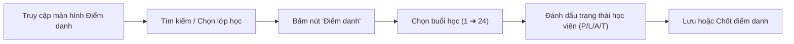
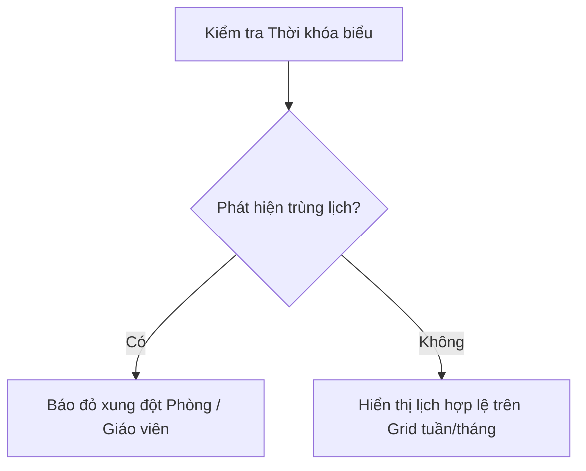
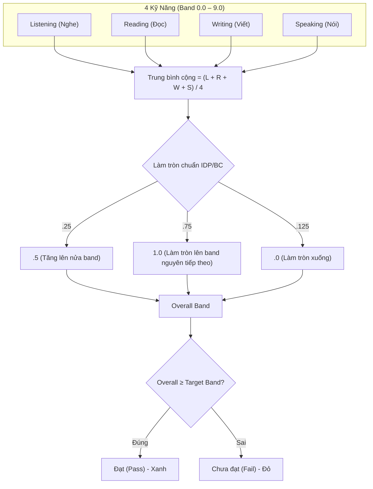

# 📖 HƯỚNG DẪN SỬ DỤNG HỆ THỐNG ECMS (DÀNH CHO GIÁO VIÊN & HỌC VỤ)

Tài liệu này hướng dẫn chi tiết quy trình thao tác trên các phân hệ đào tạo đã được chuẩn hóa và nâng cấp trong hệ thống **ECMS (English Center Management System)**, bao gồm:
1. **Quản lý điểm danh lớp học & Tạo buổi học phát sinh**
2. **Thời khóa biểu & Xếp lịch học**
3. **Quản lý kỳ thi & Nhập điểm chuẩn IELTS 4 Kỹ năng**

---

## 1. 📋 PHÂN HỆ QUẢN LÝ ĐIỂM DANH LỚP HỌC

> [!NOTE]
> Màn hình: **B · ĐÀO TẠO ➔ Điểm danh**  
> Dành cho Giảng viên phụ trách lớp học để theo dõi chuyên cần và thực hiện điểm danh từng buổi theo tiến độ khóa học (mặc định 24 buổi chuẩn).

### 1.1. Tra cứu & Xem danh sách lớp giảng dạy
1. Tại thanh công cụ lọc:
   - **Ô tìm kiếm**: Nhập mã lớp (ví dụ: `IELTS-F01`), tên khóa học, giảng viên hoặc phòng học.
   - **Trạng thái**: Lọc theo *Tất cả trạng thái*, *Đang học*, *Sắp mở*, hoặc *Đã kết thúc*.
   - **Khóa học**: Lọc theo chương trình (*IELTS Foundation*, *IELTS Intensive*, *TOEIC*, v.v.).
2. Bảng danh sách hiển thị các thông tin:
   - **Tiến độ**: Số buổi đã hoàn thành trên tổng số buổi (ví dụ: `8/24 buổi`).
   - **Chuyên cần**: Tỷ lệ học viên đi học trung bình của lớp.
   - **Thao tác**: Nhấn nút **"Điểm danh"** tại dòng lớp tương ứng để mở sổ điểm danh chi tiết.

### 1.2. Thao tác trong Hộp thoại Điểm danh (`ClassAttendanceDialog`)
- **Chọn buổi học**: Danh sách các buổi học được liệt kê từ Buổi 1 đến Buổi 24 (hoặc các buổi học phát sinh). Bấm chọn buổi học cần ghi nhận.
- **Quy ước trạng thái điểm danh**:
  - `P` (**Present** - Có mặt): Học viên tham gia lớp học đầy đủ.
  - `L` (**Late** - Đi muộn): Học viên đến lớp trễ hơn giờ quy định.
  - `E` (**Excused** - Vắng có phép): Học viên đã gửi đơn hoặc thông báo xin nghỉ trước.
  - `A` (**Absent** - Vắng không phép): Học viên vắng mặt không có lý do.
- **Tiện ích thao tác nhanh**:
  - Nút **"Tất cả có mặt"**: Tự động chuyển toàn bộ học viên sang trạng thái `Có mặt` chỉ với 1 cú nhấp.
  - Nút **"Lưu điểm danh"**: Lưu lại dữ liệu điểm danh tạm thời vào cơ sở dữ liệu.
  - Nút **"Chốt buổi học / Khóa"**: Khóa dữ liệu buổi học đã hoàn tất nhằm đảm bảo tính toàn vẹn thông tin học vụ.

### 1.3. Bổ sung buổi học phát sinh (Học bù / Ôn tập)
> [!TIP]
> Khi lớp cần tổ chức thêm buổi phụ đạo, học bù do ngày lễ hoặc ôn thi bổ sung, bạn có thể tạo hàng loạt buổi học phát sinh nhanh chóng.

1. Trong hộp thoại điểm danh hoặc quản lý lịch, nhấn nút **"+ Thêm buổi phát sinh"**.
2. **Nhập số lượng buổi cần bổ sung**: Điền số buổi muốn tạo (ví dụ: `1`, `2` hoặc `3`).
3. Chọn ngày bắt đầu, ca học (Shift/Time slot) và phòng học.
4. Hệ thống sẽ tự động tính toán các mốc ngày tiếp theo (theo đúng chu kỳ thứ trong tuần của lớp) và bổ sung vào tiến độ buổi học của lớp.

---

## 2. 📅 PHÂN HỆ THỜI KHÓA BIỂU & QUẢN LÝ LỊCH HỌC

> [!NOTE]
> Màn hình: **B · ĐÀO TẠO ➔ Lịch học / Phòng học**  
> Giúp giảng viên nắm bắt lịch giảng dạy cá nhân và học vụ theo dõi lịch sử dụng phòng học, tránh tình trạng trùng lặp lịch.

### 2.1. Xem lịch giảng dạy
- Hỗ trợ chuyển đổi giữa chế độ xem: **Lịch theo tuần (Weekly)** hoặc **Danh sách ca học (List view)**.
- Thẻ ca học hiển thị đầy đủ:
  - Tên lớp & Khóa học.
  - Khung giờ học (ví dụ: `18:00 - 20:00`, `19:30 - 21:30`).
  - Phòng học được phân bổ.
  - Trạng thái buổi học (*Chưa diễn ra*, *Đã điểm danh*, *Nghỉ/Bù*).

### 2.2. Kiểm tra xung đột lịch (Conflict Prevention)
- Hệ thống tích hợp logic xác thực tự động khi tạo hoặc dời lịch:
  - **Trùng phòng (Room Conflict)**: Cảnh báo nếu phòng học đã có lớp khác đăng ký cùng khung giờ và ngày học.
  - **Trùng giảng viên (Teacher Conflict)**: Cảnh báo nếu giảng viên đã có lịch dạy lớp khác trong cùng thời điểm.

---

## 3. 🎯 PHÂN HỆ SỔ ĐIỂM THI IELTS 4 KỸ NĂNG

> [!IMPORTANT]
> Màn hình: **B · ĐÀO TẠO ➔ Kiểm tra / Điểm số**  
> Hệ thống áp dụng quy chuẩn tính điểm **IELTS 4 Kỹ năng quốc tế (Listening, Reading, Writing, Speaking)** và công thức làm tròn chuẩn **IDP / British Council**.

### 3.1. Danh sách bài kiểm tra & Kỳ thi
- Quản lý các kỳ kiểm tra theo từng giai đoạn:
  - **Đầu vào (Placement Test)**
  - **Thường xuyên / Định kỳ (Progress Test)**
  - **Giữa khóa (Midterm Exam)**
  - **Cuối khóa (Final Mock Exam)**
- Các nút chức năng đầu trang:
  - **"+ Tạo bài kiểm tra"**: Thiết lập kỳ thi mới, gán trọng số và chọn lớp tham gia.
  - **"Nhập điểm"**: Mở nhanh giao diện vào điểm cho lớp học mong muốn.

### 3.2. Quy trình nhập điểm (`GradeEntryDialog`)
1. **Chọn lớp học**: Chọn mã lớp từ hộp thoại chọn nhanh (ví dụ: `IELTS-F01`). Danh sách học viên chính thức của lớp sẽ được tải tự động.
2. **Nhập điểm 4 kỹ năng**:
   - Thang điểm: Từ **0.0** đến **9.0** (bước nhảy hợp lệ: `0.0, 0.5, 1.0, 1.5, ..., 9.0`).
   - Nhập lần lượt các cột:
     - 🎧 **Nghe (Listening)**
     - 📖 **Đọc (Reading)**
     - ✍️ **Viết (Writing)**
     - 🗣️ **Nói (Speaking)**
3. **Tính điểm Overall tức thời**:
   - Ngay khi nhập hoặc chỉnh sửa bất kỳ điểm kỹ năng nào, hệ thống tự động tính điểm Overall và hiển thị kết quả ngay lập tức:
     $$\text{Overall} = \text{Round}_{\text{IDP/BC}}\left(\frac{\text{Listening} + \text{Reading} + \text{Writing} + \text{Speaking}}{4}\right)$$
   - Ví dụ làm tròn thực tế:
     - $6.0, 6.5, 6.0, 6.5 \rightarrow \text{TBC} = 6.25 \rightarrow \mathbf{6.5}$
     - $6.5, 6.5, 7.0, 7.0 \rightarrow \text{TBC} = 6.75 \rightarrow \mathbf{7.0}$
     - $6.0, 6.0, 6.0, 6.5 \rightarrow \text{TBC} = 6.125 \rightarrow \mathbf{6.0}$
4. **Đánh giá Đạt / Chưa đạt (Result Status)**:
   - Dựa trên điểm mục tiêu (Passing Target) của lớp (ví dụ: Target Band 6.5).
   - Nếu $\text{Overall} \ge \text{Target} \rightarrow$ **Đạt** (màu xanh lá).
   - Nếu $\text{Overall} < \text{Target} \rightarrow$ **Chưa đạt** (màu đỏ).
5. **Lưu bảng điểm**: Nhấn **"Lưu bảng điểm"** để lưu toàn bộ dữ liệu vào cơ sở dữ liệu hệ thống.

---

## 4. 💡 CÁC CÂU HỎI THƯỜNG GẶP (FAQ)

| Vấn đề | Nguyên nhân thường gặp | Hướng xử lý |
| :--- | :--- | :--- |
| **Không thấy học viên trong danh sách điểm danh / nhập điểm** | Học viên chưa được ghi danh (Enrollment) vào lớp hoặc tài khoản giáo viên đăng nhập chưa được phân công lớp này | Kiểm tra lại phân công giáo viên hoặc liên hệ bộ phận Học vụ để thêm học viên vào mã lớp tương ứng |
| **Số buổi lớp học hiển thị vượt quá 24 buổi** | Lớp đã được tạo thêm các buổi học phát sinh (học bù, phụ đạo) | Đây là hành vi bình thường; hệ thống tự động cập nhật tiến độ tương ứng với tổng số buổi thực tế |
| **Điểm Overall không tròn theo số học thông thường** | IELTS sử dụng quy tắc làm tròn đặc thù (.25 lên .5 và .75 lên 1.0) | Hệ thống đang áp dụng chính xác thuật toán chuẩn của Hội đồng Khảo thí IDP & British Council |
| **Buổi học bị khóa không sửa được điểm danh** | Buổi học đã được bấm "Chốt buổi học" để đảm bảo tính minh bạch dữ liệu | Vui lòng liên hệ Quản lý đào tạo hoặc Admin nếu cần mở khóa điều chỉnh điểm danh |

---
*Tài liệu được phát hành nội bộ cho Hệ thống Quản trị Trung tâm Anh ngữ ECMS.*
