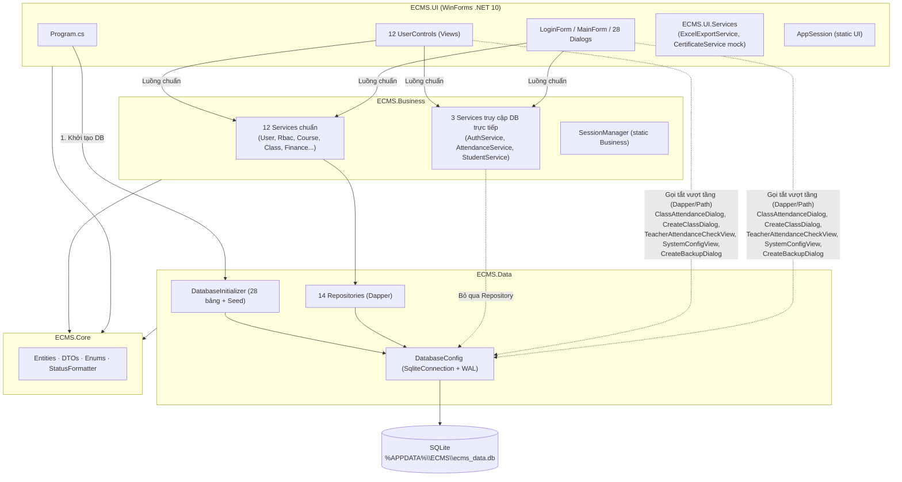

# SƠ ĐỒ KIẾN TRÚC VÀ LUỒNG CHẠY (`PROJECT_FLOW_DIAGRAMS.md`)

> Các sơ đồ dưới đây phản ánh **đúng 100% source code thực tế** hiện tại của ECMS (bao gồm cả các đường gọi tắt vượt tầng).

---

## 1. Sơ đồ kiến trúc thực tế (Actual Layered Architecture)

---

## 2. Sơ đồ luồng khởi động chương trình (Startup & Login Flow)

```mermaid
flowchart TD
    Start(["Chạy ECMS.UI.exe"]) --> Main["Program.Main()<br/>ECMS.UI/Program.cs"]
    Main --> AppCfg["ApplicationConfiguration.Initialize()"]
    AppCfg --> InitDB["DatabaseInitializer.Initialize()<br/>ECMS.Data/Database/DatabaseInitializer.cs"]
    InitDB --> OpenConn["DatabaseConfig.CreateOpenConnection()<br/>Tạo %APPDATA%\\ECMS\\ecms_data.db<br/>PRAGMA foreign_keys=ON; journal_mode=WAL"]
    OpenConn --> DDL["Chạy DDL tạo 28 bảng (IF NOT EXISTS)<br/>+ Migrate cột bảng Users"]
    DDL --> Seed["SeedInitialData()<br/>Roles, Employees, Teachers, Users (BCrypt),<br/>Courses/Classes/Finance mẫu, SystemConfigs, Permissions"]
    Seed --> SampleXlsx["Nếu có E:\\ECMS và chưa có file mẫu:<br/>Sinh DanhSachHocVien_Import.xlsx"]
    SampleXlsx --> RunLogin["Application.Run(new LoginForm())"]

    RunLogin --> LoginLoad["LoginForm_Load()<br/>Đọc SystemConfigService để nạp tên trung tâm & logo"]
    LoginLoad --> UserInput["Người dùng nhập Username / Password<br/>Nhấn Đăng nhập (btnLogin_Click)"]
    UserInput --> Auth["AuthService.LoginAsync()<br/>(hỗ trợ UsernameAliases nếu cần)"]
    Auth --> CheckOK{"Đăng nhập thành công<br/>& không phải ROLE_STU/PAR?"}
    CheckOK -- "Không" --> ShowErr["Hiện thông báo lỗi lblError"]
    CheckOK -- "Có" --> SyncSess["Đồng bộ 2 Session:<br/>1. SessionManager.SetSession(session)<br/>2. Gán dữ liệu vào AppSession"]
    SyncSess --> MustChange{"MustChangePassword == true?"}
    MustChange -- "Có" --> ForcePwd["Mở ForceChangePasswordDialog"]
    ForcePwd -- "OK" --> OpenMain
    ForcePwd -- "Cancel" --> ShowErr
    MustChange -- "Không" --> OpenMain["Ẩn LoginForm -> new MainForm().Show()"]

    OpenMain --> MainLoad["MainForm_Load()"]
    MainLoad --> Brand["ApplyBrandingAsync()<br/>Nạp thương hiệu từ SystemConfigService"]
    Brand --> RBAC["ApplyRoleBasedAccessControlAsync()<br/>Đọc RbacService -> Ẩn/Hiện Sidebar<br/>-> Tự động mở màn hình mặc định theo Role"]
```

---

## 3. Sequence Diagrams của từng chức năng

*(Sẽ được bổ sung dần trong Giai đoạn 3 và Giai đoạn 4 khi học từng chức năng cụ thể.)*
